# Part II: Verification, Validation & Pipeline

# Capítulo VI: Product Verification & Validation

Este capítulo presenta la estrategia de verificación y validación de **KairoLabs**, desarrollado por **Aether System** para el curso **1ASI0732 - Diseño de Experimentos de Ingeniería de Software**, ciclo **2026-20**. El objetivo es comprobar que los componentes del producto cumplen los requisitos funcionales y que sus interacciones permiten gestionar establecimientos, operadores, dispositivos, transportes y suscripciones de manera consistente.

La verificación examina la corrección de las entidades, funciones y contratos técnicos; la validación contrasta el comportamiento del producto con las necesidades del personal operativo de almacenes y de los gestores farmacéuticos descritas en los capítulos II y III.

Revalidación ampliada: 20/20 unitarias, 14/14 de integración y 4/4 escenarios BDD en cada viewport. Se publicaron runner BDD, ESLint y mediciones de calidad; permanecen 77 advertencias y vulnerabilidades de dependencias. [Versiones y resultados de la actualización](../assets/chapter-6/metadata/verification-2026-11-02.json).

---

## 6.1. Testing Suites & Validation

La estrategia de pruebas de KairoLabs prioriza las funcionalidades que sostienen el flujo operativo del producto: identificación del usuario, organización de establecimientos, asignación de operadores, consulta y actualización de variables ambientales, seguimiento de transportes y gestión de suscripciones. Se utilizan casos positivos, negativos y de frontera para detectar tanto errores de lógica como inconsistencias entre los componentes.

La guía del proyecto solicita documentar la creación y ejecución de pruebas sobre entidades principales y comprobar la interacción entre módulos, frontend, backend y APIs. Por ello, la estrategia separa las pruebas unitarias, que trabajan en aislamiento, de las pruebas de integración, que requieren conexiones reales entre componentes. Posteriormente se incorporarán escenarios BDD y pruebas del sistema completo.

**Base técnica y alcance**

El frontend de KairoLabs utiliza Vue 3 y organiza sus funcionalidades en los contextos `iam`, `establishment`, `monitoring`, `logistics`, `subscriptions` y `shared`. Cada contexto distribuye responsabilidades entre dominio, aplicación, infraestructura y presentación.

El backend original de MediTrackSensor constituye la implementación reutilizada y publicada en KairoLabs-Platform. Está desarrollado en ASP.NET Core 10 y Entity Framework Core, con persistencia MySQL. Sus módulos comparten una aplicación y un `AppDbContext`; en consecuencia, el diseño de pruebas considera una API modular y no presupone microservicios desplegados de manera independiente.

La rama `feature/chapter-5` aporta el contexto de implementación, incluido el uso de MySQL y del despliegue original de la API. La matriz de trazabilidad se basa en las historias de usuario y técnicas del capítulo III.

| Nivel | Objetivo | Componentes de KairoLabs | Estado de este aporte |
| :--- | :--- | :--- | :--- |
| Unitarias | Comprobar lógica de dominio sin HTTP ni base de datos. | `Device`, `Subscription`, `SignInCommand`; entidades del backend como alcance complementario. | Suite inicial del frontend ejecutada; backend pendiente. |
| Integración | Comprobar contratos y colaboración entre componentes reales. | Gateways Axios, API REST, servicios de aplicación, repositorios y MySQL. | Suite revalidada: 14 casos, 14 aprobados y 0 fallidos. |
| BDD | Expresar el comportamiento esperado desde la perspectiva del usuario. | Acceso, asignación de operadores y atención de desviaciones. | Esqueleto en 6.1.3. |
| Sistema | Validar recorridos completos y manejo de fallos. | Aplicación web y versión móvil que se entregue. | Esqueleto en 6.1.4. |

**Priorización y trazabilidad**

| Área funcional | Riesgo que se busca controlar | Historias de referencia | Nivel prioritario |
| :--- | :--- | :--- | :--- |
| Identidad y acceso | Normalización incorrecta de credenciales y respuestas de autenticación inconsistentes. | US48, TS01, TS02. | Unitarias e integración. |
| Establecimientos y operadores | Mezcla de registros entre sedes o asignaciones incorrectas. | US43-US47, TS05, TS06. | Integración. |
| Dispositivos y lecturas | Clasificación incorrecta de valores, pérdida de datos o actualización de un dispositivo ajeno a la sede. | US49-US56, US63, US66, TS07. | Unitarias e integración. |
| Transporte | Actualización incorrecta de variables durante el seguimiento logístico. | US71-US74, TS08. | Integración. |
| Suscripciones | Diferencias entre catálogo, plan enviado y suscripción persistida. | US75-US78, TS09. | Unitarias e integración. |
| Comunicación web-API | Errores de serialización, configuración de URL, CORS o formato de errores. | TS10-TS12. | Integración. |

**Entornos, datos y herramientas**

Las pruebas unitarias iniciales se ejecutan con **Node.js 24.11.1**, `node:test` y `node:assert/strict`. Se importan directamente las clases de dominio del frontend, sin montar componentes Vue ni cargar servicios HTTP. El ejecutor de Node permite comprobar estas funciones sin introducir dependencias adicionales en el proyecto.

Las pruebas de integración se ejecutan con **Node.js**, HTTP y Axios reales sobre **Kestrel + ASP.NET Core 10 + MySQL exclusivo de pruebas**. El orquestador crea una base nueva por ejecución, inicia los servicios y realiza la limpieza al finalizar. Se comprueba la persistencia mediante consultas SQL independientes; no se utiliza un proveedor en memoria. **xUnit** se mantiene como propuesta para ampliar las pruebas unitarias de entidades del backend, todavía pendientes. La implementación ejecutada de integración no utiliza `WebApplicationFactory`.

Los datos deben ser sintéticos y reproducibles: un administrador, un operador, dos establecimientos independientes, un dispositivo y un transporte por establecimiento, y una suscripción de prueba. Los valores ambientales se fijan explícitamente; la simulación aleatoria y sus temporizadores deben desactivarse durante las verificaciones de persistencia.

El modo `VITE_USE_MOCKS=true` resulta útil para ejercicios de interfaz, pero sus resultados no acreditan integración con el backend. Las pruebas web-API requieren `VITE_USE_MOCKS=false` y una configuración de URL dirigida al entorno de pruebas. Dado que los gateways admiten variables específicas por contexto, deben revisarse tanto `VITE_API_BASE_URL` como los posibles valores `VITE_MEDITRACK_SENSOR_*` que la sustituyen.

**Criterios de aceptación y registro**

Un caso se considera aprobado cuando su resultado observado coincide con el esperado y dispone de un registro reproducible. Las pruebas deben identificar el caso, requisito asociado, versión del código, precondiciones, datos, resultado esperado, resultado obtenido y evidencia. Los estados utilizados son **Aprobado**, **Fallido**, **No ejecutado** y **Bloqueado**.

La aprobación de la suite exige que sus casos críticos estén ejecutados y aprobados, y que los defectos asociados se corrijan y vuelvan a comprobar. Una ejecución parcial no permite concluir que todo el producto ha sido validado. Tampoco se interpreta el porcentaje de casos aprobados como porcentaje de cobertura de código.

---

### 6.1.1. Core Entities Unit Tests.

Las pruebas unitarias verifican el comportamiento de entidades, objetos de valor y funciones clave del dominio en aislamiento. En esta primera suite se seleccionaron componentes del frontend que intervienen directamente en la interpretación de las lecturas ambientales, la selección de planes y la preparación de credenciales.

La elección responde al impacto funcional de sus resultados: una clasificación incorrecta puede presentar una lectura inexistente como una desviación real; una traducción equivocada del catálogo puede enviar un plan distinto al seleccionado; y una transformación indebida de credenciales puede impedir el acceso del usuario.

**Componentes evaluados**

| Contexto | Clase o función | Responsabilidad evaluada |
| :--- | :--- | :--- |
| Monitoring | `Device` y `evaluateMetric()` | Conservar datos del dispositivo y clasificar lecturas como `ok`, `warning`, `critical` o `unknown`. |
| Monitoring | `Device.readField()` | Recuperar variables cuyo nombre presenta un alias admitido por el frontend. |
| Monitoring | Constructor de `Device` | Interpretar `enabled_sensors` recibido como cadena JSON y tolerar contenido incompleto. |
| Subscriptions | `Subscription` | Traducir los identificadores del catálogo a los valores de la API y viceversa. |
| IAM | `SignInCommand` | Normalizar el correo sin modificar la contraseña ni el segmento de acceso. |

**Diseño de la suite**

Se aplica el patrón **Arrange-Act-Assert**: se prepara un dato controlado, se ejecuta la función del dominio y se compara el resultado con una expectativa explícita. Los casos no dependen de red, almacenamiento del navegador, MySQL, sensores físicos ni temporizadores. Las expectativas se conservan; se corrigió el defecto de conversión detectado en el código productivo y se verificó mediante regresión.

Los umbrales de temperatura examinados corresponden a los valores actualmente codificados en `Device`: el estado crítico se activa por debajo de 2 o por encima de 8; las zonas de advertencia se aplican por debajo de 2.5 o por encima de 7. Estos valores describen el comportamiento de la implementación y no constituyen una regla universal de conservación para todos los medicamentos. La parametrización por tipo de producto debe validarse por separado.

**Matriz de casos unitarios ejecutados**

| ID | Escenario y entrada | Resultado esperado | Estado |
| :--- | :--- | :--- | :--- |
| UT-DEV-01 | Construir un dispositivo con `establishment_id=2` y `temperature=0`. | Conservar la sede y el valor numérico cero. | Aprobado. |
| UT-DEV-02 | Recibir `enabled_sensors` como `{"temperature":true}` en una cadena JSON. | Obtener el objeto de sensores habilitados. | Aprobado. |
| UT-DEV-03 | Recibir la cadena JSON incompleta `{invalid`. | No lanzar una excepción y establecer `enabled_sensors=null`. | Aprobado. |
| UT-DEV-04 | Evaluar temperatura de 4.5. | `ok`. | Aprobado. |
| UT-DEV-05 | Evaluar temperatura de 8.1. | `critical`. | Aprobado. |
| UT-DEV-06 | Evaluar temperatura de 1.9. | `critical`. | Aprobado. |
| UT-DEV-07 | Evaluar temperatura de 7.1. | `warning`. | Aprobado. |
| UT-DEV-08 | Evaluar los límites 2 y 8. | `warning` en ambos, sin clasificarlos como críticos. | Aprobado. |
| UT-DEV-09 | Evaluar el texto `sin lectura` como temperatura. | `unknown`. | Aprobado. |
| UT-DEV-10 | Evaluar `null` y `undefined` como temperatura, y comprobar el cero real. | Ausentes: `unknown`; cero real: `critical`. | Aprobado tras corrección. |
| UT-DEV-11 | Evaluar cadena vacía, espacios y tabulación/salto de línea; comprobar la cadena `0`. | Cadenas en blanco: `unknown`; cadena `0`: `critical`. | Aprobado tras corrección. |
| UT-DEV-12 | Evaluar `Open` como estado de puerta. | `critical`. | Aprobado. |
| UT-DEV-13 | Evaluar `Closed` como estado de puerta. | `ok`. | Aprobado. |
| UT-DEV-14 | Leer la métrica de luz desde un objeto con `lux=120`. | Recuperar 120 mediante el alias admitido. | Aprobado. |
| UT-SUB-01 | Traducir el identificador de catálogo `basic`. | `BASIC`. | Aprobado. |
| UT-SUB-02 | Traducir el valor de API `PREMIUM`. | `premium`. | Aprobado. |
| UT-SUB-03 | Traducir el identificador de catálogo `enterprise`. | `ENTERPRISE`. | Aprobado. |
| UT-SUB-04 | Recibir un plan de API desconocido. | Aplicar el valor predeterminado `basic` de la implementación. | Aprobado. |
| UT-IAM-01 | Recibir el correo `  OPERADOR@EXAMPLE.COM `. | `operador@example.com`. | Aprobado. |
| UT-IAM-02 | Recibir contraseña ` AbC! ` y segmento `health-entity`. | Conservar ambos valores exactamente. | Aprobado. |

La regla de plan predeterminado en UT-SUB-04 caracteriza el comportamiento actual. Su aprobación no demuestra que el sistema aplique correctamente límites comerciales o cobros, ni sustituye una validación de autorización en el servidor.

**Ejecución y evidencia**

La revalidación del 31 de octubre queda identificada por commits y hashes en [published-validation.json](../assets/chapter-6/metadata/published-validation.json).

| Dato | Registro |
| :--- | :--- |
| Fecha de ejecución | Revalidación: 2 de noviembre de 2026; capturas históricas: 30 de octubre de 2026. |
| Producto evaluado | Frontend de KairoLabs, rama `master`. |
| Versión evaluada | [Frontend `7f1d227`](https://github.com/1ASI0732-2620-9082-Aether-System/KairoLabs-Frontend/tree/7f1d227c1a5ad03a0673de9e4aaa5dccb516d231), con corrección de `Device.toNum()` y suite en el mismo repositorio. |
| Ejecutor | Node.js 24.11.1; `node:test` y `node:assert/strict`. |
| Pruebas implementadas | 20. |
| Aprobadas | 20. |
| Fallidas | 0. |
| Canceladas u omitidas | 0. |
| Cobertura de líneas o ramas | No medida. |
| Resultado de la suite | **Aprobada** para los 20 casos de dominio del frontend evaluados; código de salida 0. |

La suite está incorporada al repositorio del frontend: [código de las 20 pruebas](https://github.com/1ASI0732-2620-9082-Aether-System/KairoLabs-Frontend/blob/7f1d227c1a5ad03a0673de9e4aaa5dccb516d231/tests/unit/core-entities.test.mjs), [instrucciones](https://github.com/1ASI0732-2620-9082-Aether-System/KairoLabs-Frontend/blob/7f1d227c1a5ad03a0673de9e4aaa5dccb516d231/tests/unit/README.md) y [registro TAP](https://github.com/1ASI0732-2620-9082-Aether-System/KairoLabs-Frontend/blob/7f1d227c1a5ad03a0673de9e4aaa5dccb516d231/evidence/unit/latest.tap). El [ZIP anterior para VS Code](../assets/chapter-6/projects/KairoLabs-Unit-Tests-VSCode.zip) se conserva como anexo histórico. La fuente de reproducción actual es el repositorio.

Desde la raíz del repositorio `KairoLabs-Frontend`, con Node.js 24 o posterior y sin requerir instalación de dependencias:

```powershell
npm run test:unit
```

El archivo de prueba importa únicamente las clases de dominio indicadas y no carga `api.js` ni `vite.config.js`. La suite devuelve un código de salida distinto de cero mientras existan casos fallidos.

**Evidencias individuales en Visual Studio Code**

Las Figuras 1 a 20 presentan el código y el resultado aprobado de cada caso. Las imágenes son capturas reales de extractos del registro de la suite completa; no representan ejecuciones independientes de cada prueba.

**Figura 1**

*Conserva sede y lectura cero al construir el dispositivo (UT-DEV-01)*

<p align="center">
  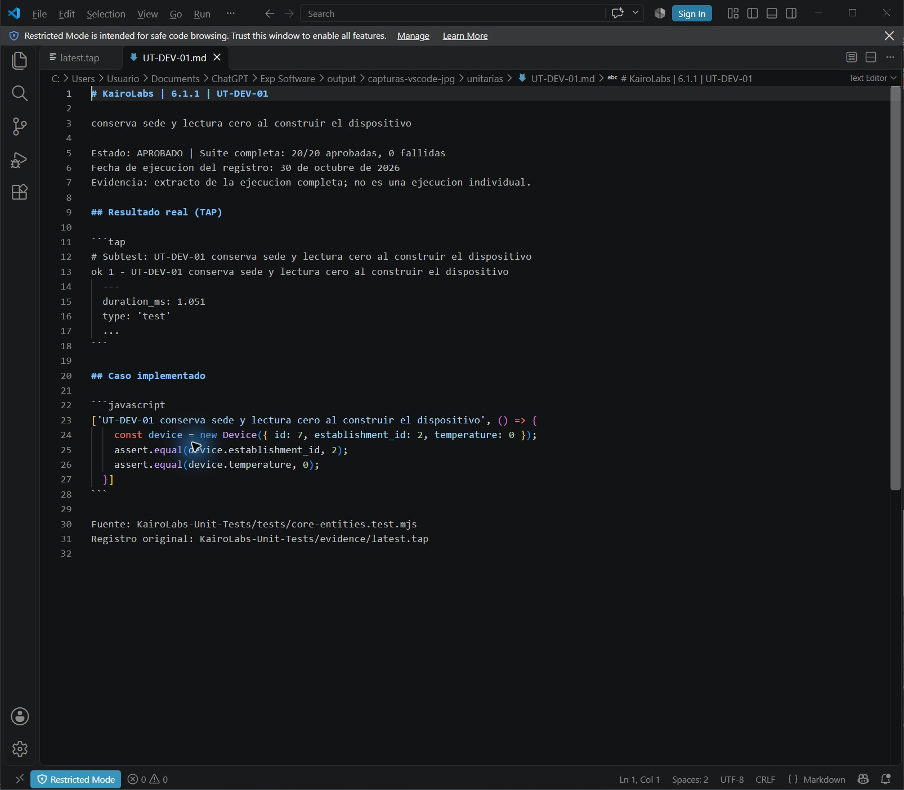
</p>

*Nota.* El dispositivo conserva su establecimiento y una lectura numérica de cero. Captura propia del caso UT-DEV-01, con resultado aprobado en el registro de ejecución del 30 de octubre de 2026.

**Figura 2**

*Interpreta enabled_sensors recibido como JSON (UT-DEV-02)*

<p align="center">
  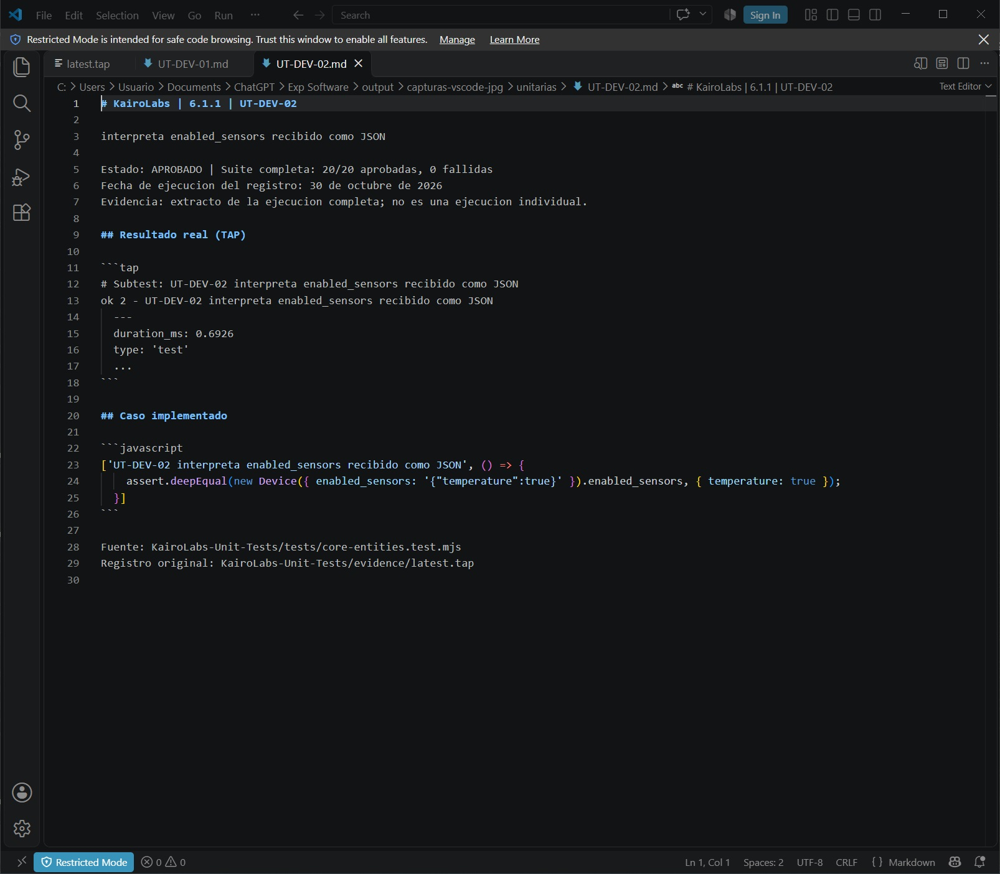
</p>

*Nota.* La configuración JSON de sensores se transforma en un objeto de dominio. Captura propia del caso UT-DEV-02, con resultado aprobado en el registro de ejecución del 30 de octubre de 2026.

**Figura 3**

*Tolera JSON incompleto sin interrumpir el dominio (UT-DEV-03)*

<p align="center">
  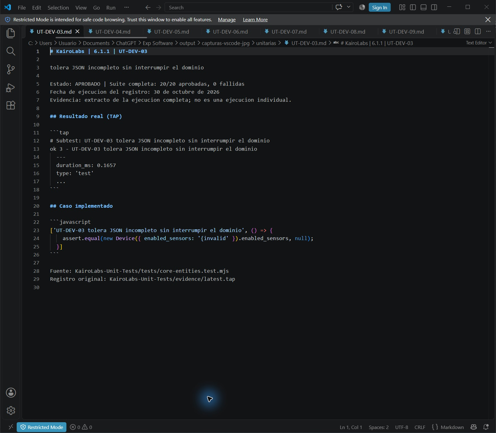
</p>

*Nota.* Un JSON incompleto no interrumpe la creación del dispositivo y produce una configuración nula. Captura propia del caso UT-DEV-03, con resultado aprobado en el registro de ejecución del 30 de octubre de 2026.

**Figura 4**

*Clasifica 4.5 grados como ok (UT-DEV-04)*

<p align="center">
  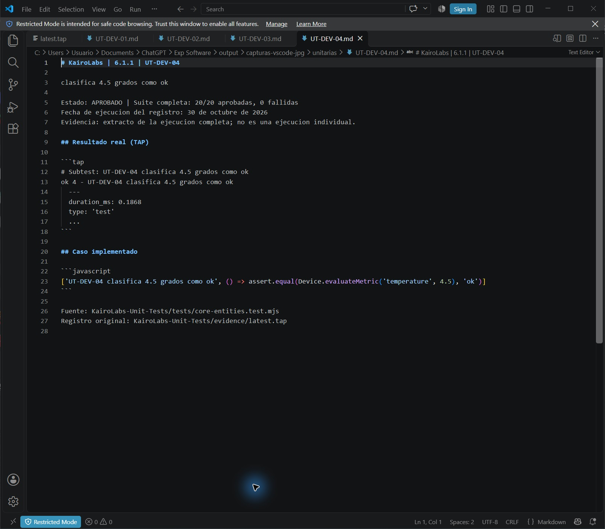
</p>

*Nota.* La lectura de 4.5 °C se clasifica como normal según los umbrales implementados. Captura propia del caso UT-DEV-04, con resultado aprobado en el registro de ejecución del 30 de octubre de 2026.

**Figura 5**

*Clasifica 8.1 grados como critical (UT-DEV-05)*

<p align="center">
  
</p>

*Nota.* La lectura de 8.1 °C se clasifica como crítica. Captura propia del caso UT-DEV-05, con resultado aprobado en el registro de ejecución del 30 de octubre de 2026.

**Figura 6**

*Clasifica 1.9 grados como critical (UT-DEV-06)*

<p align="center">
  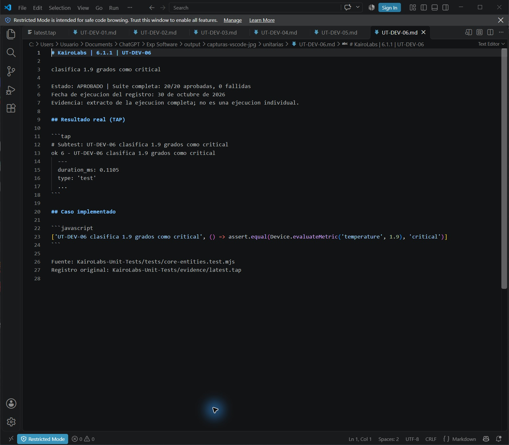
</p>

*Nota.* La lectura de 1.9 °C se clasifica como crítica. Captura propia del caso UT-DEV-06, con resultado aprobado en el registro de ejecución del 30 de octubre de 2026.

**Figura 7**

*Clasifica 7.1 grados como warning (UT-DEV-07)*

<p align="center">
  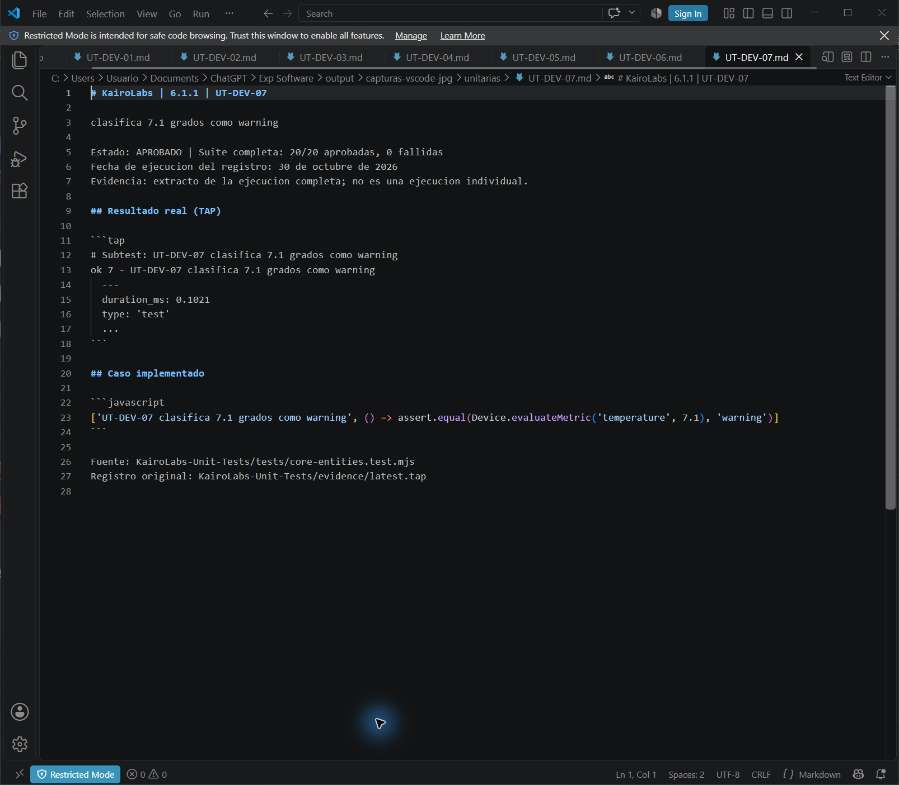
</p>

*Nota.* La lectura de 7.1 °C se clasifica como advertencia. Captura propia del caso UT-DEV-07, con resultado aprobado en el registro de ejecución del 30 de octubre de 2026.

**Figura 8**

*Distingue los limites de warning y critical (UT-DEV-08)*

<p align="center">
  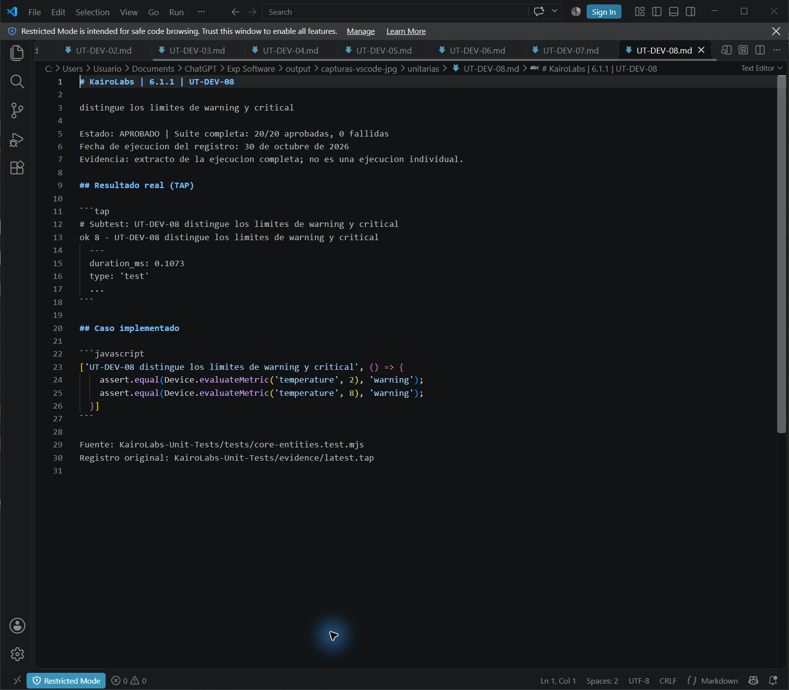
</p>

*Nota.* Las lecturas de 2 y 8 °C se clasifican como advertencia, sin superar el límite crítico. Captura propia del caso UT-DEV-08, con resultado aprobado en el registro de ejecución del 30 de octubre de 2026.

**Figura 9**

*Identifica texto no numerico como unknown (UT-DEV-09)*

<p align="center">
  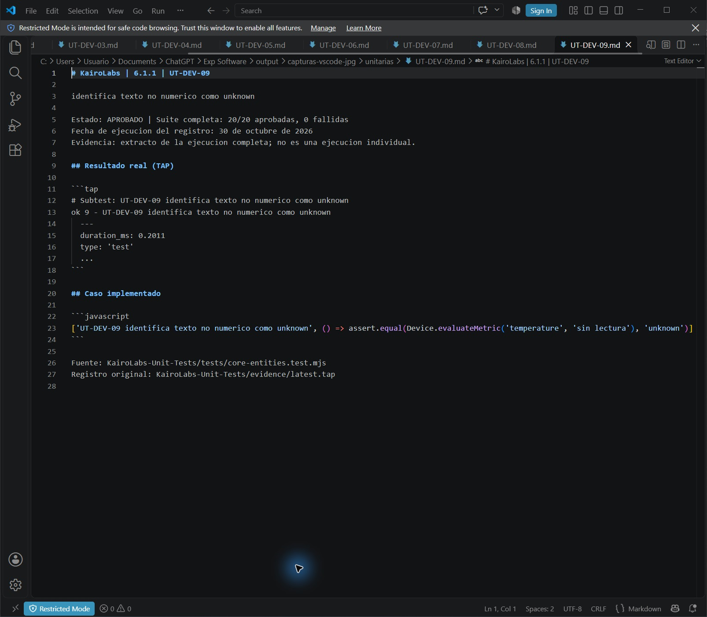
</p>

*Nota.* Una cadena no numérica se interpreta como una lectura desconocida. Captura propia del caso UT-DEV-09, con resultado aprobado en el registro de ejecución del 30 de octubre de 2026.

**Figura 10**

*Identifica temperatura null como unknown (UT-DEV-10)*

<p align="center">
  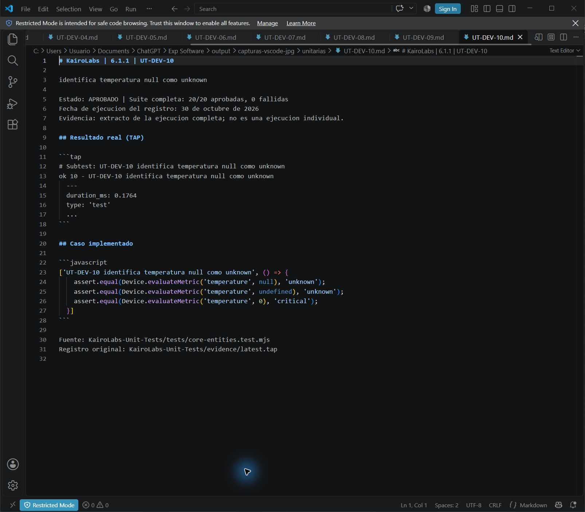
</p>

*Nota.* Los valores nulo e indefinido se interpretan como datos ausentes; el cero real conserva su clasificación crítica. Captura propia del caso UT-DEV-10, con resultado aprobado en el registro de ejecución del 30 de octubre de 2026.

**Figura 11**

*Identifica temperatura vacia como unknown (UT-DEV-11)*

<p align="center">
  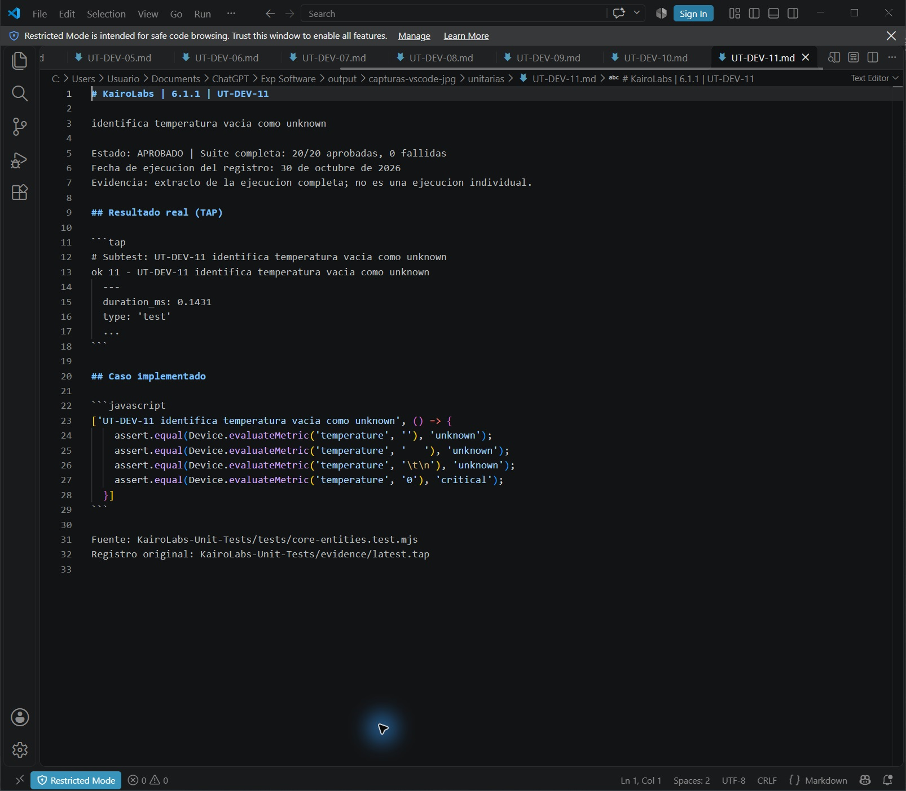
</p>

*Nota.* Las cadenas vacías o en blanco se distinguen del valor numérico cero tras la corrección. Captura propia del caso UT-DEV-11, con resultado aprobado en el registro de ejecución del 30 de octubre de 2026.

**Figura 12**

*Clasifica puerta abierta como critical (UT-DEV-12)*

<p align="center">
  
</p>

*Nota.* Una puerta abierta se identifica como condición crítica. Captura propia del caso UT-DEV-12, con resultado aprobado en el registro de ejecución del 30 de octubre de 2026.

**Figura 13**

*Clasifica puerta cerrada como ok (UT-DEV-13)*

<p align="center">
  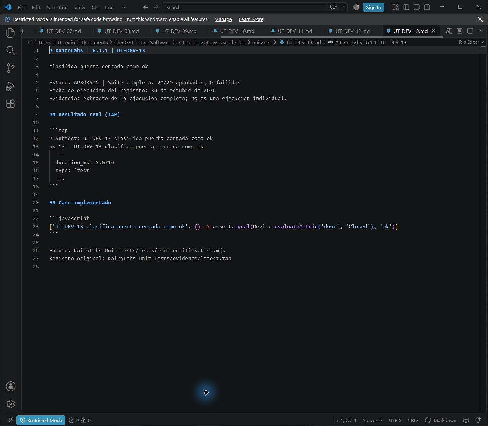
</p>

*Nota.* Una puerta cerrada se identifica como condición normal. Captura propia del caso UT-DEV-13, con resultado aprobado en el registro de ejecución del 30 de octubre de 2026.

**Figura 14**

*Recupera luz desde el alias lux (UT-DEV-14)*

<p align="center">
  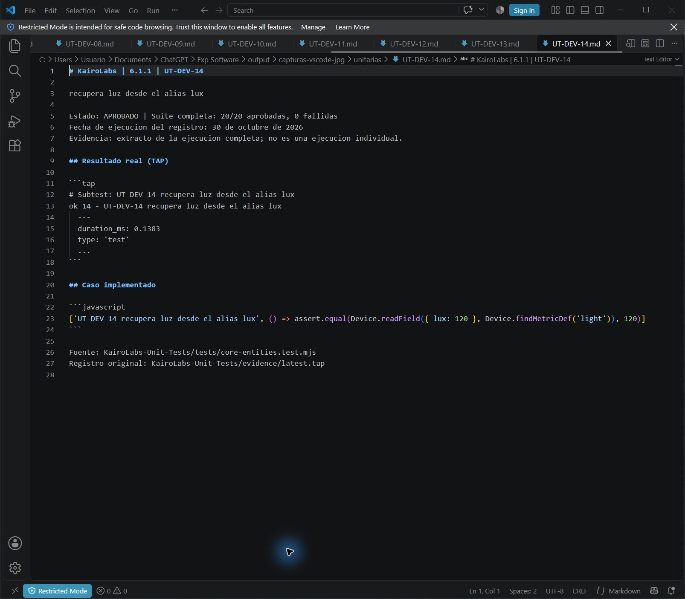
</p>

*Nota.* La métrica de luz puede recuperarse mediante el alias lux. Captura propia del caso UT-DEV-14, con resultado aprobado en el registro de ejecución del 30 de octubre de 2026.

**Figura 15**

*Traduce basic a BASIC (UT-SUB-01)*

<p align="center">
  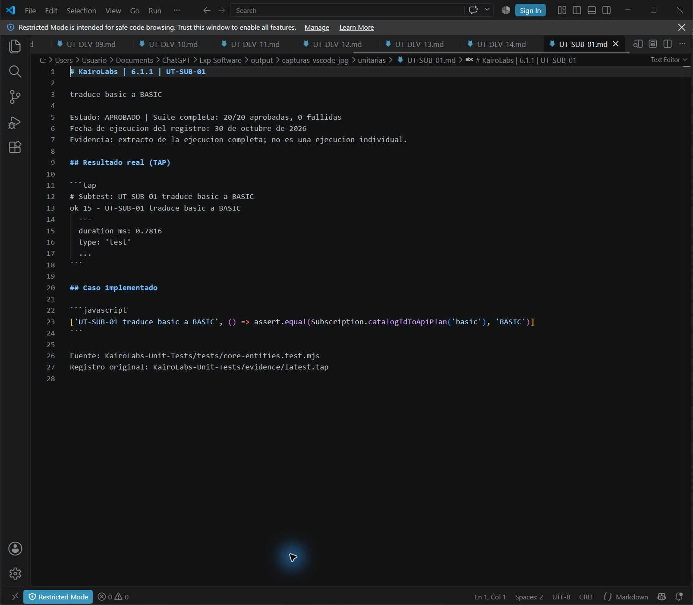
</p>

*Nota.* El identificador basic se traduce al valor BASIC utilizado por la API. Captura propia del caso UT-SUB-01, con resultado aprobado en el registro de ejecución del 30 de octubre de 2026.

**Figura 16**

*Traduce PREMIUM al catalogo premium (UT-SUB-02)*

<p align="center">
  
</p>

*Nota.* El valor PREMIUM de la API se traduce al identificador premium del catálogo. Captura propia del caso UT-SUB-02, con resultado aprobado en el registro de ejecución del 30 de octubre de 2026.

**Figura 17**

*Traduce enterprise a ENTERPRISE (UT-SUB-03)*

<p align="center">
  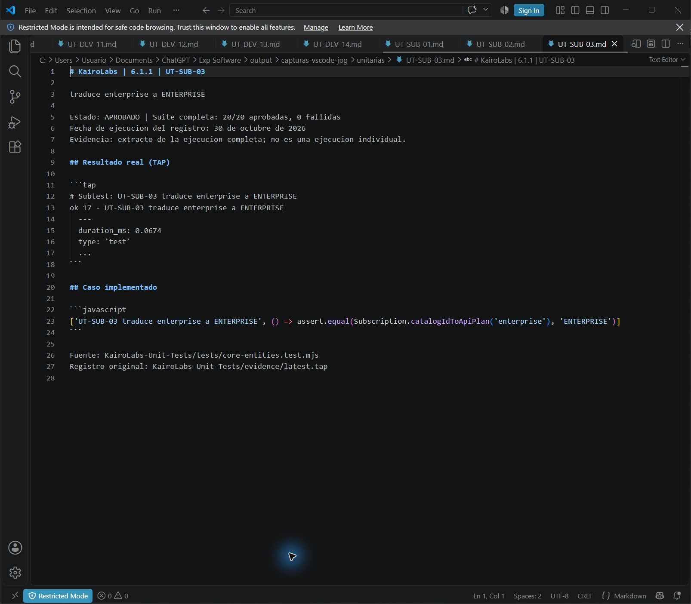
</p>

*Nota.* El identificador enterprise se traduce al valor ENTERPRISE de la API. Captura propia del caso UT-SUB-03, con resultado aprobado en el registro de ejecución del 30 de octubre de 2026.

**Figura 18**

*Usa basic ante un plan desconocido (UT-SUB-04)*

<p align="center">
  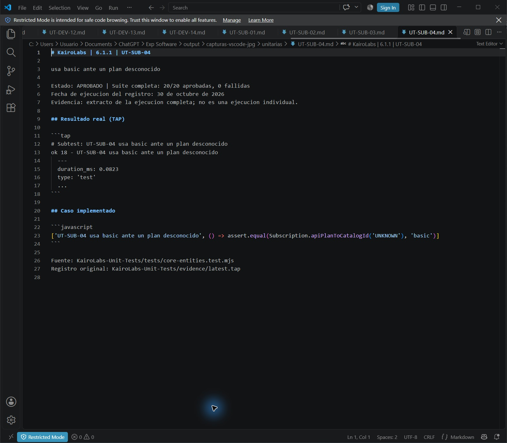
</p>

*Nota.* Un plan desconocido utiliza el valor predeterminado basic de la implementación. Captura propia del caso UT-SUB-04, con resultado aprobado en el registro de ejecución del 30 de octubre de 2026.

**Figura 19**

*Normaliza espacios y mayusculas del correo (UT-IAM-01)*

<p align="center">
  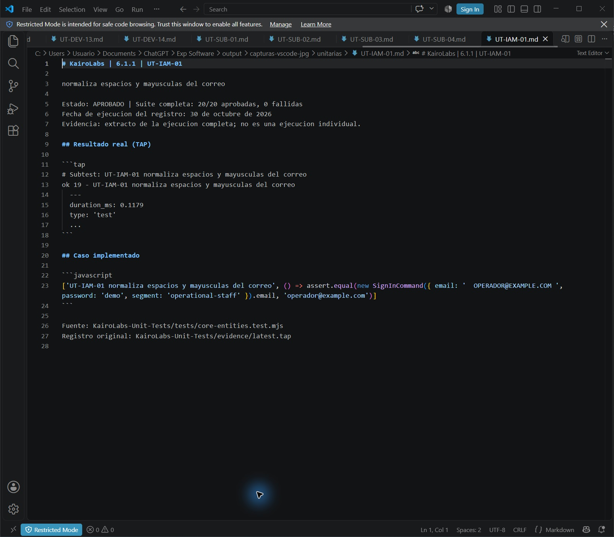
</p>

*Nota.* El correo se normaliza eliminando espacios externos y convirtiendo sus letras a minúsculas. Captura propia del caso UT-IAM-01, con resultado aprobado en el registro de ejecución del 30 de octubre de 2026.

**Figura 20**

*Conserva exactamente la clave y el segmento (UT-IAM-02)*

<p align="center">
  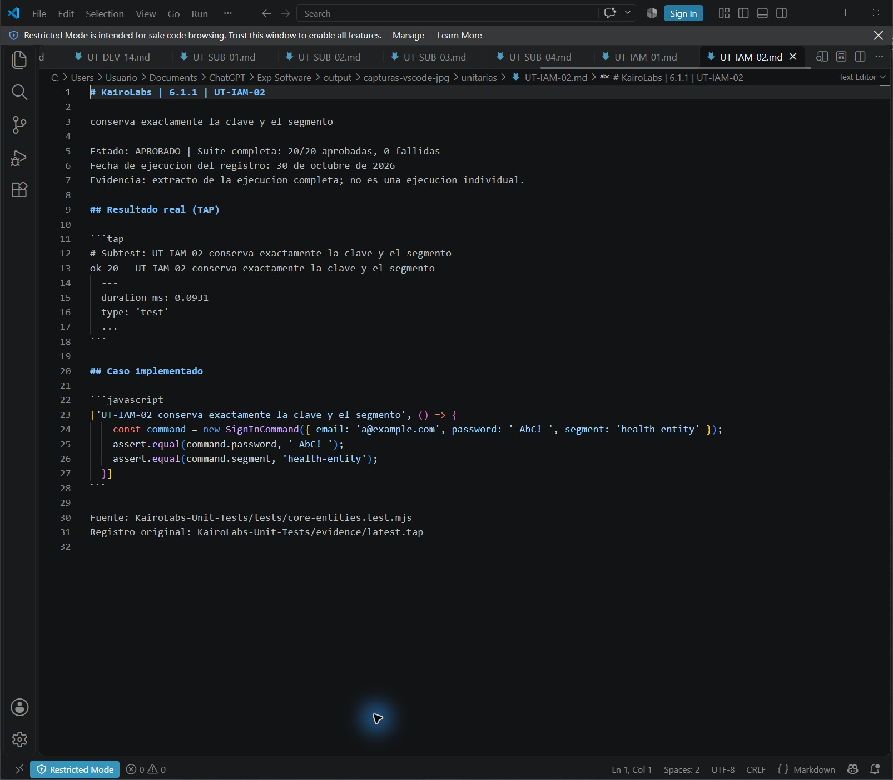
</p>

*Nota.* La contraseña y el segmento de acceso se conservan sin transformaciones. Captura propia del caso UT-IAM-02, con resultado aprobado en el registro de ejecución del 30 de octubre de 2026.

**Análisis de defectos**

La ejecución inicial produjo 18 casos aprobados y 2 fallidos. Los casos UT-DEV-10 y UT-DEV-11 detectaron un defecto de conversión: `Number(null)` y `Number('')` producen cero y la temperatura se clasificaba como crítica. Se corrigió `Device.toNum()` para devolver `null` antes de convertir cuando el dato es `null`, `undefined` o una cadena vacía o compuesta únicamente por espacios en blanco. Así `evaluateMetric()` devuelve `unknown` para lecturas ausentes y conserva `critical` para una temperatura real de 0 °C, tanto numérica como recibida en la cadena `0`.

La corrección se aplicó al frontend publicado y al código incluido en el proyecto de VS Code. Las expectativas originales se conservaron y los casos UT-DEV-10 y UT-DEV-11 se ampliaron con aserciones para `undefined`, espacios, tabulaciones/saltos de línea y cero real. La nueva ejecución mantuvo 20 casos y obtuvo **20 aprobados y 0 fallidos**. El registro inicial se conserva en [core-entities-before-fix.tap](../assets/chapter-6/evidence/unit/before-fix.tap) y la revalidación en [core-entities.tap](../assets/chapter-6/evidence/unit/latest.tap).

```javascript
static toNum(v) {
    if (v == null || (typeof v === 'string' && v.trim() === '')) return null;
    const n = Number(v);
    return Number.isFinite(n) ? n : null;
}
```

| Hallazgo | Impacto funcional | Acción realizada | Estado |
| :--- | :--- | :--- | :--- |
| DEF-UNIT-01: conversión de valores ausentes a cero. | Una lectura inexistente podía mostrarse como alarma térmica y distorsionar la interpretación del monitoreo. Se relaciona con US53, US55 y US66. | Validar ausencia de dato antes de convertir y ampliar la regresión con blancos, `undefined` y ceros reales. | Publicado y revalidado el 31 de octubre de 2026. |

El hallazgo confirma la utilidad de probar condiciones negativas y no únicamente valores dentro de rango. Los 20 casos aprobados acreditan las comprobaciones descritas; no representan cobertura total del código ni permiten afirmar que todo el monitoreo esté libre de defectos. La ampliación a otras métricas y las pruebas unitarias de las entidades del backend permanecen pendientes; los resultados de integración se documentan en 6.1.2.

**Ampliación prevista para entidades del backend**

La guía incluye las entidades principales del sistema. Por ello, la suite del frontend debe complementarse con los siguientes casos sobre el backend reutilizado. Esta matriz es un diseño pendiente de implementación y ejecución.

| ID propuesto | Entidad o función | Comprobación esperada | Estado |
| :--- | :--- | :--- | :--- |
| UT-BE-01 | `Device.UpdateSensorReading()` | Sustituir las siete variables ambientales conservando identidad y establecimiento. | No ejecutado. |
| UT-BE-02 | `Device.UpdateDoorStatus()` | Actualizar la puerta sin alterar la lectura ni la sede. | No ejecutado. |
| UT-BE-03 | `Operator.IncrementAlertsAnswered()` | Incrementar de 0 a 1 y de 1 a 2 sin modificar horario o asignación. | No ejecutado. |
| UT-BE-04 | `Operator.UpdateSchedule()` y `UpdateEstablishment()` | Actualizar únicamente el atributo correspondiente. | No ejecutado. |
| UT-BE-05 | `Subscription(CreateSubscriptionCommand)` | Conservar plan, fechas y administrador; iniciar en `Pending`, según el constructor actual. | No ejecutado. |
| UT-BE-06 | Funciones equivalentes de `Transport` | Actualizar lecturas y estado de puerta preservando el vínculo con la sede. | No ejecutado. |

No se atribuyen a `SensorReading` ni a `Email` validaciones que no están implementadas: en el código revisado son registros que almacenan valores. Las restricciones adicionales de formato, fechas o rangos deben vincularse con un requisito y con la capa que las aplique antes de declarar que están verificadas.

---

### 6.1.2. Core Integration Tests.

Las pruebas de integración de KairoLabs verifican que sus componentes colaboran correctamente mediante comunicaciones y persistencia reales. Se implementó una suite que inicia la API ASP.NET Core del proyecto original, utiliza una instancia MySQL aislada y comprueba el flujo entre controladores, servicios de aplicación, repositorios y base de datos. Además, se integran los gateways Axios y assemblers del frontend de KairoLabs con esa API.

El objetivo es comprobar que las operaciones conservan sus datos y asociaciones, que las solicitudes inválidas no generan cambios parciales y que las respuestas pueden interpretarse desde el frontend. Se incorporaron también casos sobre CORS y autenticación para contrastar los requisitos de acceso remoto seguro y de comunicación entre aplicaciones.

> **Estado:** suite independiente publicada en KairoLabs-Platform y revalidada el 2 de noviembre de 2026: **14 ejecutadas, 14 aprobadas y 0 fallidas**. [Versión fuente evaluada `564dcf5`](https://github.com/1ASI0732-2620-9082-Aether-System/KairoLabs-Platform/tree/564dcf5132a6d54c0064e57ab1c7a8ba7cca7d51).

**Entorno y versión evaluada**

| Elemento | Configuración utilizada |
| :--- | :--- |
| Backend | [KairoLabs-Platform `564dcf5`](https://github.com/1ASI0732-2620-9082-Aether-System/KairoLabs-Platform/tree/564dcf5132a6d54c0064e57ab1c7a8ba7cca7d51); backend reutilizado de MediTrackSensor base `c6c0bc7`, con CORS/JWT y configuración de pruebas incluidos. |
| Frontend | Snapshot de gateways/assemblers del frontend base `0d2c76f`, incluido explícitamente en `KairoLabs-Platform/frontend/` para IT-WEB-01. La suite unitaria usa el frontend publicado indicado en 6.1.1. |
| SDK | .NET 10.0.403, preparado en una carpeta local sin instalación global. |
| Persistencia | MySQL Community Server 8.4.13, ejecutado como proceso portátil en `127.0.0.1:33079`. |
| API | Kestrel en `http://127.0.0.1:5187`; entorno `Integration`. |
| Ejecutor | Node.js 24.11.1, `node:test`, `node:assert/strict` y Windows PowerShell. |
| Frontend-API | Gateways `IamApi` y `MonitoringApi`, `SignInAssembler` y `DeviceAssembler`; Axios real; mocks desactivados. |
| Aislamiento | Base nueva `kairolabs_it_<identificador>` por ejecución, con datos sintéticos, eliminada al finalizar. |

El backend reutilizado, que antes solo se entregaba como copia local, está ahora incorporado a `KairoLabs-Platform`. La suite compila los archivos de ese mismo repositorio y utiliza una base MySQL temporal; no accede a producción. Su origen MediTrackSensor permanece documentado en `provenance.json`.

**Implementación y procedimiento**

El proyecto de VS Code incluye `tests/integration.test.mjs` y un orquestador en `scripts/run-integration.ps1`. El orquestador compila el backend, prepara MySQL, crea la base temporal e inicia la API, que ejecuta su lógica de migraciones. Después de verificar `/health/db`, ejecuta los casos y realiza la limpieza mediante un bloque `finally`.

La preparación genera un usuario administrador y su entidad, obtiene su JWT mediante el login público y lo utiliza en las operaciones protegidas. Después crea un usuario operador, dos establecimientos independientes y un dispositivo asociado al primero. Los casos crean adicionalmente un transporte y una suscripción. Se utilizan direcciones `example.invalid` y valores ambientales fijos; las vistas y stores que activan simuladores no se cargan. IT-SEC-01 omite o sustituye expresamente el token para comprobar los rechazos.

Cada solicitud HTTP se dirige exclusivamente a la API local. Las consultas posteriores se realizan mediante nuevas solicitudes, y los casos de persistencia incorporan consultas SQL independientes con el cliente MySQL. De esta forma, la validación no depende únicamente del objeto devuelto por una operación de escritura o del estado en memoria del frontend.

Para IT-WEB-01 se compilan los módulos de infraestructura del frontend mediante una configuración exclusiva de pruebas. Se utiliza Axios real, con la URL local y `VITE_USE_MOCKS=false`; los assemblers procesan las respuestas recibidas. En Node se proporciona un adaptador mínimo de `sessionStorage` para el interceptor de sesión. Este caso acredita la colaboración del gateway con la API y sus modelos, pero no un recorrido visual completo en navegador.

**Matriz de resultados reales**

| ID | Requisito de referencia | Verificación ejecutada | Resultado observado | Estado |
| :--- | :--- | :--- | :--- | :--- |
| IT-IAM-01 | TS01. | Inicio de sesión válido y consulta independiente de la contraseña persistida. | HTTP 200, usuario correcto y JWT; la respuesta no expone contraseña ni hash y el dato persistido presenta formato BCrypt. | Aprobado. |
| IT-IAM-02 | TS01, TS12. | Inicio de sesión con contraseña incorrecta. | HTTP 401, cuerpo de error con `status=401` y sin token. | Aprobado. |
| IT-EST-01 | TS05. | Recuperación por administrador y consulta SQL de las dos sedes creadas. | HTTP 200; ambas sedes aparecen y existen dos filas correspondientes en MySQL. La preparación comprobó HTTP 201 al crearlas. | Aprobado. |
| IT-OP-01 | US43, US44, TS06. | Asignación de operador a A y consulta de operadores en A y B. | HTTP 200 al asignar, horario conservado y operador presente solo en A. El controlador actual usa 200 para esta creación. | Aprobado. |
| IT-DEV-01 | US49, US50, TS07. | Consulta del dispositivo creado en A. | Coinciden identificador, ubicación, tipo `Refrigerated` y establecimiento; la preparación comprobó HTTP 201 al crearlo. | Aprobado. |
| IT-DEV-02 | US52, TS07. | Actualización de siete variables y puerta, seguida de GET y SQL independiente. | HTTP 200; se recuperan 5 °C, 50 % de humedad, luz 120, aire 420, vibración 0.03, presión 1013, partículas 12 y puerta `Closed`; MySQL conserva los valores comprobados. | Aprobado. |
| IT-DEV-03 | TS07. | Intento de actualizar desde B un dispositivo perteneciente a A. | HTTP 404 y lectura completa sin cambios al consultar nuevamente A. | Aprobado. |
| IT-DEV-04 | US52, TS12. | Actualización con `door_status=INVALID`. | HTTP 400, `status=400` y dispositivo sin modificaciones parciales. | Aprobado. |
| IT-DEV-05 | US49. | Creación con `type_of_medication=INVALID`. | HTTP 400; la cantidad de dispositivos permanece igual. | Aprobado. |
| IT-LOG-01 | US73, TS08. | Creación de transporte, actualización de lectura, GET, SQL e identificador inexistente. | HTTP 201 al crear y 200 al actualizar; las variables se recuperan y la temperatura se confirma en MySQL; un identificador inexistente devuelve 404. | Aprobado. |
| IT-SUB-01 | US76-US78, TS09. | Crear, consultar y eliminar suscripción, con nueva consulta y SQL. | HTTP 201, 200 y 204; plan, administrador y fechas coinciden; tras eliminar, la suscripción no aparece y SQL devuelve cero filas. | Aprobado. |
| IT-WEB-01 | US48, US50, TS01. | Login con `IamApi`, creación de sesión por assembler y lectura mediante `MonitoringApi`. | Axios recibe HTTP 200; sesión de entidad correcta; el dispositivo conserva temperatura, sede y sensores habilitados al transformarse en entidad. | Aprobado. |
| IT-WEB-02 | TS11. | Preflight OPTIONS para origen local, origen ajeno y dominio de KairoLabs. | Los orígenes local y KairoLabs reciben `Access-Control-Allow-Origin` con su valor exacto; el origen ajeno no se autoriza. | Aprobado tras corrección. |
| IT-SEC-01 | US61. | Solicitudes sin token, con token inválido, firma alterada, emisor o audiencia incorrectos y token expirado; control con JWT válido. | Los seis accesos sin credencial válida devuelven 401; el acceso con JWT válido devuelve 200 y el rechazo anónimo incluye `WWW-Authenticate: Bearer`. | Aprobado tras corrección. |

**Resumen y evidencias**

| Métrica | Resultado |
| :--- | :--- |
| Casos ejecutados | 14. |
| Aprobados | 14. |
| Fallidos | 0. |
| Cancelados u omitidos | 0. |
| Código de salida | 0. |
| Resultado de la suite | **Aprobada** para los 14 casos de integración descritos. |
| Cobertura de código | No medida. |

La salida íntegra se conserva en [latest.tap](../assets/chapter-6/evidence/integration/latest.tap). Los resultados por caso y el entorno se registran en [results.json](../assets/chapter-6/evidence/integration/results.json), y las solicitudes y respuestas depuradas en [http-transcript.json](../assets/chapter-6/evidence/integration/http-transcript.json). Las credenciales y los JWT se redactan antes de escribir la evidencia.

**Trazabilidad de la suite independiente de integración**

Registros publicados en el propio repositorio: [salida TAP](https://github.com/1ASI0732-2620-9082-Aether-System/KairoLabs-Platform/blob/59d0ac9be71784fa9c5c3901308b0d9c10274f1f/evidence/latest.tap), [resultados](https://github.com/1ASI0732-2620-9082-Aether-System/KairoLabs-Platform/blob/59d0ac9be71784fa9c5c3901308b0d9c10274f1f/evidence/results.json) y [versiones y hashes](https://github.com/1ASI0732-2620-9082-Aether-System/KairoLabs-Platform/blob/59d0ac9be71784fa9c5c3901308b0d9c10274f1f/evidence/validation-source.json).

- [Pruebas de integración: `tests/integration.test.mjs`](https://github.com/1ASI0732-2620-9082-Aether-System/KairoLabs-Platform/blob/564dcf5132a6d54c0064e57ab1c7a8ba7cca7d51/tests/integration.test.mjs).
- [Backend corregido: `Program.cs`](https://github.com/1ASI0732-2620-9082-Aether-System/KairoLabs-Platform/blob/564dcf5132a6d54c0064e57ab1c7a8ba7cca7d51/backend/TechnoByteLambders.MediTrackSensor.Platform/Program.cs) y [endpoints públicos de IAM](https://github.com/1ASI0732-2620-9082-Aether-System/KairoLabs-Platform/blob/564dcf5132a6d54c0064e57ab1c7a8ba7cca7d51/backend/TechnoByteLambders.MediTrackSensor.Platform/Iam/Interfaces/REST/UsersController.cs).
- [Ejecutor del entorno API/MySQL](https://github.com/1ASI0732-2620-9082-Aether-System/KairoLabs-Platform/blob/564dcf5132a6d54c0064e57ab1c7a8ba7cca7d51/scripts/run-integration.ps1) e [instrucciones de reproducción](https://github.com/1ASI0732-2620-9082-Aether-System/KairoLabs-Platform/blob/564dcf5132a6d54c0064e57ab1c7a8ba7cca7d51/README.md).
- Registros de la revalidación: [TAP](../assets/chapter-6/evidence/integration/latest.tap), [resultados por caso](../assets/chapter-6/evidence/integration/results.json) y [solicitudes/respuestas redactadas](../assets/chapter-6/evidence/integration/http-transcript.json).

Desde la raíz de `KairoLabs-Platform`, en Windows x64 con Node.js 24+, ejecutar `npm run setup` una vez y luego `npm test`. Los puertos 5187 y 33079 deben estar libres. La suite levanta API y MySQL reales, usa HTTP y SQL independiente y limpia sus recursos temporales. Estos 14 casos pertenecen a una suite de integración propia; no se derivan de las pruebas BDD/sistema.

**Evidencias individuales en Visual Studio Code**

Las Figuras 21 a 34 presentan el código y el resultado aprobado de cada caso. Las imágenes son capturas reales de extractos del registro de la suite completa; no representan ejecuciones independientes de cada prueba.

**Figura 21**

*Login valido integra API, BCrypt y MySQL sin exponer credenciales (IT-IAM-01)*

<p align="center">
  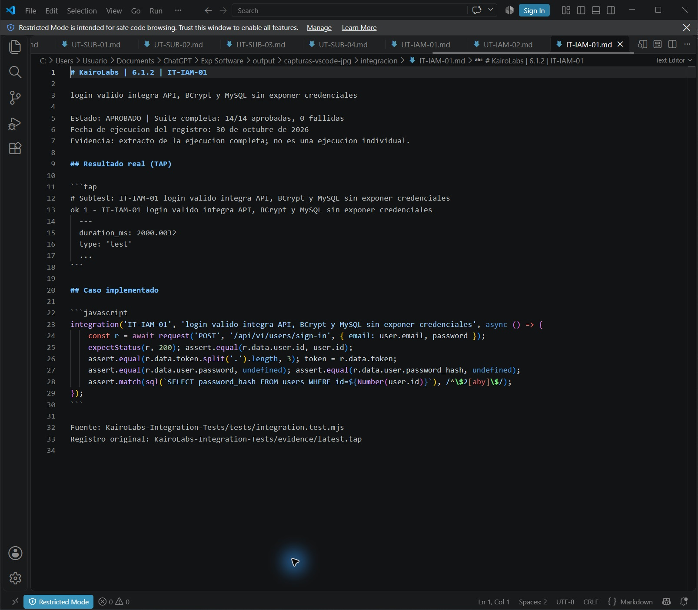
</p>

*Nota.* El inicio de sesión válido integra la API, BCrypt y MySQL sin exponer credenciales en la respuesta. Captura propia del caso IT-IAM-01, con resultado aprobado en el registro de ejecución del 30 de octubre de 2026.

**Figura 22**

*Clave incorrecta devuelve 401 y no emite token (IT-IAM-02)*

<p align="center">
  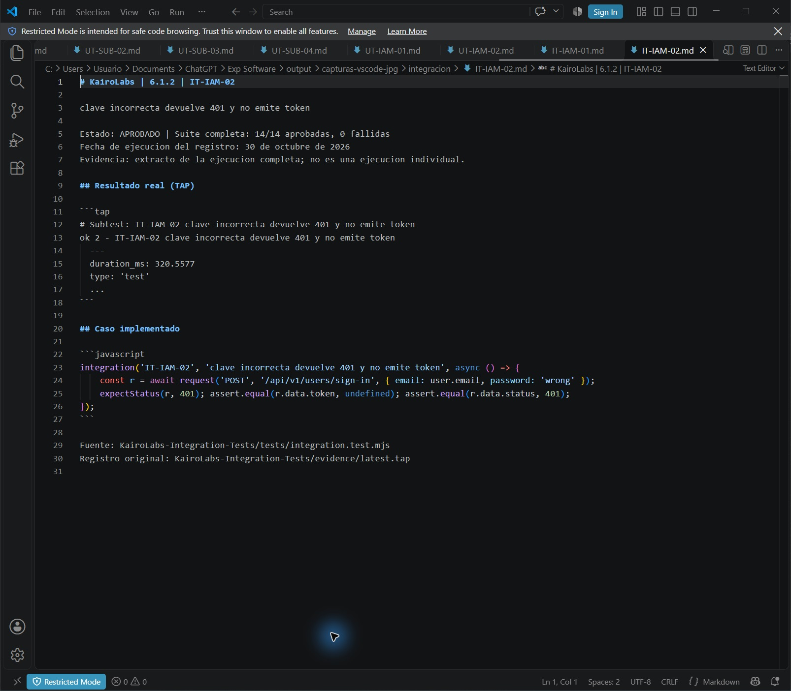
</p>

*Nota.* Una contraseña incorrecta produce HTTP 401 y no genera un token. Captura propia del caso IT-IAM-02, con resultado aprobado en el registro de ejecución del 30 de octubre de 2026.

**Figura 23**

*Sedes creadas se recuperan por administrador y por SQL independiente (IT-EST-01)*

<p align="center">
  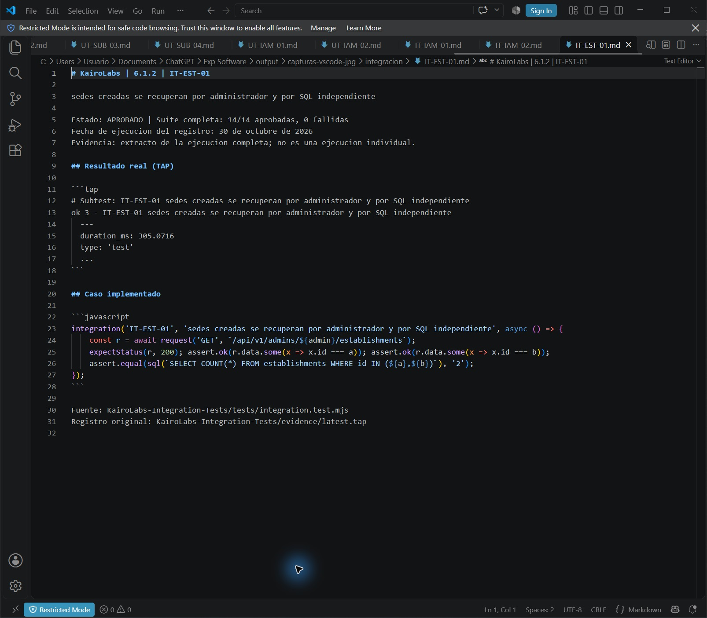
</p>

*Nota.* Las sedes se recuperan por administrador y se confirman mediante una consulta SQL independiente. Captura propia del caso IT-EST-01, con resultado aprobado en el registro de ejecución del 30 de octubre de 2026.

**Figura 24**

*Asignacion de operador no mezcla sedes (IT-OP-01)*

<p align="center">
  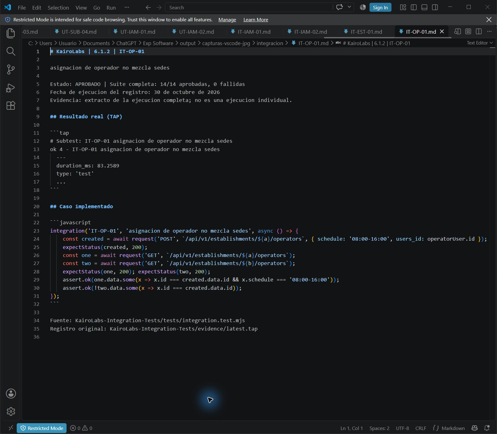
</p>

*Nota.* El operador asignado aparece únicamente en la sede correspondiente y conserva su horario. Captura propia del caso IT-OP-01, con resultado aprobado en el registro de ejecución del 30 de octubre de 2026.

**Figura 25**

*Dispositivo se recupera con su sede, ubicacion y tipo (IT-DEV-01)*

<p align="center">
  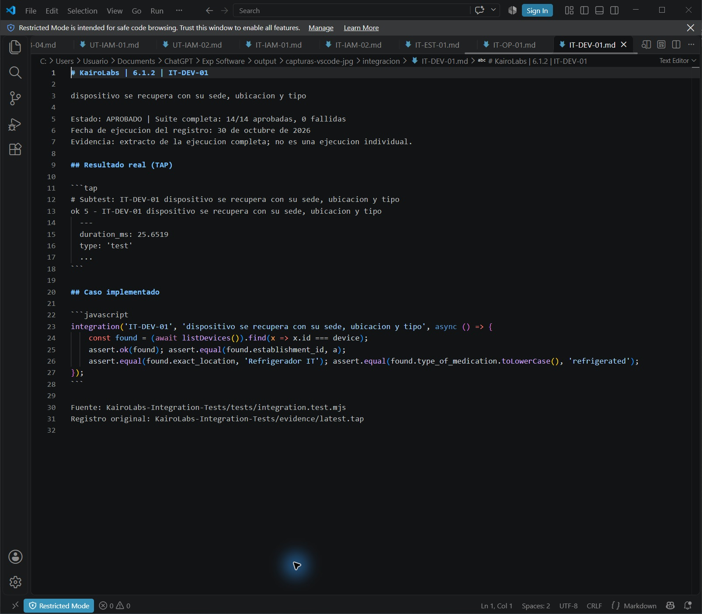
</p>

*Nota.* El dispositivo recuperado conserva ubicación, tipo de medicamento y establecimiento. Captura propia del caso IT-DEV-01, con resultado aprobado en el registro de ejecución del 30 de octubre de 2026.

**Figura 26**

*Lectura persiste en MySQL y se recupera en otra solicitud (IT-DEV-02)*

<p align="center">
  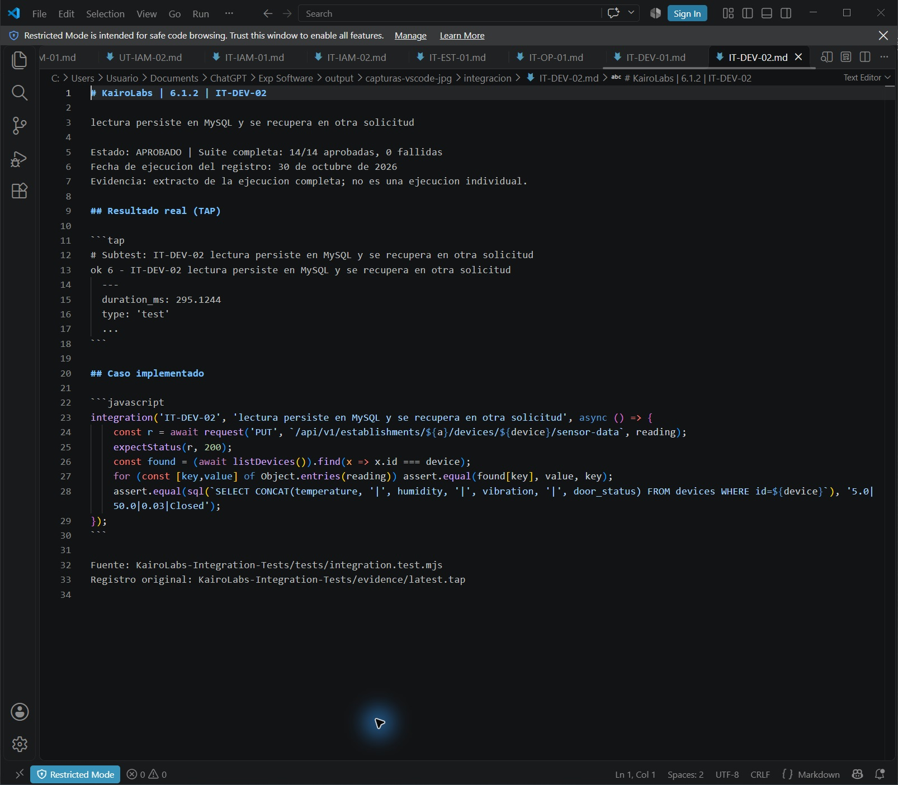
</p>

*Nota.* La lectura actualizada se recupera mediante una nueva solicitud y se contrasta con MySQL. Captura propia del caso IT-DEV-02, con resultado aprobado en el registro de ejecución del 30 de octubre de 2026.

**Figura 27**

*Actualizar desde otra sede devuelve 404 sin modificar la lectura (IT-DEV-03)*

<p align="center">
  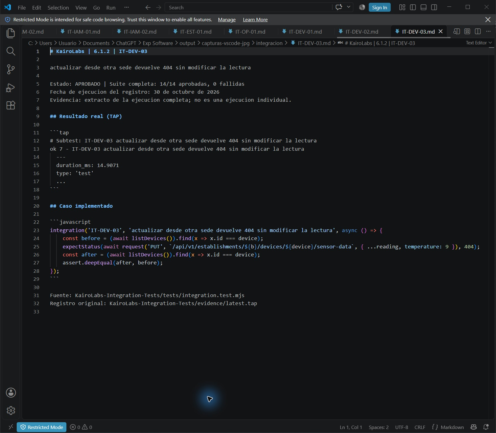
</p>

*Nota.* La actualización desde una sede ajena devuelve HTTP 404 y no modifica el dispositivo. Captura propia del caso IT-DEV-03, con resultado aprobado en el registro de ejecución del 30 de octubre de 2026.

**Figura 28**

*DoorStatus invalido devuelve 400 sin persistencia parcial (IT-DEV-04)*

<p align="center">
  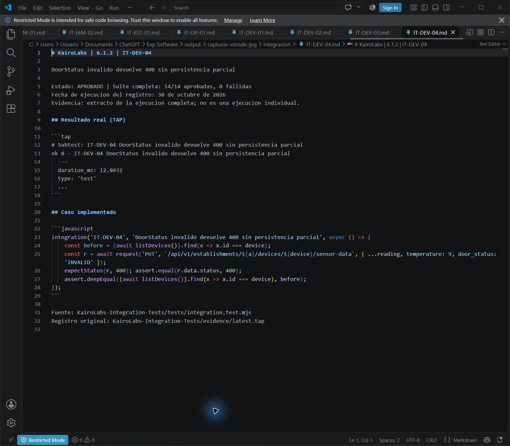
</p>

*Nota.* Un estado de puerta inválido produce HTTP 400 sin persistencia parcial. Captura propia del caso IT-DEV-04, con resultado aprobado en el registro de ejecución del 30 de octubre de 2026.

**Figura 29**

*Tipo de medicamento invalido devuelve 400 sin crear dispositivo (IT-DEV-05)*

<p align="center">
  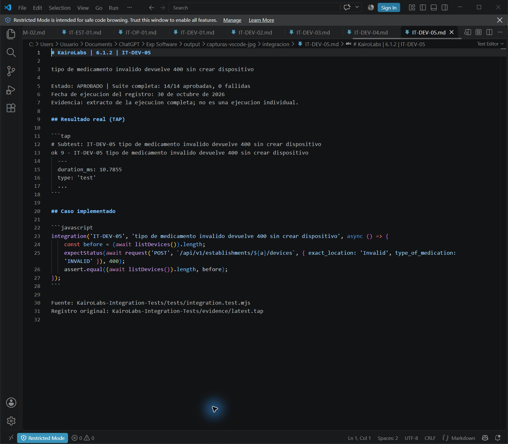
</p>

*Nota.* Un tipo de medicamento inválido produce HTTP 400 sin crear otro dispositivo. Captura propia del caso IT-DEV-05, con resultado aprobado en el registro de ejecución del 30 de octubre de 2026.

**Figura 30**

*Transporte guarda lectura y rechaza identificador inexistente (IT-LOG-01)*

<p align="center">
  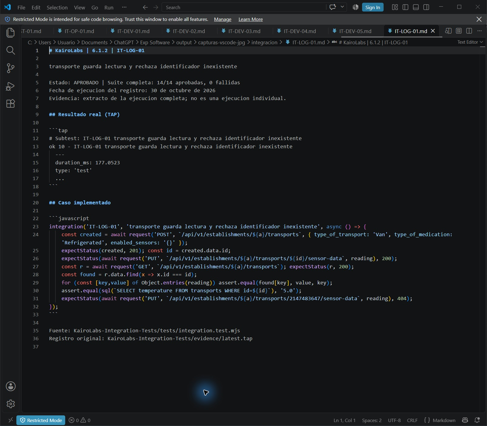
</p>

*Nota.* El transporte conserva la lectura persistida y rechaza un identificador inexistente. Captura propia del caso IT-LOG-01, con resultado aprobado en el registro de ejecución del 30 de octubre de 2026.

**Figura 31**

*Suscripcion completa ciclo crear consultar eliminar y nueva consulta (IT-SUB-01)*

<p align="center">
  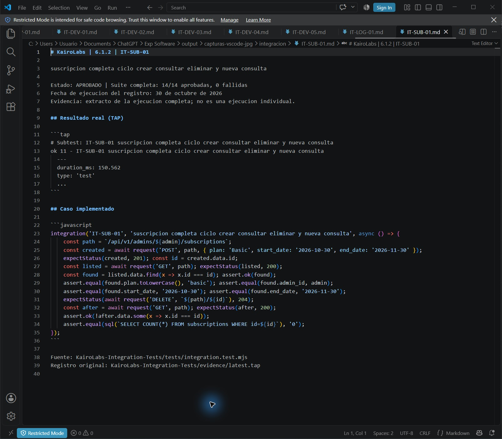
</p>

*Nota.* La suscripción completa el ciclo de creación, consulta y eliminación, verificado también en MySQL. Captura propia del caso IT-SUB-01, con resultado aprobado en el registro de ejecución del 30 de octubre de 2026.

**Figura 32**

*Gateways Axios y assemblers reales consumen API y datos persistidos (IT-WEB-01)*

<p align="center">
  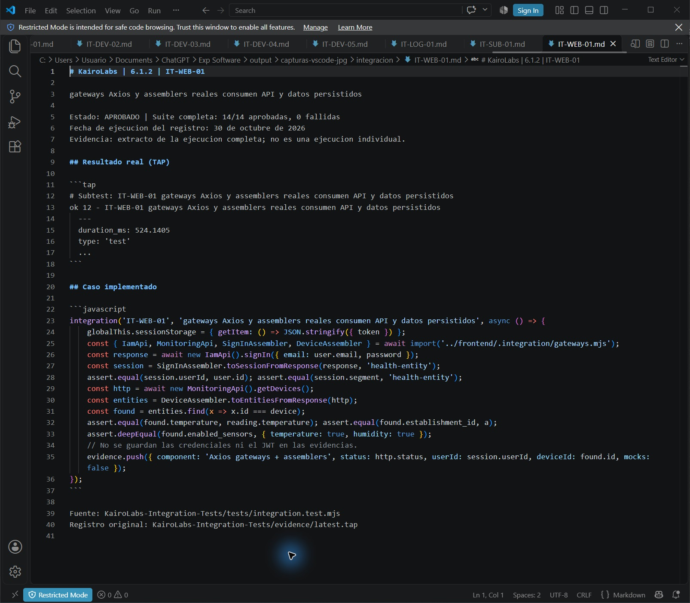
</p>

*Nota.* Los gateways Axios y assemblers reales procesan la sesión y los dispositivos recibidos de la API local. Captura propia del caso IT-WEB-01, con resultado aprobado en el registro de ejecución del 30 de octubre de 2026.

**Figura 33**

*CORS permite origen local rechaza ajeno y admite dominio KairoLabs (IT-WEB-02)*

<p align="center">
  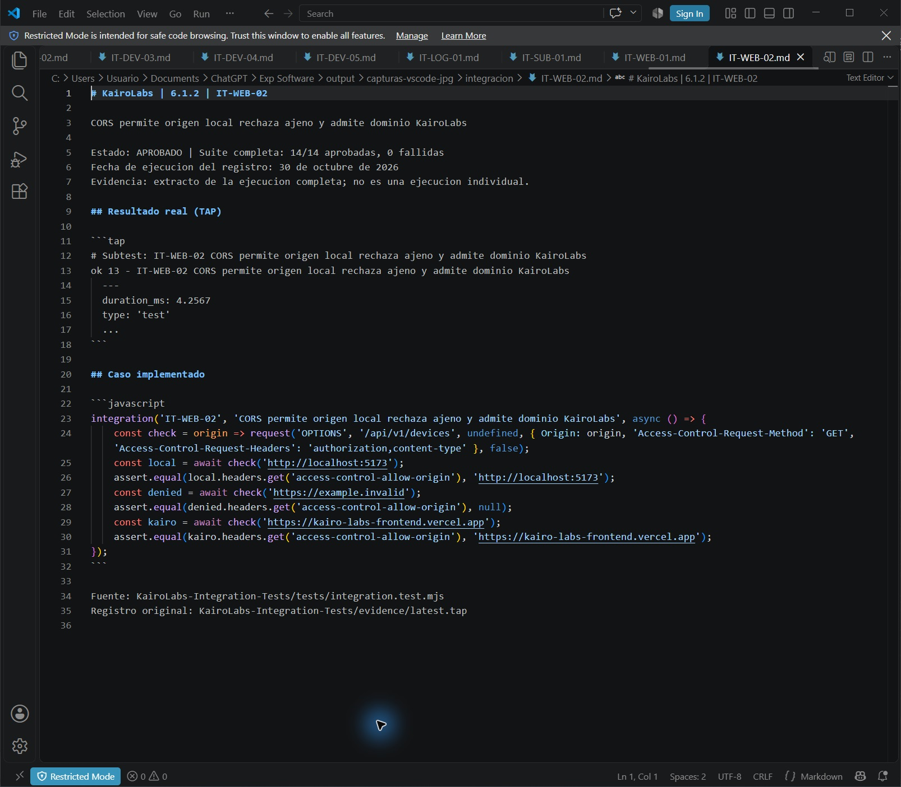
</p>

*Nota.* La política CORS admite los orígenes autorizados, incluido KairoLabs, y rechaza un origen ajeno. Captura propia del caso IT-WEB-02, con resultado aprobado en el registro de ejecución del 30 de octubre de 2026.

**Figura 34**

*API exige autenticacion para listar datos operativos (IT-SEC-01)*

<p align="center">
  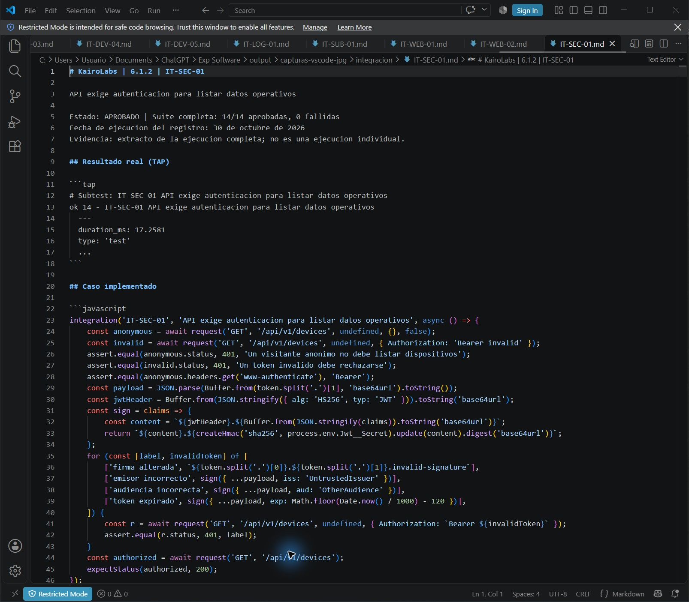
</p>

*Nota.* La API rechaza credenciales JWT ausentes o inválidas y permite la solicitud con un token válido. Captura propia del caso IT-SEC-01, con resultado aprobado en el registro de ejecución del 30 de octubre de 2026.

**Correcciones y revalidación**

La ejecución previa produjo 12 aprobados y 2 fallidos. Se añadió el dominio de KairoLabs a la lista explícita de orígenes CORS, conservando el rechazo del origen ajeno. En el backend se registraron `AddAuthentication().AddJwtBearer()` y una política de autenticación obligatoria por defecto, y se incorporó `UseAuthentication()` antes de `UseAuthorization()`. La validación exige firma HS256, emisor, audiencia y vigencia; la clave se obtiene de configuración y debe tener al menos 32 bytes. Login y registro se mantienen públicos mediante `[AllowAnonymous]`; los endpoints de salud y la redirección inicial también se declaran públicos de forma explícita.

Las solicitudes funcionales de la suite ahora utilizan el JWT obtenido del login. No se cambió la expectativa de 401 de IT-SEC-01 ni se sustituyeron los gateways por mocks. Se añadieron aserciones de firma, emisor, audiencia y expiración dentro del mismo caso. El orquestador también se ajustó para que Windows PowerShell 5 reintente la conexión mientras MySQL arranca, sin confundir su stderr transitorio con un error definitivo.

La evidencia inicial se conserva en [before-fix/latest.tap](../assets/chapter-6/evidence/integration/before-fix/latest.tap) y [before-fix/results.json](../assets/chapter-6/evidence/integration/before-fix/results.json). La salida actual en `latest.tap` corresponde a la versión corregida, con 14 aprobados y 0 fallidos.

| ID | Evidencia y efecto | Acción realizada o pendiente | Estado |
| :--- | :--- | :--- | :--- |
| DEF-INT-01 | El dominio de KairoLabs no recibía autorización CORS. | Se añadió el origen exacto y se comprobó que los orígenes autorizados reciben la cabecera y el ajeno continúa rechazado. | Publicado y revalidado el 31 de octubre de 2026. |
| DEF-INT-02 | El listado de dispositivos respondía 200 sin identidad válida. | Se conectó la validación JWT y la política de autenticación por defecto. IT-SEC-01 verifica rechazos 401 y acceso 200 con token válido. La autorización detallada por roles y pertenencia conserva su alcance de trabajo adicional. | Autenticación publicada y revalidada el 31 de octubre de 2026. |
| OBS-INT-01 | En una base vacía, el arranque registra `Table 'transports' already exists` durante las migraciones. El reintento de la propia aplicación permite continuar y la suite se ejecuta. | Revisar la consistencia entre preparación de tablas e historial de migraciones; agregar una prueba específica de arranque limpio y repetición idempotente. | Observación pendiente. |
| OBS-INT-02 | La compilación produce advertencias NuGet `NU1902` y `NU1903` para la dependencia transitiva `System.Security.Cryptography.Pkcs` 9.0.0. | Analizar y actualizar la dependencia dentro del trabajo de calidad y seguridad de 6.2.1.2; repetir compilación y regresión. | Observación pendiente. |

Los extractos de arranque y compilación se conservan en [startup-diagnostics.txt](../assets/chapter-6/evidence/integration/startup-diagnostics.txt) y [build-warnings.txt](../assets/chapter-6/evidence/integration/build-warnings.txt). Las observaciones de preparación no se incluyen artificialmente en el conteo de las 14 pruebas.

**Reproducción y capturas**

El [proyecto de integración para VS Code](../assets/chapter-6/projects/KairoLabs-Integration-Tests-VSCode.zip) contiene `KairoLabs-Integration.code-workspace` y permite ejecutar la preparación y la suite desde **F5** o la tarea **KairoLabs: ejecutar 14 pruebas de integracion**. Desde su terminal integrada también puede utilizarse:

```powershell
npm test
```

En el equipo de preparación ya se dispone de .NET y MySQL locales. En otra ubicación, se utiliza `npm run setup` para descargar las herramientas oficiales antes de ejecutar. El primer arranque puede requerir Internet para restaurar paquetes; la guía del proyecto incluye los pasos y requisitos.

Las capturas deben mostrar los casos ejecutados y el resumen completo de 14 pruebas, 14 aprobadas y 0 fallidas, junto con el código de los casos. Para documentar la evolución puede añadirse la evidencia inicial, identificándola expresamente como anterior a la corrección.

*Texto sugerido para la figura: Figura 6.1.2-1. Revalidación de las pruebas de integración con API ASP.NET Core y MySQL locales, y gateways reales del frontend. Tras corregir CORS y autenticación JWT, se ejecutaron 14 casos: 14 aprobados y 0 fallidos.*

**Límites de la validación**

Los resultados acreditan las interacciones enumeradas sobre la versión corregida publicada y sus datos sintéticos. No sustituyen las pruebas de la interfaz en navegador, los recorridos BDD, las pruebas móviles ni una auditoría completa de autorización entre entidades. IT-WEB-02 comprueba las cabeceras de preflight por HTTP, no el comportamiento completo de un navegador. IT-SEC-01 comprueba autenticación y validación de tokens; no completa la matriz de roles, permisos o acceso entre entidades de todos los recursos.

Al integrar la autenticación obligatoria en la aplicación completa deben revisarse los flujos que consultaban endpoints operativos sin sesión. Por ejemplo, el registro de operadores del frontend de referencia consulta el listado de administradores antes del alta; ese flujo requiere un mecanismo de incorporación adecuado y no se valida como recorrido completo en esta suite.

La actualización de lecturas valida el registro vigente, no series históricas, trazabilidad por lote ni sensores físicos. Las correcciones CORS/JWT están publicadas junto al backend probado en KairoLabs-Platform; no se afirma su despliegue en producción. Las observaciones de migraciones y dependencias mantienen su estado pendiente.

Referencia técnica de la corrección: [configuración de JWT Bearer en ASP.NET Core 10](https://learn.microsoft.com/aspnet/core/security/authentication/configure-jwt-bearer-authentication?view=aspnetcore-10.0).

---

### 6.1.3. Core Behavior-Driven Development (BDD)

Se implementó y publicó una suite Cucumber.js con escenarios Gherkin en español y pasos Playwright que operan sobre la interfaz Vue, la API ASP.NET Core y MySQL reales. La revalidación del **2 de noviembre de 2026 (America/Lima)** obtuvo **4 escenarios aprobados de 4 y 22 pasos aprobados de 22 en escritorio**, y los mismos resultados en móvil emulado. En conjunto son ocho ejecuciones de cuatro escenarios, no ocho funcionalidades diferentes.

**Trazabilidad y reproducción**

Evidencia publicada en el repositorio: [BDD y capturas](https://github.com/1ASI0732-2620-9082-Aether-System/KairoLabs-Frontend/tree/a91e33e62a2e0ebdc8e9fdc89c1993583dc1c496/evidence/bdd) y [análisis de calidad](https://github.com/1ASI0732-2620-9082-Aether-System/KairoLabs-Frontend/tree/a91e33e62a2e0ebdc8e9fdc89c1993583dc1c496/evidence/quality). [Revalidación y diagnósticos del backend](https://github.com/1ASI0732-2620-9082-Aether-System/KairoLabs-Platform/tree/15ba942ae7a89c644c155ee5294ef93e6c65367d/evidence).

- [Escenarios `bdd/core.feature`](https://github.com/1ASI0732-2620-9082-Aether-System/KairoLabs-Frontend/blob/7f1d227c1a5ad03a0673de9e4aaa5dccb516d231/bdd/core.feature), [pasos y aserciones](https://github.com/1ASI0732-2620-9082-Aether-System/KairoLabs-Frontend/blob/7f1d227c1a5ad03a0673de9e4aaa5dccb516d231/bdd/steps.mjs), [runner del navegador](https://github.com/1ASI0732-2620-9082-Aether-System/KairoLabs-Frontend/blob/7f1d227c1a5ad03a0673de9e4aaa5dccb516d231/bdd/run.mjs) y [guía BDD](https://github.com/1ASI0732-2620-9082-Aether-System/KairoLabs-Frontend/blob/7f1d227c1a5ad03a0673de9e4aaa5dccb516d231/bdd/README.md).
- [Orquestador API/MySQL compartido](https://github.com/1ASI0732-2620-9082-Aether-System/KairoLabs-Platform/blob/3f2f716764c552e7ae946ed7d417498208842bd1/scripts/run-integration.ps1). Las carpetas KairoLabs-Frontend y KairoLabs-Platform deben ser hermanas, o indicarse `-PlatformRoot`.
- [Resultados JSON escritorio](../assets/chapter-6/evidence/bdd/cucumber-desktop.json), [JSON móvil](../assets/chapter-6/evidence/bdd/cucumber-mobile.json), [registro de ejecución](../assets/chapter-6/evidence/bdd/run.log), [entorno](../assets/chapter-6/evidence/bdd/environment.json) y [tráfico por escenario](../assets/chapter-6/evidence/bdd/network.jsonl).
- Reportes HTML con capturas adjuntas: [escritorio](../assets/chapter-6/evidence/bdd/cucumber-desktop.html) y [móvil emulado](../assets/chapter-6/evidence/bdd/cucumber-mobile.html). GitHub muestra el archivo como código; descargarlo y abrirlo localmente para interactuar con el reporte.

Desde KairoLabs-Platform, ejecutar `npm run setup` una vez. Desde KairoLabs-Frontend, con Windows x64 y Node.js 24+:

```powershell
npm ci
npx playwright install chromium
npm run test:bdd
```

También se dispone de `npm run test:bdd:desktop` y `npm run test:bdd:mobile`. Se requieren los puertos 5173, 5187 y 33079 libres. El runner crea datos sintéticos en una base temporal, inicia los servicios locales y elimina sus procesos y base al terminar. Los gateways se configuran para localhost, `VITE_USE_MOCKS=false`, y el navegador bloquea fetch/XHR externos. Los registros no incluyen contraseñas ni encabezados JWT. Cada escenario utiliza un contexto nuevo y espera a que desaparezca el cargador antes de capturar el resultado.

**Escenarios publicados**

```gherkin
# language: es
Característica: Acceso y consulta de información operativa
  Antecedentes:
    Dado que existe una entidad con sede y dispositivo de prueba en la API real

  Escenario: Una cuenta de prueba activa accede a su panel
    Cuando inicia sesión con credenciales válidas
    Entonces se muestra el panel autenticado

  Escenario: La aplicación rechaza credenciales inválidas
    Cuando inicia sesión con una contraseña incorrecta
    Entonces muestra un error y conserva la pantalla de acceso

  Escenario: El usuario consulta establecimientos desde el frontend integrado
    Cuando inicia sesión con credenciales válidas
    Y navega al listado de establecimientos
    Entonces la sede persistida se muestra en pantalla

  Escenario: El usuario consulta dispositivos desde el frontend integrado
    Cuando inicia sesión con credenciales válidas
    Y navega al listado de dispositivos
    Entonces el dispositivo persistido se muestra en pantalla
```

**Figura 35**

*Ejecución Cucumber en escritorio: cuatro escenarios aprobados*

<p align="center">
  
</p>

*Nota.* Captura del reporte HTML real de la suite, con cuatro escenarios y 22 pasos aprobados. Elaboración propia, 2 de noviembre de 2026.

**Figura 36**

*Ejecución Cucumber en móvil emulado: cuatro escenarios aprobados*

<p align="center">
  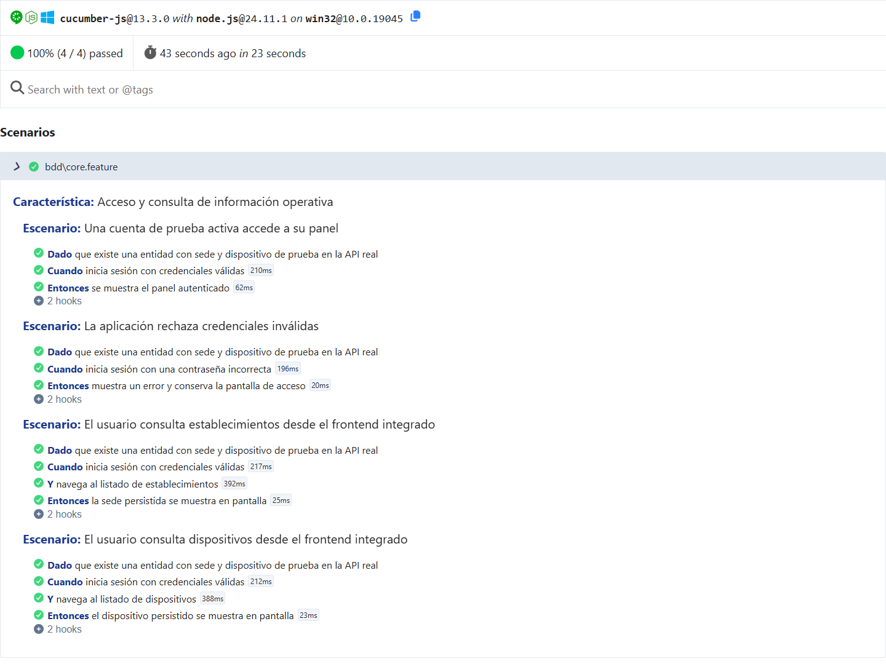
</p>

*Nota.* Captura del reporte HTML real. Chromium utiliza el perfil Pixel 7 de Playwright; no se acredita un dispositivo físico. Elaboración propia, 2 de noviembre de 2026.

### 6.1.4. Core System Tests

Los mismos escenarios BDD ejercitan cuatro recorridos de sistema completos dentro de su alcance: formulario de acceso, respuesta API, sesión y panel; rechazo de credenciales; consulta de sedes; consulta de dispositivos. Se comprueban tanto respuestas HTTP como contenido visible. La navegación de consulta abre rutas reales del frontend después del login; no se afirma cobertura de todos los menús ni gestos táctiles.

| ID | Recorrido y comprobación | Escritorio 1440 × 1000 | Pixel 7 emulado |
| :--- | :--- | :--- | :--- |
| SYS-01 | Login válido: HTTP 200, sesión con token y panel autenticado. | Aprobado | Aprobado |
| SYS-02 | Clave incorrecta: HTTP 401, error visible y ausencia de sesión. | Aprobado | Aprobado |
| SYS-03 | Sede creada por API y mostrada en el listado del frontend. | Aprobado | Aprobado |
| SYS-04 | Dispositivo creado por API y mostrado en el listado del frontend. | Aprobado | Aprobado |

No se suman estas ejecuciones otra vez al total BDD: son la misma evidencia descrita desde su alcance de sistema. No cubren aplicación móvil nativa, dispositivo físico, todos los roles, producción ni todos los procesos del producto. Lighthouse no forma parte de estos resultados funcionales.

**Figura 37**

*Panel autenticado en escritorio*

<p align="center">
  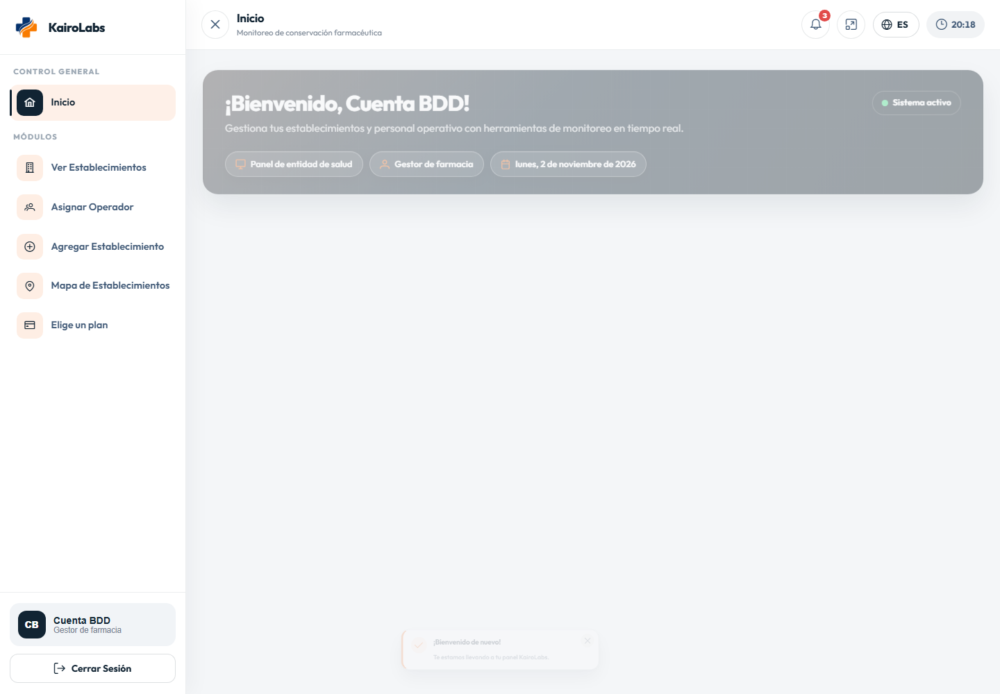
</p>

*Nota.* La cuenta sintética accede mediante el formulario y la API real. Captura automatizada de la aplicación tras finalizar la carga; elaboración propia, 2 de noviembre de 2026.

**Figura 38**

*Rechazo de credenciales en móvil emulado*

<p align="center">
  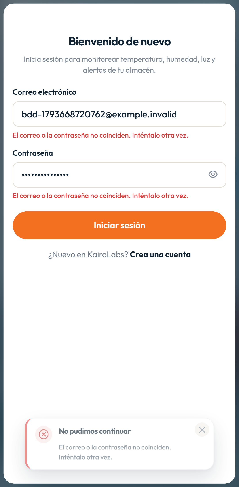
</p>

*Nota.* El mensaje de error acompaña al rechazo HTTP 401 y no se crea una sesión. Captura automatizada de la aplicación tras finalizar la carga; elaboración propia, 2 de noviembre de 2026.

**Figura 39**

*Consulta de la sede persistida en escritorio*

<p align="center">
  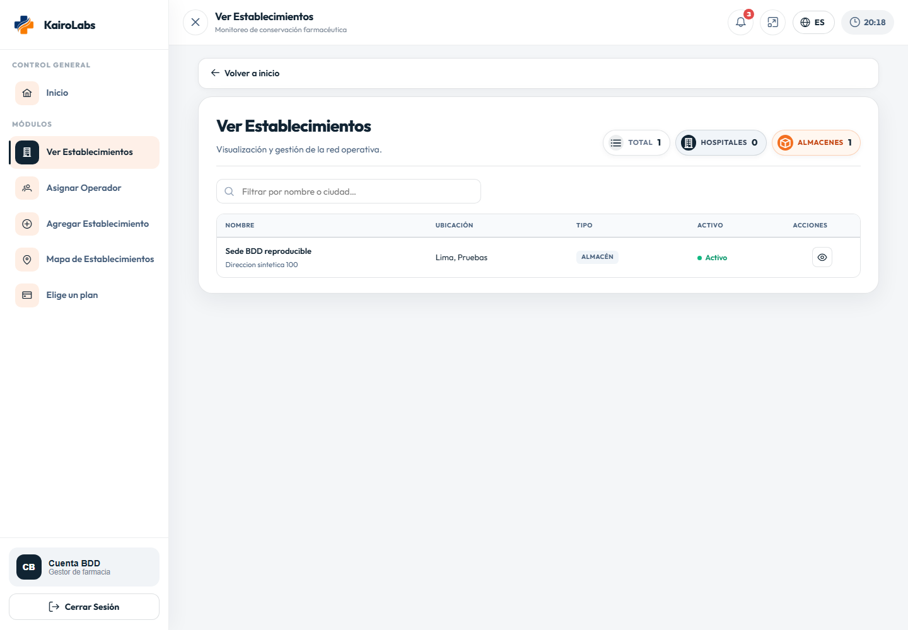
</p>

*Nota.* El registro sintético creado en MySQL por la API aparece en el listado. Captura automatizada de la aplicación tras finalizar la carga; elaboración propia, 2 de noviembre de 2026.

**Figura 40**

*Consulta del dispositivo persistido en móvil emulado*

<p align="center">
  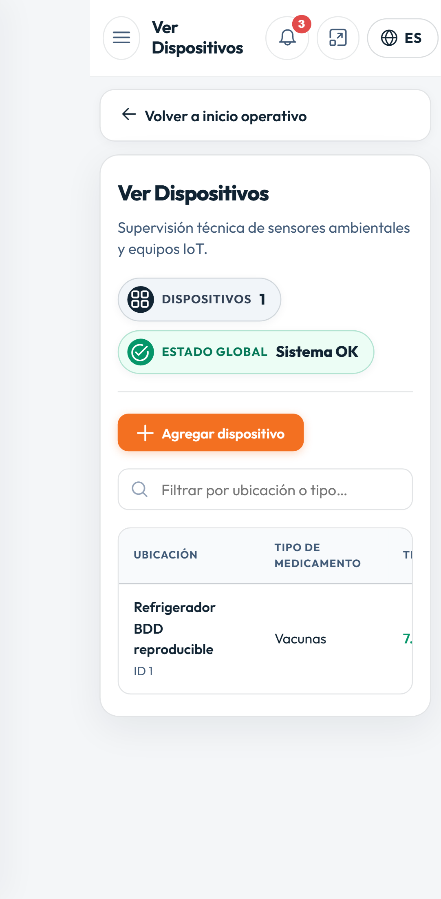
</p>

*Nota.* El dispositivo sintético se visualiza en la aplicación con el gateway real. Captura automatizada de la aplicación tras finalizar la carga; elaboración propia, 2 de noviembre de 2026.

## 6.2. Static testing & Verification

### 6.2.1. Static Code Analysis

El **2 de noviembre de 2026** se ejecutó análisis reproducible sobre `src/` del frontend. Se combinan ESLint, eslint-plugin-vue y eslint-plugin-security, métricas de complejidad por función y jscpd para duplicación, auditoría npm de dependencias y compilación. El alcance incluye código de demostración bajo `src/shared/infrastructure/mocks/`; excluye dependencias instaladas y reportes generados. La revisión del backend es acotada y no se presenta como un análisis estático completo de C#.

Fuentes: [configuración ESLint](https://github.com/1ASI0732-2620-9082-Aether-System/KairoLabs-Frontend/blob/7f1d227c1a5ad03a0673de9e4aaa5dccb516d231/eslint.config.js), [script de análisis](https://github.com/1ASI0732-2620-9082-Aether-System/KairoLabs-Frontend/blob/7f1d227c1a5ad03a0673de9e4aaa5dccb516d231/scripts/analyze-quality.mjs), [versiones y hashes](../assets/chapter-6/evidence/quality/source-version.json), [resumen JSON](../assets/chapter-6/evidence/quality/summary.json), [registro completo](../assets/chapter-6/evidence/quality/run.log) y [reporte HTML](../assets/chapter-6/evidence/quality/report.html).

```powershell
npm ci
npm run lint
npm run quality
```

`lint` falla ante errores. `quality` registra ESLint, complejidad, duplicación, auditorías y build; su código de salida 0 indica ausencia de errores ESLint y compilación correcta, **no aprobación de seguridad**. Los códigos de auditoría se guardan aparte y fueron 1. No se ha instalado un hook precommit automático.

#### 6.2.1.1. Coding standard & Code conventions.

La configuración publicada combina las reglas recomendadas de JavaScript y las esenciales de Vue, más reglas explícitas para variables, comparaciones, complejidad y seguridad. Las convenciones observadas del proyecto incluyen `*.entity.js`, `*.assembler.js`, stores y componentes Vue separados por contexto. No se afirma cumplimiento integral de Airbnb, todas las prioridades de Vue, indentación o punto y coma: la configuración ejecutada no aplica esas guías completas.

**Tabla 12**

*Reglas y resultados de la verificación de convenciones*

| Regla o grupo | Resultado | Interpretación |
| :--- | :--- | :--- |
| JavaScript recomendado y Vue esencial | 0 errores totales en 94 archivos | Sin errores bloqueantes de la configuración actual. |
| `eqeqeq` | 37 advertencias | Comparaciones no estrictas que requieren revisar tipos antes de sustituirlas. |
| `no-unused-vars` | 2 advertencias | Variables o importaciones sin uso. |
| `prefer-const` | 1 advertencia | Declaración que puede ser constante. |
| `complexity` con umbral 15 | 11 advertencias | Funciones con demasiadas decisiones según ESLint. |
| `security/detect-object-injection` | 26 advertencias | Claves dinámicas que requieren revisión contextual de seguridad. |
| **Total** | **0 errores y 77 advertencias** | El linter pasa, pero no está libre de observaciones. |

*Nota.* Elaboración propia a partir de [eslint.json](../assets/chapter-6/evidence/quality/eslint.json) y [salida de lint](../assets/chapter-6/evidence/quality/lint.txt). Leaflet se declara de solo lectura únicamente en la vista que lo carga por CDN; no se desactiva `no-undef` globalmente.

#### 6.2.1.2. Code Quality & Code Security

**Calidad y mantenibilidad**

Se midieron **773 funciones**, con complejidad media **2,68**, máxima **25** y **11 por encima de 15**. La medición utiliza la regla `complexity` de ESLint con umbral cero para extraer todos los valores; ese umbral de medición no es el criterio de aprobación. El umbral de advertencia de la configuración normal es 15.

La mayor complejidad corresponde a `completeHealthEntityRegistration` (25), seguida de `Operator.formatSchedule` y constructores de `Transport` y `Device` (22), y `loadProfileFromSession` (21). Se recomienda separar responsabilidades y proteger la refactorización con las suites publicadas. El detalle de función, archivo y línea está en [complexity.json](../assets/chapter-6/evidence/quality/complexity.json).

jscpd detectó **127 pares de fragmentos clonados y 1496 líneas duplicadas: 5,12 %** de las líneas analizadas. Se fijaron mínimos de 50 tokens y cinco líneas. El parser contabiliza 187 fuentes/fragmentos, incluidas secciones de archivos Vue; no equivalen a 187 archivos físicos. Los pares y sus ubicaciones se conservan en [jscpd-report.json](../assets/chapter-6/evidence/quality/jscpd/jscpd-report.json). Estas métricas sirven como indicadores de mantenibilidad; no se calcula Maintainability Index ni se afirma un umbral global aprobado por el equipo.

**Seguridad de dependencias y del código**

La auditoría completa registró **21 paquetes con avisos: 14 de severidad alta y 7 moderada**, sin críticos. Al excluir dependencias de desarrollo, `npm audit --omit=dev` registró **13 de severidad alta**. Se distinguen los paquetes afectados de los avisos únicos: un mismo advisory puede propagarse por dependencias transitivas. Registros íntegros: [auditoría completa](../assets/chapter-6/evidence/quality/npm-audit.json) y [auditoría de producción](../assets/chapter-6/evidence/quality/npm-audit-production.json). Ambos comandos finalizaron con código 1, por lo que los hallazgos permanecen abiertos.

**Tabla 13**

*Paquetes afectados según la auditoría ejecutada y enlaces a sus avisos*

| Paquete | Severidad | Dependencia directa | Avisos directos o propagación |
| :--- | :--- | :--- | :--- |
| `@eslint-community/eslint-utils` | moderate | No | Propagación desde eslint |
| `@eslint/config-array` | moderate | No | Propagación desde minimatch |
| `@eslint/js` | moderate | Sí | Propagación desde eslint |
| `@intlify/core-base` | high | No | [GHSA-8rc2-428q-7ww3](https://github.com/advisories/GHSA-8rc2-428q-7ww3), [GHSA-83rm-6c8r-g728](https://github.com/advisories/GHSA-83rm-6c8r-g728) |
| `@intlify/devtools-types` | high | No | Propagación desde @intlify/core-base, @intlify/shared |
| `@intlify/message-compiler` | high | No | Propagación desde @intlify/shared |
| `@intlify/shared` | high | No | [GHSA-83rm-6c8r-g728](https://github.com/advisories/GHSA-83rm-6c8r-g728) |
| `@vue/server-renderer` | high | No | [GHSA-g2v6-rqmx-r4w6](https://github.com/advisories/GHSA-g2v6-rqmx-r4w6) |
| `axios` | high | Sí | [GHSA-xj6q-8x83-jv6g](https://github.com/advisories/GHSA-xj6q-8x83-jv6g), [GHSA-mmx7-hfxf-jppx](https://github.com/advisories/GHSA-mmx7-hfxf-jppx), [GHSA-pmv8-rq9r-6j72](https://github.com/advisories/GHSA-pmv8-rq9r-6j72), [GHSA-mwf2-3pr3-8698](https://github.com/advisories/GHSA-mwf2-3pr3-8698), [GHSA-gcfj-64vw-6mp9](https://github.com/advisories/GHSA-gcfj-64vw-6mp9), [GHSA-7q8q-rj6j-mhjq](https://github.com/advisories/GHSA-7q8q-rj6j-mhjq), [GHSA-jqh4-m9w3-8hp9](https://github.com/advisories/GHSA-jqh4-m9w3-8hp9), [GHSA-f4gw-2p7v-4548](https://github.com/advisories/GHSA-f4gw-2p7v-4548), [GHSA-42h9-826w-cgv3](https://github.com/advisories/GHSA-42h9-826w-cgv3), [GHSA-hcpx-6fm6-wx23](https://github.com/advisories/GHSA-hcpx-6fm6-wx23), [GHSA-vh66-26gq-q6x8](https://github.com/advisories/GHSA-vh66-26gq-q6x8), [GHSA-9fr6-4gfg-395g](https://github.com/advisories/GHSA-9fr6-4gfg-395g), [GHSA-mghh-pgcx-3jjj](https://github.com/advisories/GHSA-mghh-pgcx-3jjj), [GHSA-x97p-jq2g-jp4f](https://github.com/advisories/GHSA-x97p-jq2g-jp4f), [GHSA-3pq3-5fj3-cg6v](https://github.com/advisories/GHSA-3pq3-5fj3-cg6v), [GHSA-542g-h47m-68v8](https://github.com/advisories/GHSA-542g-h47m-68v8), [GHSA-j8rh-479h-cp32](https://github.com/advisories/GHSA-j8rh-479h-cp32), [GHSA-4hqw-qxg8-jxx2](https://github.com/advisories/GHSA-4hqw-qxg8-jxx2), [GHSA-m8m8-qj5v-23w3](https://github.com/advisories/GHSA-m8m8-qj5v-23w3), [GHSA-44g4-m2mj-wpvx](https://github.com/advisories/GHSA-44g4-m2mj-wpvx) |
| `eslint` | moderate | Sí | Propagación desde @eslint-community/eslint-utils, @eslint/config-array, minimatch |
| `eslint-plugin-vue` | moderate | Sí | Propagación desde @eslint-community/eslint-utils, eslint, vue-eslint-parser |
| `follow-redirects` | high | No | [GHSA-q3jh-wrc6-jgq8](https://github.com/advisories/GHSA-q3jh-wrc6-jgq8), [GHSA-8r9p-f939-6h3c](https://github.com/advisories/GHSA-8r9p-f939-6h3c), [GHSA-mrwp-f3q8-3g9p](https://github.com/advisories/GHSA-mrwp-f3q8-3g9p) |
| `form-data` | high | No | [GHSA-hmw2-7cc7-3qxx](https://github.com/advisories/GHSA-hmw2-7cc7-3qxx) |
| `minimatch` | moderate | No | [GHSA-g3hv-75wg-m249](https://github.com/advisories/GHSA-g3hv-75wg-m249) |
| `nanoid` | high | No | [GHSA-28wg-ghj8-5hjv](https://github.com/advisories/GHSA-28wg-ghj8-5hjv), [GHSA-2v37-7h3g-55p8](https://github.com/advisories/GHSA-2v37-7h3g-55p8) |
| `postcss` | high | No | [GHSA-fxqj-rqcc-2cmp](https://github.com/advisories/GHSA-fxqj-rqcc-2cmp), [GHSA-r28c-9q8g-f849](https://github.com/advisories/GHSA-r28c-9q8g-f849) |
| `source-map-js` | high | No | [GHSA-68fv-2mgg-jv7q](https://github.com/advisories/GHSA-68fv-2mgg-jv7q) |
| `vite` | high | Sí | [GHSA-v6wh-96g9-6wx3](https://github.com/advisories/GHSA-v6wh-96g9-6wx3), [GHSA-698v-4r3x-3vcv](https://github.com/advisories/GHSA-698v-4r3x-3vcv), [GHSA-r825-w8mm-5pxw](https://github.com/advisories/GHSA-r825-w8mm-5pxw), [GHSA-587h-7wmj-h5pm](https://github.com/advisories/GHSA-587h-7wmj-h5pm), [GHSA-9jrq-w75r-8gcw](https://github.com/advisories/GHSA-9jrq-w75r-8gcw), [GHSA-rq7h-c2jc-7f22](https://github.com/advisories/GHSA-rq7h-c2jc-7f22), [GHSA-fx2h-pf6j-xcff](https://github.com/advisories/GHSA-fx2h-pf6j-xcff) |
| `vue` | high | Sí | Propagación desde @vue/server-renderer |
| `vue-eslint-parser` | moderate | No | Propagación desde eslint |
| `vue-i18n` | high | Sí | [GHSA-8rc2-428q-7ww3](https://github.com/advisories/GHSA-8rc2-428q-7ww3), [GHSA-83rm-6c8r-g728](https://github.com/advisories/GHSA-83rm-6c8r-g728) |

*Nota.* Tabla generada desde el registro npm real del lockfile evaluado, sin inventar versiones reparadas ni asumir que `npm audit fix` sea seguro en todos los casos. El reporte JSON conserva los rangos, rutas y propuestas de remediación completas.

La revisión de código identifica 26 accesos por claves variables que requieren examinar su origen; no son 26 explotaciones demostradas. La búsqueda textual no encontró `v-html` ni `innerHTML` en `src/`, lo que no prueba ausencia total de XSS. Se revisó el uso BCrypt en IAM y la validación JWT; continúan pendientes los permisos completos por rol y pertenencia. La revisión de SQL de migraciones no acredita inmunidad global a SQLi. El procedimiento, archivos examinados y plan priorizado se documentan en [security-review.md](../assets/chapter-6/evidence/quality/security-review.md).

La compilación frontend terminó con **código 0**: [build.log](../assets/chapter-6/evidence/quality/build.log). El backend sigue emitiendo NU1902/NU1903 para `System.Security.Cryptography.Pkcs` 9.0.0; ahora existe el [registro de compilación completo](../assets/chapter-6/evidence/integration/build-warnings.txt). El [diagnóstico de arranque](../assets/chapter-6/evidence/integration/startup-diagnostics.txt) conserva la incidencia de migración recuperada por reintento. Las 14 pruebas aprobadas no cierran estas observaciones.

**Plan de mejora:** actualizar dependencias tras evaluar compatibilidad; dividir las funciones con complejidad alta; revisar comparaciones y claves dinámicas; reducir duplicación cuando exista una responsabilidad realmente compartida. Después de cada corrección deben repetirse compilación, auditorías y suites. Los responsables del equipo y fechas de cierre quedan por asignar; no se inventa una aprobación por pares.

**Figura 41**

*Resultados medidos de calidad y seguridad del frontend*

<p align="center">
  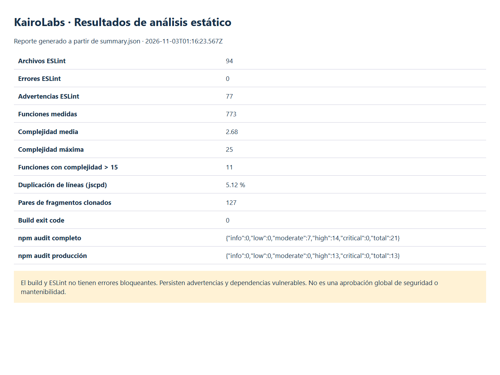
</p>

*Nota.* Captura del reporte HTML generado desde summary.json. Se muestran errores, advertencias, complejidad, duplicación y auditorías; los avisos de seguridad permanecen abiertos. Elaboración propia, 2 de noviembre de 2026; la marca ISO del reporte está en UTC.

### 6.2.2. Reviews

La revisión de KairoLabs busca comprobar que el código y la documentación sean coherentes con lo que necesita el producto. Además de los resultados de las herramientas automáticas, es necesario revisar cómo se manejan las lecturas de los sensores, quién puede acceder a los datos y qué se ha comprobado con las pruebas.

Esta sección reúne las correcciones y los pendientes descritos en 6.1.1, 6.1.2 y 6.2.1, junto con las diferencias encontradas en la copia local del frontend. Se preparó con apoyo de una revisión asistida del código y los documentos disponibles al **31 de octubre de 2026**. Las pruebas citadas ya estaban registradas en el informe. Aún queda pendiente que otro integrante revise los cambios y que el equipo registre su aprobación, ya que no se cuenta con nombres de revisores ni actas de esa actividad.

**Objetivo y alcance de la revisión**

La revisión se centra en la gestión de establecimientos, operadores, dispositivos, transportes y suscripciones. Incluye el frontend desarrollado con Vue 3 y el backend ASP.NET Core con MySQL, reutilizado de MediTrackSensor. En cada caso se consideran las versiones señaladas en el informe.

**Tabla 14**

*Componentes y documentos incluidos en la revisión de KairoLabs*

| Componente o documento | Qué se revisa | Referencia |
| :--- | :--- | :--- |
| Monitoring | Que una lectura ausente se distinga de un cero real, que las lecturas se clasifiquen correctamente y que cada dispositivo conserve su sede. | `Device` y casos UT-DEV-01 a UT-DEV-14 de 6.1.1. |
| IAM y Subscriptions | Que el correo se normalice sin cambiar la contraseña y que los planes coincidan entre el catálogo y la API. | `SignInCommand`, `Subscription` y casos UT-IAM / UT-SUB de 6.1.1. |
| Comunicación frontend-API | Cómo se envían las solicitudes, se interpretan las respuestas y se utiliza el JWT; si las pruebas usan datos simulados o servicios reales. | `IamApi`, `MonitoringApi`, assemblers y caso IT-WEB-01 de 6.1.2. |
| Configuración y respuestas del backend | Qué orígenes permite CORS, qué operaciones exigen autenticación y cómo se responden los errores y se manejan los datos de cada establecimiento. | `Program.cs` y casos IT-WEB-02, IT-SEC-01 e IT-DEV de 6.1.2. |
| Base de datos y dependencias | Cómo arranca la aplicación con una base vacía y qué problemas de migraciones o seguridad siguen pendientes. | OBS-INT-01, OBS-INT-02 y auditoría de 6.2.1.2. |
| Informe y resultados de pruebas | Que los resultados correspondan a la versión indicada y que las conclusiones se ajusten a lo que se probó. | Capítulo VI y [registro de versiones y hashes](../assets/chapter-6/metadata/published-validation.json). |

*Nota.* Queda pendiente ampliar la revisión a las pruebas móviles, los recorridos completos en el navegador y los permisos de acceso de todos los recursos.

**Procedimiento y guía para próximas revisiones**

Para las siguientes entregas, se propone trabajar con estos pasos:

1. **Definir qué se va a revisar.** Anotar la historia de usuario o requisito, el repositorio, la rama, el commit y los archivos. El autor explica qué debería hacer el cambio y comparte sus evidencias.
2. **Revisar el cambio con otro integrante.** El revisor utiliza los criterios de la Tabla 14 y señala el archivo o la función donde encuentra un problema. Si el autor revisa su propio trabajo, debe registrarlo como autorrevisión.
3. **Ordenar las observaciones.** Explicar qué problema se encontró, qué puede afectar y qué tan pronto debe atenderse. En KairoLabs tienen prioridad el acceso a los datos, la interpretación de las lecturas y su almacenamiento.
4. **Corregir y volver a comprobar.** Guardar el commit de la corrección y las pruebas que confirman el resultado. El problema sigue pendiente mientras solo exista una propuesta de solución.
5. **Registrar el resultado.** Anotar quién revisó, cuándo lo hizo y si aprobó el cambio. Para los pendientes, indicar qué falta y quién se encargará.

Cada revisión debe dejar una ficha con: **ID, fecha, autor, revisor, requisito, repositorio y commit, archivos revisados, criterio, problema encontrado, prioridad, acción, responsable, evidencia y estado**. Los nombres y las aprobaciones se registran cuando se realice la actividad.

**Problemas encontrados y seguimiento**

La prioridad es **Alta** cuando el problema afecta el acceso, la interpretación de las lecturas o requiere revisar un aviso de seguridad. Es **Media** cuando afecta el arranque de la aplicación, la repetición de las pruebas o la identificación de lo entregado. Esta clasificación ayuda a organizar el trabajo; los avisos de seguridad conservan la severidad que les asigna cada herramienta.

**Tabla 15**

*Problemas revisados, acciones y pendientes de KairoLabs*

| ID | Problema encontrado | Prioridad | Qué se hizo o qué falta hacer | Estado y evidencia |
| :--- | :--- | :--- | :--- | :--- |
| REV-01 | **Monitoring:** una lectura ausente podía convertirse en cero y mostrarse como una temperatura crítica. | Alta. | Se corrigió el manejo de `null`, `undefined` y textos en blanco para distinguirlos de un cero real. Se añadieron pruebas para evitar que el error se repita. | **Corregido y comprobado en la versión registrada.** UT-DEV-10 y UT-DEV-11; resultados [antes](../assets/chapter-6/evidence/unit/before-fix.tap) y [después](../assets/chapter-6/evidence/unit/latest.tap). La nueva revalidación de la copia publicada se registra en REV-08. |
| REV-02 | **Comunicación web-API:** CORS no permitía las solicitudes desde el dominio de KairoLabs. | Alta. | Se agregó el dominio a la lista de orígenes permitidos y se comprobó que un origen ajeno siguiera siendo rechazado. | **Corregido y comprobado en la versión registrada.** DEF-INT-01 e IT-WEB-02 de 6.1.2. |
| REV-03 | **IAM / API:** se podía consultar el listado de dispositivos sin una identidad válida. | Alta. | Se incorporó la validación JWT y se exigió autenticación por defecto, indicando qué endpoints deben seguir siendo públicos. | **Autenticación corregida y comprobada en la versión registrada.** DEF-INT-02 e IT-SEC-01. El resultado corresponde a los accesos y tokens probados. |
| REV-04 | **Permisos de acceso:** falta comprobar todas las operaciones según el rol y la entidad a la que pertenece el usuario. | Alta. | Revisar los permisos de administradores y operadores, e intentar accesos permitidos y prohibidos entre entidades. Revisar también el registro de operadores, que consulta administradores antes de iniciar sesión. | **Pendiente.** El alcance que falta cubrir se explica en 6.1.2. |
| REV-05 | **Base de datos:** al iniciar con una base vacía aparece el mensaje de que la tabla `transports` ya existe. La aplicación reintenta y continúa. | Media. | Revisar la creación de tablas y las migraciones. Comprobar que el primer arranque y los siguientes se completen sin ese conflicto. | **Pendiente.** OBS-INT-01 y [registro de arranque](../assets/chapter-6/evidence/integration/startup-diagnostics.txt). |
| REV-06 | **Dependencias:** se documentaron problemas de seguridad en paquetes del frontend y una observación sobre paquetes utilizados por el backend. | Alta. | Revisar las versiones afectadas, actualizar los paquetes y guardar los nuevos resultados de auditoría, compilación y pruebas. | **Pendiente.** Auditoría de 6.2.1.2 y OBS-INT-02. Se completó `build-warnings.txt` con la compilación real; las advertencias NU1902/NU1903 y la remediación continúan pendientes. |
| REV-07 | **Informe:** faltaban suites BDD/sistema reproducibles en el repositorio. | Media. | Se publicaron escenarios Gherkin, pasos Playwright, runner, guía y registros en ambos viewports. | **Subsanado el 2 de noviembre de 2026 para los cuatro flujos evaluados.** 6.1.3 y 6.1.4; 4/4 escenarios y 22/22 pasos por viewport. No acredita cobertura total del producto. |
| REV-08 | **Versiones del frontend:** se había señalado una copia local sin la corrección ni script unitario. | Alta. | Se verificó el código publicado con Device.toNum() corregido y test:unit, y se reejecutaron las 20 pruebas desde esa copia. | **Subsanado en la versión registrada el 2 de noviembre de 2026.** [Versión y hashes](../assets/chapter-6/evidence/quality/source-version.json), 6.1.1 y [TAP](../assets/chapter-6/evidence/unit/latest.tap). |

*Nota.* REV-01 a REV-03 recogen correcciones que ya cuentan con resultados de pruebas. Aún falta registrar su aprobación por otro integrante. REV-07 y REV-08 se actualizaron con la ejecución del 2 de noviembre; permisos, migraciones y remediación de dependencias siguen pendientes. La revisión inicial utilizó registros existentes; esta actualización incorpora suites publicadas y verificaciones reejecutadas el 2 de noviembre de 2026.

**Evidencias y criterios de cierre**

Los siguientes archivos permiten consultar qué se probó y sobre qué versión:

- **Versiones revisadas:** [commits, comandos y hashes de validación](../assets/chapter-6/metadata/published-validation.json). Las referencias son `7f1d227` para el frontend y `564dcf5` para el backend.
- **Pruebas del dominio:** resultados [antes de la corrección](../assets/chapter-6/evidence/unit/before-fix.tap) y [después de la corrección](../assets/chapter-6/evidence/unit/latest.tap), descritos en 6.1.1.
- **Pruebas de integración:** [resultados por caso](../assets/chapter-6/evidence/integration/results.json), [registro TAP](../assets/chapter-6/evidence/integration/latest.tap) y [solicitudes y respuestas con las credenciales ocultas](../assets/chapter-6/evidence/integration/http-transcript.json), explicados en 6.1.2.
- **Pendientes:** [registro de migraciones](../assets/chapter-6/evidence/integration/startup-diagnostics.txt), auditoría de dependencias de 6.2.1.2 y observaciones de la Tabla 15.

Un problema se considera resuelto cuando la corrección está identificada y hay evidencia de que funciona. Si lo revisa otro integrante, también debe quedar su nombre y su decisión. Que todas las pruebas registradas pasen demuestra que esos casos funcionan; todavía deben atenderse los pendientes de seguridad, migraciones y permisos, y medirse la cobertura del código.

**Relación con la responsabilidad ética y profesional**

Esta revisión se relaciona con el **ABET Student Outcome 4** porque ayuda a tomar decisiones responsables y a explicar con claridad qué funciona y qué falta comprobar. En KairoLabs, una lectura ausente presentada como crítica puede confundir al personal del almacén, mientras que un permiso mal configurado puede exponer información de los establecimientos. Revisar estos puntos y dejar evidencia de las correcciones permite evaluar sus posibles efectos sociales y económicos y decidir qué mejoras atender primero.

## 6.3. Validation Interviews

### 6.3.1. Diseño de Entrevistas

Con el objetivo de validar la Landing Page, la Web Application y la versión móvil de KairoLabs, se diseñaron las siguientes preguntas para cada segmento objetivo.

**Segmento 1: Personal operativo de almacenes farmacéuticos**


Preguntas principales:

- ¿Qué te pareció el diseño de la Landing Page y de la aplicación?
- ¿Te resultó fácil registrarte e iniciar sesión?
- ¿Pudiste identificar si un dispositivo o transporte estaba fuera de rango?
- ¿Considerarías usar la aplicación en tu rutina diaria?
- ¿Preferirías revisar las alertas desde el celular o desde la computadora?
- ¿Qué cambiarías o agregarías a la aplicación?


**Segmento 2: Entidades de salud y gestores farmacéuticos**

Preguntas principales:

- ¿Qué te pareció el diseño de la Landing Page y de la aplicación?
- ¿Te resultó claro elegir un plan de suscripción?
- ¿Pudiste registrar un establecimiento y asignarle un operador sin ayuda?
- ¿La aplicación te permite supervisar tus sedes desde un solo lugar?
- ¿Lo implementarías en tu institución?
- ¿Qué cambiarías o agregarías a la aplicación?


### 6.3.2. Registro de Entrevistas

**Entrevistas realizadas al Segmento 1: Personal operativo de almacenes farmacéuticos**

| Entrevista #1 | |
| :--- | :--- |
| Nombre | Javier  |
| Apellidos | Martinez Sosa |
| Edad | 50 |
| Link | https://drive.google.com/file/d/1A6hqdlfVXd3_0FE9t3PeF7nVdngG637y/view?usp=sharing|
| Resumen | El entrevistado consideró que el diseño de la Landing Page y de la aplicación es claro y profesional, y entendió rápidamente la funcionalidad. El registro le resultó rápido, aunque tuvo dudas con el código de entidad. Identificó sin problemas el refrigerador en estado crítico y el transporte con la puerta abierta. Señaló que usaría la aplicación en su rutina diaria, porque reemplazaría el registro manual en cuaderno, y que prefiere recibir las alertas en el celular, ya que pasa el día dentro del almacén. Como mejora, sugirió notificaciones móviles ante valores fuera de rango y poder registrar las acciones que realizó para solucionarlas. |


**Entrevistas realizadas al Segmento 2: Entidades de salud y gestores farmacéuticos**

| Entrevista #1 | |
| :--- | :--- |
| Nombre | Jesús |
| Apellidos |Cortez Soria |
| Edad | 28 |
| Link | https://drive.google.com/file/d/1LCIJoFUU3MESTbz8qhF1c-9DdYnKdk4o/view?usp=drive_link |
| Resumen | El entrevistado consideró la aplicación clara y útil para supervisar todas sus sedes desde un solo lugar, y logró registrar un establecimiento y asignar un operador sin ayuda. La implementaría en su institución y sugirió agregar un historial exportable para auditorías y alertas por WhatsApp. |

| Evidencia | 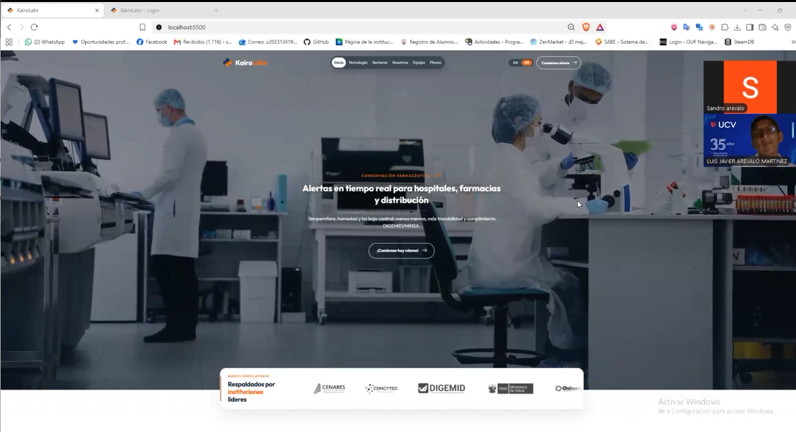 

### 6.3.3. Evaluaciones según heurísticas.

#### UX Heuristics & Principles Evaluation

**Usability – Inclusive Design – Information Architecture**

**CARRERA:** Ingeniería de Software<br>
**CURSO:** Diseño de Experimentos de Ingeniería de Software<br>
**SECCIÓN:** 9082<br>
**PROFESOR:** Juan Fernando Ysen Paiba<br>
**AUDITOR:** Grupo SANUVI<br>
**EQUIPO AUDITADO:** Aether System<br>
**CLIENTE(S):** Segmento 1: personal operativo de almacenes farmacéuticos. Segmento 2: entidades de salud y gestores farmacéuticos.<br>
**SITE O APP A EVALUAR:** KairoLabs — Landing Page, aplicación web e incremento móvil documentado.

#### Alcance y procedimiento

Se reorganiza la auditoría **recibida sobre KairoLabs**, documentada entre el 2 y el 11 de noviembre de 2026. Se utiliza la estructura de evaluación aportada como modelo: identificación, tareas, escala, resumen y descripción de problemas. No se incorporan los hallazgos de la auditoría que Aether System realizó a Ferova ni los del ejemplo InstAlert.

La fuente describe una inspección de la Landing desplegada y de las evidencias de los capítulos IV, V y VI. Esta adaptación documental no constituye una nueva sesión con usuarios ni una nueva comprobación de todos los flujos. Las severidades se mantienen como valoración recibida; los casos que necesitan interacción o evidencia adicional se identifican expresamente. No se afirma que los problemas hayan sido corregidos.

*Nota de identificación.* SANUVI se consigna según la confirmación del equipo receptor. El DOCX recibido emplea otra denominación para el auditor; esa discrepancia de identificación no se utiliza para inventar participantes o atribuirles nuevas pruebas.

**TAREAS A EVALUAR:**

1. Identificar el producto, su alcance y la información de confianza presentada en la Landing.
2. Comparar planes, precios y beneficios entre Landing y aplicación.
3. Registrarse como gestor o personal operativo y comprender el código de entidad.
4. Iniciar sesión y localizar mecanismos para recuperar el acceso.
5. Interpretar lecturas, estados y alertas del monitoreo.
6. Consultar operadores, dispositivos y transportes, e identificar las acciones de eliminación.
7. Navegar hacia contacto, registro y canales sociales desde la Landing.
8. Reconocer qué tareas de monitoreo admite el incremento móvil evaluado.

**No están incluidas en esta versión de la evaluación:**

1. La ejecución de una nueva prueba de eliminación o de recuperación de contraseña.
2. El procesamiento efectivo de pagos y la verificación de un cobro.
3. Una certificación de accesibilidad o pruebas completas con tecnologías de asistencia.
4. La exactitud de sensores físicos, la validación clínica o una auditoría criptográfica.
5. La comprobación de convenios institucionales o de resultados comerciales sin sus documentos de respaldo.
6. La generalización a versiones posteriores, a todas las cuentas o a una aplicación móvil distinta de la documentada.

#### Escala de severidad

| Nivel | Descripción |
| :--- | :--- |
| 0 | No se identifica un problema; no requiere corrección por este motivo. |
| 1 | Problema superficial o cosmético. Produce una dificultad mínima; puede corregirse según disponibilidad. |
| 2 | Problema menor. Genera confusión o esfuerzo adicional, pero permite continuar; debe programarse su mejora. |
| 3 | Problema mayor. Dificulta una tarea relevante o crea expectativas erróneas; requiere atención prioritaria. |
| 4 | Problema muy grave. Impide una tarea esencial; requiere corrección antes del lanzamiento. |

La fuente usa la escala 0–4. Se registran siete hallazgos con nivel 3, cuatro con nivel 2 y uno con nivel 1; no se documentan hallazgos de nivel 4. Estos niveles no equivalen a una medición experimental de impacto.

#### Tabla resumen

| # | Problema | Severidad recibida | Heurística o principio afectado |
| :--- | :--- | :--- | :--- |
| 1 | Acciones de eliminación sin confirmación documentada. | 3 — confirmación pendiente | Usability — H5: prevención de errores; H6: reconocimiento antes que recuerdo. |
| 2 | Planes y precios inconsistentes entre productos. | 3 | Usability — H4: consistencia y estándares. Information Architecture — claridad del catálogo. |
| 3 | Presentación ambigua de respaldo institucional. | 3 | Usability — H2: correspondencia con el mundo real. Information Architecture — credibilidad del contenido. |
| 4 | Desajuste entre el alcance móvil anunciado y el incremento evaluado. | 3 | Usability — H4: consistencia y estándares. Information Architecture — utilidad para la tarea. |
| 5 | Código de entidad sin ayuda contextual. | 3 | Usability — H10: ayuda y documentación; H6: reconocimiento antes que recuerdo. |
| 6 | Recuperación de contraseña no visible en el acceso. | 3 | Usability — H3: control y libertad; H9: reconocimiento, diagnóstico y recuperación de errores. |
| 7 | Etiqueta del registro poco explícita. | 2 | Usability — H2: correspondencia con el mundo real; H1: visibilidad del estado. |
| 8 | Interpretación del estado dependiente del color. | 2 | Usability — H1: visibilidad del estado. Inclusive Design — información perceptible por vías equivalentes. |
| 9 | Densidad del inicio y notificación superpuesta. | 1 | Usability — H8: diseño estético y minimalista. |
| 10 | Destinos de navegación no corroborados en la Landing. | 3 — destino por validar | Usability — H3: control y libertad; H4: consistencia. Information Architecture — encontrabilidad y navegación. |
| 11 | Perfiles provisionales en la presentación del equipo. | 2 | Usability — H2: correspondencia con el mundo real; H4: consistencia. |
| 12 | Métricas y afirmaciones técnicas sin sustento adjunto. | 2 | Usability — H2: correspondencia con el mundo real. Information Architecture — credibilidad y transparencia. |

#### Descripción de problemas

##### PROBLEMA #1: Acciones de eliminación sin confirmación documentada

**Severidad:** 3 — Problema mayor.

**Heurística o principio afectado:** Usability — H5: prevención de errores; H6: reconocimiento antes que recuerdo.

**Problema:**

La auditoría señala botones de eliminación en diálogos de operadores y transportes, e iconos de eliminación en el listado de dispositivos. Las capturas muestran la acción, pero no acreditan qué sucede después de activarla. Por ello, la ausencia de confirmación debe corroborarse con el recorrido antes de atribuir una eliminación inmediata.

**Evidencia:**

<p align="center">
  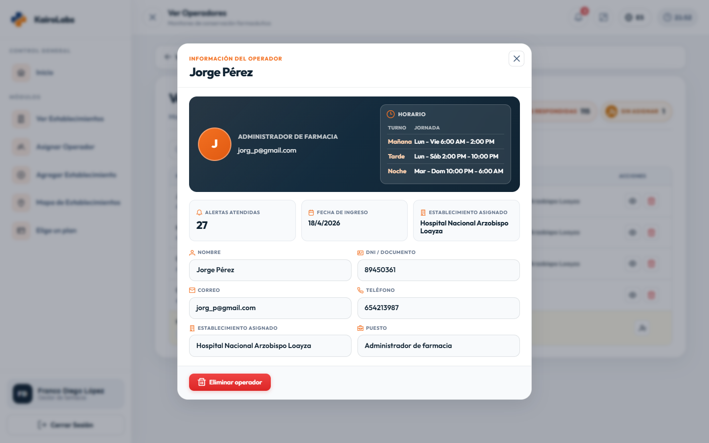
</p>

*Nota.* Evidencia 1.1. Captura preexistente del capítulo V, utilizada como referencia visual de la inspección recibida. No corresponde a una captura nueva del auditor ni demuestra por sí sola el recorrido posterior a la pantalla.

<p align="center">
  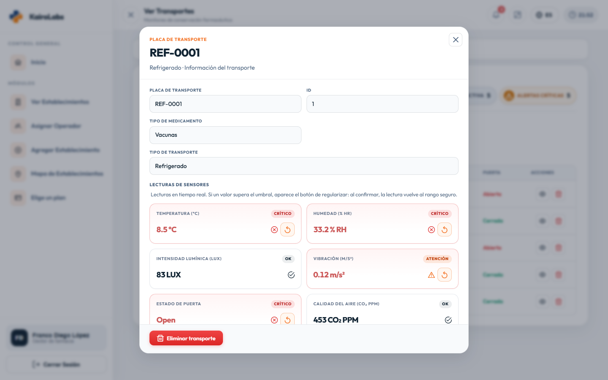
</p>

*Nota.* Evidencia 1.2. Captura preexistente del capítulo V, utilizada como referencia visual de la inspección recibida. No corresponde a una captura nueva del auditor ni demuestra por sí sola el recorrido posterior a la pantalla.

**Recomendación:**

Si no existe protección efectiva, añadir una confirmación que identifique el registro y sus consecuencias, separar la acción de las consultas frecuentes y ofrecer cancelación antes de ejecutar.

**Estado y criterio de verificación:**

Pendiente de corroborar el paso posterior al clic y la posibilidad de cancelar.

##### PROBLEMA #2: Planes y precios inconsistentes entre productos

**Severidad:** 3 — Problema mayor.

**Heurística o principio afectado:** Usability — H4: consistencia y estándares. Information Architecture — claridad del catálogo.

**Problema:**

La fuente recibida compara Premium como «Personalizado» en la Landing con US$ 149/mes en la aplicación, igual que Profesional. También identifica cinco planes en la Landing y tres en la app. Esta diferencia dificulta reconocer qué oferta puede contratarse; las capturas no demuestran que se haya realizado un cobro incorrecto.

**Evidencia:**

<p align="center">
  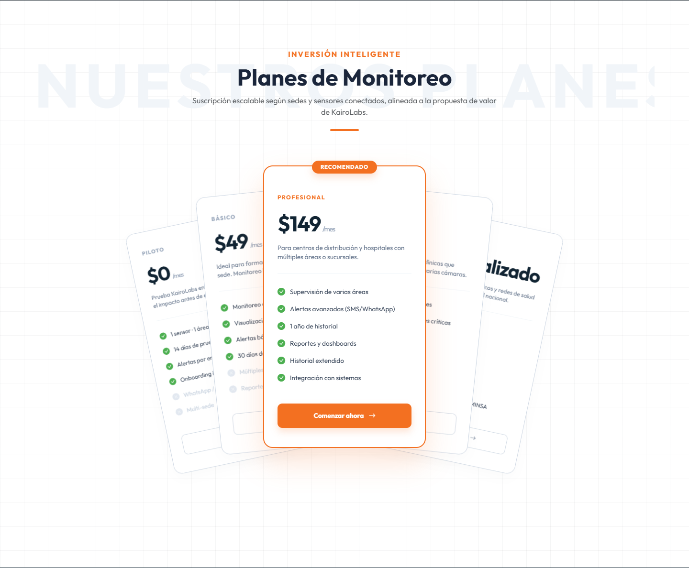
</p>

*Nota.* Evidencia 2.1. Captura preexistente del capítulo V, utilizada como referencia visual de la inspección recibida. No corresponde a una captura nueva del auditor ni demuestra por sí sola el recorrido posterior a la pantalla.

<p align="center">
  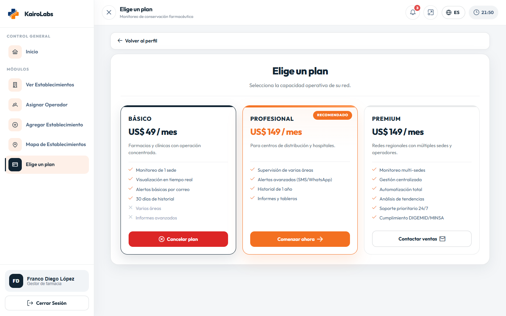
</p>

*Nota.* Evidencia 2.2. Captura preexistente del capítulo V, utilizada como referencia visual de la inspección recibida. No corresponde a una captura nueva del auditor ni demuestra por sí sola el recorrido posterior a la pantalla.

**Recomendación:**

Centralizar el catálogo de planes, precios, periodicidad y beneficios; mostrar la misma oferta en ambas plataformas o explicar expresamente cuáles son propuestas aún no disponibles.

**Estado y criterio de verificación:**

Comparar el mismo catálogo y moneda en ambas plataformas antes de dar el hallazgo por corregido.

##### PROBLEMA #3: Presentación ambigua de respaldo institucional

**Severidad:** 3 — Problema mayor.

**Heurística o principio afectado:** Usability — H2: correspondencia con el mundo real. Information Architecture — credibilidad del contenido.

**Problema:**

La franja «Respaldados por instituciones líderes» utiliza logotipos institucionales, mientras que la sección Nosotros describe un proyecto académico. Puede interpretarse como un aval o convenio. La documentación recibida no aporta una autorización; tampoco permite afirmar que nunca haya existido alguna.

**Evidencia:**

<p align="center">
  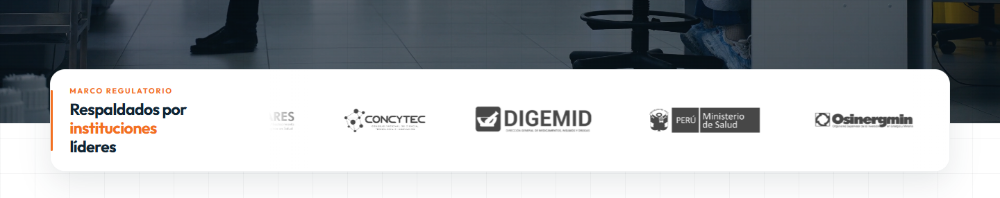
</p>

*Nota.* Evidencia 3.1. Captura preexistente del capítulo V, utilizada como referencia visual de la inspección recibida. No corresponde a una captura nueva del auditor ni demuestra por sí sola el recorrido posterior a la pantalla.

<p align="center">
  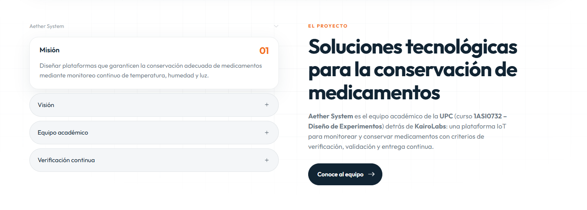
</p>

*Nota.* Evidencia 3.2. Captura preexistente del capítulo V, utilizada como referencia visual de la inspección recibida. No corresponde a una captura nueva del auditor ni demuestra por sí sola el recorrido posterior a la pantalla.

**Recomendación:**

Verificar documentalmente cualquier convenio. Si solo se emplean normas o referencias institucionales, sustituir la frase por «Marco normativo de referencia» y aclarar que no implica respaldo oficial.

**Estado y criterio de verificación:**

Pendiente de aclaración institucional y revisión del texto publicado.

##### PROBLEMA #4: Desajuste entre el alcance móvil anunciado y el incremento evaluado

**Severidad:** 3 — Problema mayor.

**Heurística o principio afectado:** Usability — H4: consistencia y estándares. Information Architecture — utilidad para la tarea.

**Problema:**

El informe y la Landing anuncian monitoreo web y móvil; la auditoría describe el incremento móvil inspeccionado como informativo y con redirección a la web. No acredita consulta nativa de dispositivos y alertas. Este hallazgo corresponde a la versión documentada; no demuestra que todas las versiones futuras carezcan de esas funciones.

**Evidencia:**

<p align="center">
  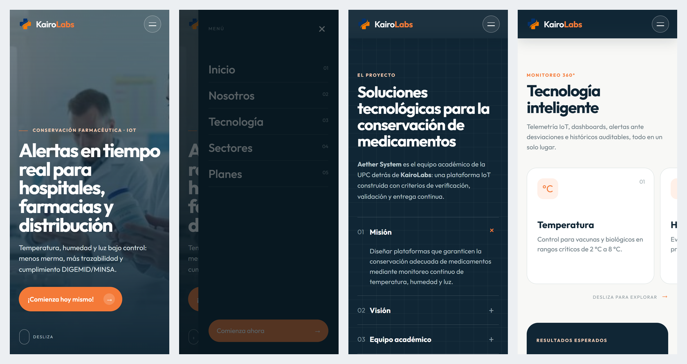
</p>

*Nota.* Evidencia 4.1. Captura preexistente del capítulo V, utilizada como referencia visual de la inspección recibida. No corresponde a una captura nueva del auditor ni demuestra por sí sola el recorrido posterior a la pantalla.

<p align="center">
  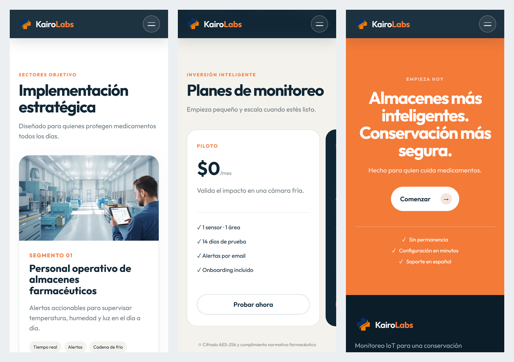
</p>

*Nota.* Evidencia 4.2. Captura preexistente del capítulo V, utilizada como referencia visual de la inspección recibida. No corresponde a una captura nueva del auditor ni demuestra por sí sola el recorrido posterior a la pantalla.

**Recomendación:**

Describir el alcance móvil vigente con precisión. Para el incremento funcional, incorporar acceso autenticado, dispositivos y alertas; validar su funcionamiento en la aplicación móvil correspondiente.

**Estado y criterio de verificación:**

Las pruebas responsive de la web no sustituyen la verificación de una aplicación móvil nativa.

##### PROBLEMA #5: Código de entidad sin ayuda contextual

**Severidad:** 3 — Problema mayor.

**Heurística o principio afectado:** Usability — H10: ayuda y documentación; H6: reconocimiento antes que recuerdo.

**Problema:**

El registro del personal de almacén solicita un código de entidad sin explicar quién lo proporciona. La auditoría lo relaciona con la duda recogida en una entrevista del Segmento 1; la inspección y la entrevista son evidencias distintas y no se cuentan como participantes adicionales.

**Evidencia:**

<p align="center">
  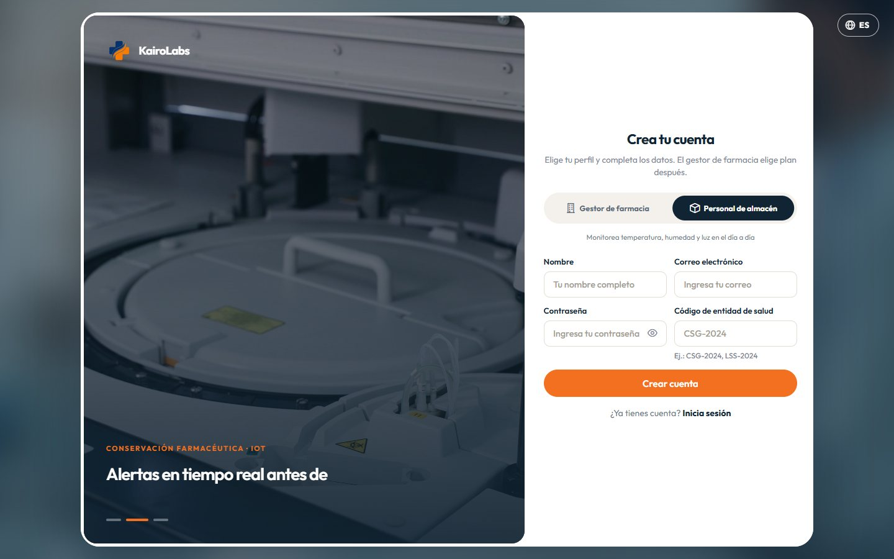
</p>

*Nota.* Evidencia 5.1. Captura preexistente del capítulo V, utilizada como referencia visual de la inspección recibida. No corresponde a una captura nueva del auditor ni demuestra por sí sola el recorrido posterior a la pantalla.

**Recomendación:**

Añadir junto al campo «Solicita este código al administrador de tu entidad» y mensajes que distingan código vacío, inválido o no disponible.

**Estado y criterio de verificación:**

Comprobar que una persona del segmento identifica cómo obtener el código sin ayuda del evaluador.

##### PROBLEMA #6: Recuperación de contraseña no visible en el acceso

**Severidad:** 3 — Problema mayor.

**Heurística o principio afectado:** Usability — H3: control y libertad; H9: reconocimiento, diagnóstico y recuperación de errores.

**Problema:**

En la pantalla de acceso documentada se observan correo, contraseña, inicio de sesión y creación de cuenta, pero no una opción visible para recuperar el acceso. Esto describe la interfaz inspeccionada; no confirma por sí solo la inexistencia de cualquier procedimiento administrativo externo.

**Evidencia:**

<p align="center">
  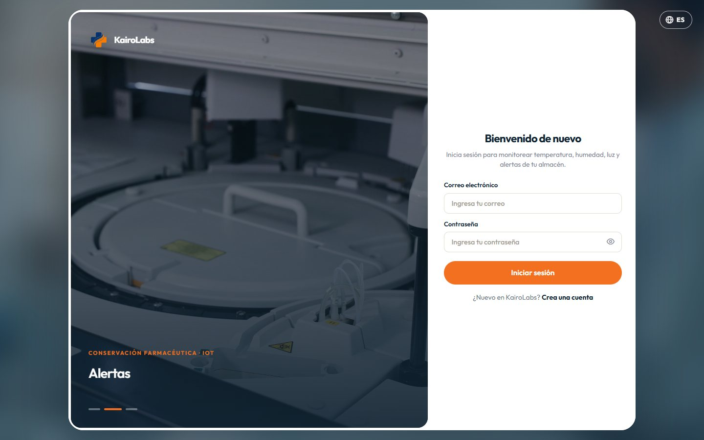
</p>

*Nota.* Evidencia 6.1. Captura preexistente del capítulo V, utilizada como referencia visual de la inspección recibida. No corresponde a una captura nueva del auditor ni demuestra por sí sola el recorrido posterior a la pantalla.

**Recomendación:**

Incorporar «¿Olvidaste tu contraseña?» y un flujo de restablecimiento con expiración y validación del enlace, sin revelar si un correo pertenece a una cuenta.

**Estado y criterio de verificación:**

Validar solicitud, recepción, enlace expirado y nuevo acceso; no se declara ese flujo implementado en esta evaluación.

##### PROBLEMA #7: Etiqueta del registro poco explícita

**Severidad:** 2 — Problema menor.

**Heurística o principio afectado:** Usability — H2: correspondencia con el mundo real; H1: visibilidad del estado.

**Problema:**

El formulario «Crea tu cuenta» presenta «Ver planes» como acción principal. La etiqueta no explica si los datos quedan guardados o si solo se navega hacia otra pantalla, generando incertidumbre sobre el avance del registro.

**Evidencia:**

<p align="center">
  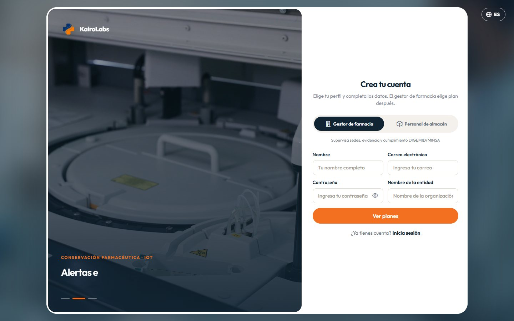
</p>

*Nota.* Evidencia 7.1. Captura preexistente del capítulo V, utilizada como referencia visual de la inspección recibida. No corresponde a una captura nueva del auditor ni demuestra por sí sola el recorrido posterior a la pantalla.

**Recomendación:**

Utilizar «Continuar» o «Crear cuenta y elegir plan», según lo que realmente haga la acción, e indicar los pasos restantes y el momento de confirmación.

**Estado y criterio de verificación:**

Corroborar el comportamiento real del botón para que la nueva etiqueta no prometa una creación que aún no ocurre.

##### PROBLEMA #8: Interpretación del estado dependiente del color

**Severidad:** 2 — Problema menor.

**Heurística o principio afectado:** Usability — H1: visibilidad del estado. Inclusive Design — información perceptible por vías equivalentes.

**Problema:**

La auditoría describe temperaturas destacadas en rojo o naranja en el listado, sin una etiqueta junto al valor. Esa presentación puede dificultar distinguir estados con daltonismo o bajo brillo. La conclusión se limita al listado documentado: el detalle y el Centro de Control sí emplean indicadores adicionales.

**Evidencia:**

<p align="center">
  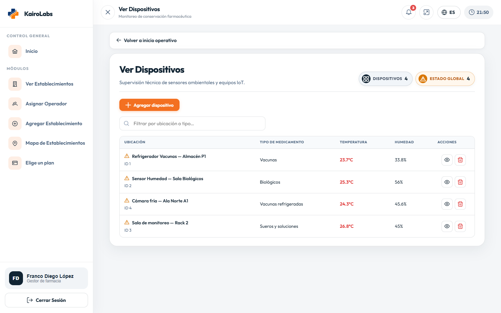
</p>

*Nota.* Evidencia 8.1. Captura preexistente del capítulo V, utilizada como referencia visual de la inspección recibida. No corresponde a una captura nueva del auditor ni demuestra por sí sola el recorrido posterior a la pantalla.

**Recomendación:**

Acompañar el color con «OK», «Atención» o «Crítico», iconos distinguibles y una leyenda accesible. Mantener unidades y criterios de clasificación comprensibles.

**Estado y criterio de verificación:**

Revisar el listado sin depender del color; no se afirma cumplimiento o incumplimiento WCAG completo.

##### PROBLEMA #9: Densidad del inicio y notificación superpuesta

**Severidad:** 1 — Problema superficial.

**Heurística o principio afectado:** Usability — H8: diseño estético y minimalista.

**Problema:**

La pantalla de inicio concentra accesos, KPIs y paneles de sensores. Según la captura citada en la auditoría, el aviso de bienvenida se superpone a una tarjeta. Es una interferencia visual documentada, sin medición de tiempos o errores de usuarios.

**Evidencia:**

<p align="center">
  
</p>

*Nota.* Evidencia 9.1. Captura preexistente del capítulo V, utilizada como referencia visual de la inspección recibida. No corresponde a una captura nueva del auditor ni demuestra por sí sola el recorrido posterior a la pantalla.

**Recomendación:**

Priorizar alertas críticas, agrupar información secundaria y situar la notificación donde no cubra datos o acciones, manteniendo un cierre accesible.

**Estado y criterio de verificación:**

Verificar la superposición y legibilidad en los tamaños objetivo, incluyendo estados con alertas críticas.

##### PROBLEMA #10: Destinos de navegación no corroborados en la Landing

**Severidad:** 3 — Problema mayor.

**Heurística o principio afectado:** Usability — H3: control y libertad; H4: consistencia. Information Architecture — encontrabilidad y navegación.

**Problema:**

La auditoría informa botones dirigidos a #contacto sin encontrar un destino equivalente en el contenido inspeccionado y redes sociales enlazadas a #. Es un resultado comunicado por el auditor; las capturas por sí solas no permiten confirmar los href ni su funcionamiento actual.

**Evidencia:**

<p align="center">
  
</p>

*Nota.* Evidencia 10.1. Captura preexistente del capítulo V, utilizada como referencia visual de la inspección recibida. No corresponde a una captura nueva del auditor ni demuestra por sí sola el recorrido posterior a la pantalla.

<p align="center">
  
</p>

*Nota.* Evidencia 10.2. Captura preexistente del capítulo V, utilizada como referencia visual de la inspección recibida. No corresponde a una captura nueva del auditor ni demuestra por sí sola el recorrido posterior a la pantalla.

**Recomendación:**

Validar cada destino en la misma versión: crear una sección de contacto real o dirigir al registro con el plan seleccionado. Enlazar perfiles sociales auténticos o retirar los iconos que no tengan destino.

**Estado y criterio de verificación:**

Pendiente de reproducir la navegación en el sitio y registrar URL, fecha y resultado de cada enlace.

##### PROBLEMA #11: Perfiles provisionales en la presentación del equipo

**Severidad:** 2 — Problema menor.

**Heurística o principio afectado:** Usability — H2: correspondencia con el mundo real; H4: consistencia.

**Problema:**

La fuente identifica tres nombres y dos tarjetas «Integrante por confirmar / Perfil en incorporación», mientras que el equipo del informe está compuesto por cinco integrantes. El uso de iniciales en lugar de una foto no constituye, por sí solo, un defecto: el problema es la información provisional o incompleta.

**Evidencia:**

<p align="center">
  
</p>

*Nota.* Evidencia 11.1. Captura preexistente del capítulo V, utilizada como referencia visual de la inspección recibida. No corresponde a una captura nueva del auditor ni demuestra por sí sola el recorrido posterior a la pantalla.

**Recomendación:**

Completar los cinco perfiles con información confirmada; utilizar iniciales coherentes cuando no se disponga de fotografía y eliminar los mensajes de incorporación si ya no representan el estado real.

**Estado y criterio de verificación:**

Comparar los perfiles publicados con los integrantes confirmados, sin inventar fotografías o identidades.

##### PROBLEMA #12: Métricas y afirmaciones técnicas sin sustento adjunto

**Severidad:** 2 — Problema menor.

**Heurística o principio afectado:** Usability — H2: correspondencia con el mundo real. Information Architecture — credibilidad y transparencia.

**Problema:**

La auditoría cita respuesta en menos de cinco minutos, +30 % de trazabilidad en seis meses, 100 % de históricos auditables y cifrado AES-256. El material recibido no adjunta mediciones ni comprobación técnica de esas afirmaciones. Esto no prueba que no exista cifrado: cuestiona su justificación visible y el uso de metas como si fueran resultados.

**Evidencia:**

<p align="center">
  
</p>

*Nota.* Evidencia 12.1. Captura preexistente del capítulo V, utilizada como referencia visual de la inspección recibida. No corresponde a una captura nueva del auditor ni demuestra por sí sola el recorrido posterior a la pantalla.

<p align="center">
  
</p>

*Nota.* Evidencia 12.2. Captura preexistente del capítulo V, utilizada como referencia visual de la inspección recibida. No corresponde a una captura nueva del auditor ni demuestra por sí sola el recorrido posterior a la pantalla.

**Recomendación:**

Distinguir objetivos de resultados medidos e indicar población, periodo, método y fuente. Publicar afirmaciones técnicas solo cuando estén respaldadas por evidencia verificable de la implementación.

**Estado y criterio de verificación:**

Pendiente de vincular cada afirmación con una medición o revisión técnica; no se ejecutaron ensayos de criptografía en esta inspección.

#### Fortalezas y seguimiento

La auditoría también reconoce la coherencia visual azul marino/naranja, el selector ES/EN y los indicadores de estado del Centro de Control y del detalle de sensores. Estas fortalezas no eliminan las limitaciones específicas del listado u otros flujos.

Los doce hallazgos quedan abiertos para su revisión. El equipo debe registrar responsable, versión, corrección y evidencia de revalidación antes de declararlos resueltos. Las observaciones basadas en enlaces o pasos no visibles deben confirmarse o descartarse mediante el recorrido correspondiente, manteniendo separadas las pruebas funcionales del capítulo VI de esta inspección heurística.

#### Fuentes y referencia conceptual

- Auditoría recibida sobre KairoLabs, archivo proporcionado por el equipo: *Auditoria al grupo.docx*, periodo consignado 2–11 de noviembre de 2026. [Trazabilidad documental e imágenes](../assets/chapter-6/heuristicas/provenance.json).
- Nielsen Norman Group. *10 Usability Heuristics for User Interface Design*. https://www.nngroup.com/articles/ten-usability-heuristics/

## 6.4. Auditoría de Experiencias de Usuario

### 6.4.2. Auditoría recibida

Esta sección documenta la auditoría recibida sobre **KairoLabs**, producto de **Aether System**, y organiza su cronograma, contenido y seguimiento. Se utiliza exclusivamente la evaluación recibida de nuestro software, sin incorporar los hallazgos de la auditoría realizada a Ferova. La descripción detallada de los doce problemas, sus capturas y sus recomendaciones se presenta en [6.3.3. Evaluaciones según heurísticas](#633-evaluaciones-según-heurísticas).

#### 6.4.2.1. Información del grupo auditor

| Campo | Detalle |
| :--- | :--- |
| Grupo auditor | SANUVI, según la identificación confirmada por el equipo receptor. |
| Grupo auditado | Aether System. |
| Producto auditado | KairoLabs: Landing Page, aplicación web e incremento móvil documentado. |
| Carrera | Ingeniería de Software. |
| Curso | Diseño de Experimentos de Ingeniería de Software. |
| Sección | 9082. |
| Docente | Juan Fernando Ysen Paiba. |
| Documento de referencia | Auditoría recibida, archivo *Auditoria al grupo.docx*. |

*Nota.* La diferencia de denominación del auditor que presenta el archivo fuente se aclara en 6.3.3. Los integrantes individuales del equipo auditor y sus firmas no se inventan.

#### 6.4.2.2. Cronograma de auditoría recibida

La fuente recibida consigna un periodo de evaluación del **2 al 11 de noviembre de 2026**. Para organizar la entrega se adopta el **12 de noviembre de 2026** como fecha referencial de consolidación y priorización del informe, previa a la fecha de esta actualización. Esa última fecha es una referencia de planificación documental; no constituye un acta de reunión ni acredita ejecución de correcciones del software.

| Fase | Periodo | Actividad | Producto o registro |
| :--- | :--- | :--- | :--- |
| 1. Inspección de la Landing Page | 02/11/2026–04/11/2026 | Revisión de propuesta de valor, mensajes de confianza, catálogo de planes, selector de idioma, equipo y navegación. | Observaciones de contenido, consistencia y destinos de la Landing. |
| 2. Inspección del acceso y registro | 05/11/2026–07/11/2026 | Revisión de acceso, registro por perfil, código de entidad y pantalla de inicio con Centro de Control. | Observaciones de ayuda contextual, recuperación del acceso, etiquetas y organización del inicio. |
| 3. Inspección de módulos operativos | 08/11/2026–09/11/2026 | Revisión de establecimientos, operadores, dispositivos, transportes y selección de plan. | Observaciones sobre acciones de eliminación, estados de sensores y catálogo de suscripción. |
| 4. Revisión móvil y cierre de evaluación | 10/11/2026–11/11/2026 | Inspección del incremento móvil, consolidación de hallazgos, valoración de severidad y recomendaciones. | Documento recibido con doce hallazgos y fortalezas observadas. |
| 5. Consolidación documental y priorización | 12/11/2026, fecha referencial | Organización de los hallazgos en la estructura del informe y definición de acciones y criterios de cierre. | Matriz de seguimiento de 6.4.2.4; la fecha no acredita cambios ya implementados. |

*Nota.* Las fases 1–4 proceden del cronograma del documento recibido. La fase 5 es una referencia organizativa adoptada para esta entrega. La fuente no aporta duración por sesión, registro de asistencia ni actas; por ello no se asignan horas o participantes adicionales.

#### 6.4.2.3. Contenido de auditoría recibida

**Objetivo y alcance**

La evaluación examinó si la interfaz y la información de KairoLabs facilitan las tareas de los dos segmentos objetivo: personal operativo de almacenes farmacéuticos y entidades de salud o gestores farmacéuticos. Se revisaron la Landing desplegada y las capturas y descripciones de las aplicaciones incluidas en los capítulos IV, V y VI.

El procedimiento corresponde a una inspección heurística, no a una prueba experimental con una muestra nueva de usuarios. Se emplearon las heurísticas de Nielsen y criterios complementarios de diseño inclusivo y arquitectura de información. Las observaciones permiten priorizar mejoras, pero no prueban por sí solas una causa técnica ni el comportamiento de todos los recorridos.

**Fortalezas identificadas**

- **Coherencia visual:** uso consistente de azul marino y naranja, jerarquía y acciones primarias reconocibles entre Landing, acceso y aplicación web.
- **Adaptación y opciones de idioma:** presencia de selector ES/EN y una presentación de la Landing adaptada a una vista de smartphone. Esto no equivale a una certificación completa de accesibilidad.
- **Visibilidad del monitoreo:** estados e indicadores en el Centro de Control y en el detalle de lecturas que ayudan a reconocer condiciones OK, Atención y Crítico. La observación sobre dependencia del color se limita al listado documentado.

**Hallazgos recibidos y prioridad**

Los identificadores AR-01 a AR-12 corresponden, en el mismo orden, a los problemas #1 a #12 de 6.3.3. Se conserva la severidad recibida y se distingue lo observado de aquello que necesita un recorrido de confirmación.

| ID | Área | Hallazgo | Severidad | Alcance de la evidencia |
| :--- | :--- | :--- | :--- | :--- |
| AR-01 | Operadores, dispositivos y transportes | Acciones de eliminación sin confirmación documentada. | 3 | Se ven las acciones; debe comprobarse el paso posterior al clic. |
| AR-02 | Planes de suscripción | Diferencias de catálogo y precio entre Landing y aplicación. | 3 | Comparación documental de las ofertas; no demuestra un cobro incorrecto. |
| AR-03 | Confianza institucional | Mensaje de respaldo que puede interpretarse como aval oficial. | 3 | Mensajes y logotipos visibles; falta documentación institucional para confirmar el alcance. |
| AR-04 | Incremento móvil | Alcance informativo distinto del monitoreo móvil anunciado. | 3 | Versión descrita y capturada; no se generaliza a otros incrementos ni a una app nativa posterior. |
| AR-05 | Registro operativo | Código de entidad sin explicación de cómo obtenerlo. | 3 | Pantalla de registro; la duda de entrevista se conserva como evidencia de otra actividad. |
| AR-06 | Acceso | Recuperación de contraseña no visible. | 3 | Interfaz de acceso documentada; no descarta procedimientos administrativos externos. |
| AR-07 | Registro de entidad | Botón «Ver planes» poco explícito sobre el avance del registro. | 2 | Texto visible; debe contrastarse con la acción efectiva. |
| AR-08 | Listado de dispositivos | Interpretación de estados dependiente del color. | 2 | Presentación del listado; no implica que todas las pantallas carezcan de etiquetas. |
| AR-09 | Inicio | Alta densidad informativa y aviso de bienvenida superpuesto. | 1 | Captura estática; no se midieron errores o tiempos de usuarios. |
| AR-10 | Navegación de la Landing | Destinos de contacto y redes sociales no corroborados. | 3 | Comprobación comunicada por el auditor; pendiente de reproducir enlaces en la misma versión. |
| AR-11 | Equipo | Información provisional o incompleta sobre integrantes. | 2 | Contenido publicado frente a la composición del equipo; las iniciales por sí solas no son un defecto. |
| AR-12 | Contenido y afirmaciones técnicas | Métricas, resultados esperados y cifrado sin sustento adjunto. | 2 | Falta de respaldo en el material recibido; no prueba ausencia de cifrado ni resultados negativos. |

*Nota.* La distribución es de **7 hallazgos de severidad 3, 4 de severidad 2 y 1 de severidad 1**. No se registraron hallazgos de severidad 4. La valoración expresa impacto estimado, no una medición experimental de frecuencia o gravedad.

**Evidencias y límites**

Las capturas asociadas a cada caso se encuentran en 6.3.3 y en [la carpeta de evidencias heurísticas](../assets/chapter-6/heuristicas/). Son imágenes preexistentes del capítulo V utilizadas como apoyo visual; el DOCX recibido no contiene imágenes incrustadas. Su [registro de procedencia](../assets/chapter-6/heuristicas/provenance.json) identifica el documento y el commit de origen de las capturas.

La auditoría no acredita pruebas completas de teclado, lectores de pantalla, procesamiento de pagos, sensores físicos, recuperación de contraseña, autorización entre entidades o criptografía. Los hallazgos que dependen de navegación, interacción o documentos institucionales deberán confirmarse antes de cerrar una causa o implementar una solución definitiva.

#### 6.4.2.4. Resumen de modificaciones para subsanar hallazgos

**Modificaciones documentales efectuadas**

Se amplió 6.3.3 con la ficha académica, el alcance, las tareas, la escala de severidad, una tabla resumen y doce descripciones con evidencia, recomendación y criterio de verificación. Se aclararon los casos que requieren confirmación y se registró la procedencia de las imágenes. Esta mejora documental está incorporada al informe; no significa que las funcionalidades de la aplicación hayan sido corregidas.

**Modificaciones de software propuestas y condiciones de cierre**

La matriz siguiente constituye el plan de subsanación. Se propone atender primero los casos de severidad 3 y después los de nivel 2 y 1, considerando el costo y los riesgos de cada cambio. Los responsables se expresan como roles sugeridos: no se atribuyen aprobaciones ni actividades a integrantes concretos sin un registro de asignación.

| ID | Modificación propuesta | Rol responsable sugerido | Evidencia necesaria para cerrar | Estado |
| :--- | :--- | :--- | :--- | :--- |
| AR-01 | Confirmar el comportamiento de eliminación; si falta protección, incorporar confirmación identificando el registro y opción de cancelar. | Frontend y QA. | Recorrido donde cancelar no elimina y confirmar elimina solo el registro elegido; comprobación de persistencia. | Pendiente de corroboración e implementación si corresponde. |
| AR-02 | Unificar catálogo, precios, periodicidad y beneficios entre Landing y aplicación. | Frontend y responsable del producto. | Comparación de ambas vistas con el mismo catálogo y prueba de que el plan seleccionado se conserva durante el registro. | Propuesto; sin cierre verificado. |
| AR-03 | Verificar el alcance del respaldo; reformular el texto como referencia normativa si no existe aval acreditado. | Contenido y responsable del producto. | Texto publicado y documento de respaldo, o aclaración explícita que evite atribuir un aval inexistente. | Pendiente de aclaración y ajuste. |
| AR-04 | Precisar el alcance móvil vigente y planificar acceso, dispositivos y alertas en el producto móvil correspondiente. | Equipo móvil y producto. | Descripción coherente y recorridos de las funcionalidades que se anuncien como disponibles. | Propuesto; no se acredita implementación nativa. |
| AR-05 | Añadir ayuda junto al código de entidad y mensajes para sus estados de validación. | Frontend y UX. | Captura actualizada y prueba de comprensión con el segmento objetivo, sin ayuda del evaluador. | Propuesto; sin revalidación. |
| AR-06 | Incorporar acceso visible a recuperación de contraseña y un mecanismo seguro de restablecimiento. | Frontend, backend y QA. | Solicitud, enlace válido, enlace vencido y posterior acceso; protección frente a enumeración de cuentas. | Propuesto; no se declara un flujo funcional. |
| AR-07 | Ajustar la etiqueta del botón y explicar los pasos y el momento de creación de la cuenta. | Frontend y UX. | Recorrido del registro que coincida con el texto del botón y conserve los datos al avanzar. | Pendiente de confirmar la acción actual y modificarla. |
| AR-08 | Complementar los colores con etiquetas, iconos y una leyenda comprensible. | Frontend y UX. | Listado actualizado y verificación de identificación del estado sin depender del color. | Propuesto; sin comprobación de accesibilidad. |
| AR-09 | Reubicar la bienvenida y priorizar los elementos de monitoreo importantes. | Frontend y UX. | Capturas y recorrido en los tamaños objetivo, sin superposición sobre información o acciones. | Propuesto; sin medición posterior. |
| AR-10 | Revisar cada destino y reparar contacto, registro por plan y redes sociales que no conduzcan a contenido real. | Landing Page y QA. | Matriz de enlaces con URL, versión, fecha, resultado esperado y resultado observado. | Pendiente de reproducción y corrección de los destinos afectados. |
| AR-11 | Completar los perfiles con información confirmada y retirar mensajes provisionales que ya no correspondan. | Contenido y coordinación del equipo. | Comparación del sitio con la lista confirmada de cinco integrantes; revisión de cada tarjeta. | Propuesto; sin atribuir cambios de la Landing a ajustes del repositorio del informe. |
| AR-12 | Separar metas de resultados y vincular afirmaciones técnicas con sus fuentes o verificaciones. | Producto, contenido y responsable técnico. | Fuente, método, periodo y alcance de cada afirmación; evidencia técnica para las propiedades de seguridad anunciadas. | Pendiente de sustento o reformulación. |

*Nota.* «Propuesto» y «pendiente» indican que esta sección no adjunta un commit funcional ni una prueba posterior que acredite el cierre. La fecha referencial del 12/11/2026 no convierte estas acciones en trabajos ya ejecutados.

**Procedimiento de revalidación**

1. Confirmar el hallazgo en una versión identificada y descartar los casos que no se reproduzcan.
2. Registrar responsable, requisito de aceptación y commit del cambio.
3. Repetir la tarea afectada y las pruebas de regresión pertinentes, incluyendo escritorio y móvil cuando aplique.
4. Guardar evidencia antes/después, resultado esperado, resultado observado y versión evaluada.
5. Solicitar revisión del equipo y actualizar el estado a «Corregido y revalidado» únicamente cuando exista evidencia suficiente; conservar los casos abiertos y sus motivos.

El cierre de estos hallazgos debe basarse en resultados verificables. La aprobación de las suites unitarias, de integración o BDD existentes no sustituye automáticamente la revalidación de cada observación de experiencia de usuario.

**Referencias**

American Psychological Association. (2021). *Figure setup*. https://apastyle.apa.org/style-grammar-guidelines/tables-figures/figures

Aether System. (2026). *KairoLabs-Frontend* [Código fuente; commit base 0d2c76f8fb20405e6ea271dfe505222cc7cc1aa2]. GitHub. https://github.com/1ASI0732-2620-9082-Aether-System/KairoLabs-Frontend/tree/0d2c76f8fb20405e6ea271dfe505222cc7cc1aa2

MediTrackSensor. (2026). *medi-track-sensor-platform* [Código fuente; commit base c6c0bc7cfe03014f0ec311d8fb6c6a3ae8dddb03]. GitHub. https://github.com/1ASI0730-2610-12258-TBL-MediTrackSensor/medi-track-sensor-platform/tree/c6c0bc7cfe03014f0ec311d8fb6c6a3ae8dddb03
