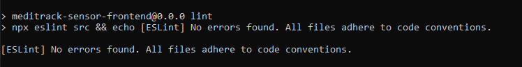
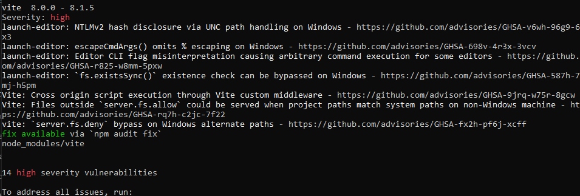

# Part II: Verification, Validation & Pipeline

# Capítulo VI: Product Verification & Validation

Este capítulo presenta la estrategia de verificación y validación de **KairoLabs**, desarrollado por **Aether System** para el curso **1ASI0732 - Diseño de Experimentos de Ingeniería de Software**, ciclo **2026-20**. El objetivo es comprobar que los componentes del producto cumplen los requisitos funcionales y que sus interacciones permiten gestionar establecimientos, operadores, dispositivos, transportes y suscripciones de manera consistente.

La verificación examina la corrección de las entidades, funciones y contratos técnicos; la validación contrasta el comportamiento del producto con las necesidades del personal operativo de almacenes y de los gestores farmacéuticos descritas en los capítulos II y III.

> **Estado del documento, al 30 de octubre de 2026:** se documentan los apartados 6.1, 6.1.1 y 6.1.2. Se incluye evidencia de ejecución de una suite unitaria del frontend. Las pruebas unitarias del backend permanecen pendientes. La suite de integración se implementó y ejecutó contra la API original y MySQL locales: 14 casos, 14 aprobados y 0 fallidos después de corregir CORS y autenticación JWT en la copia local del backend; las correcciones aún no están publicadas. Los apartados 6.1.3, 6.1.4 y 6.2 se conservan como títulos para su desarrollo posterior. No se atribuyen resultados satisfactorios a actividades que todavía no cuentan con evidencia.

---

## 6.1. Testing Suites & Validation

La estrategia de pruebas de KairoLabs prioriza las funcionalidades que sostienen el flujo operativo del producto: identificación del usuario, organización de establecimientos, asignación de operadores, consulta y actualización de variables ambientales, seguimiento de transportes y gestión de suscripciones. Se utilizan casos positivos, negativos y de frontera para detectar tanto errores de lógica como inconsistencias entre los componentes.

La guía del proyecto solicita documentar la creación y ejecución de pruebas sobre entidades principales y comprobar la interacción entre módulos, frontend, backend y APIs. Por ello, la estrategia separa las pruebas unitarias, que trabajan en aislamiento, de las pruebas de integración, que requieren conexiones reales entre componentes. Posteriormente se incorporarán escenarios BDD y pruebas del sistema completo.

**Base técnica y alcance**

El frontend de KairoLabs utiliza Vue 3 y organiza sus funcionalidades en los contextos `iam`, `establishment`, `monitoring`, `logistics`, `subscriptions` y `shared`. Cada contexto distribuye responsabilidades entre dominio, aplicación, infraestructura y presentación.

El backend original de MediTrackSensor constituye la referencia de implementación que se reutilizará en KairoLabs. Está desarrollado en ASP.NET Core 10 y Entity Framework Core, con persistencia MySQL. Sus módulos comparten una aplicación y un `AppDbContext`; en consecuencia, el diseño de pruebas considera una API modular y no presupone microservicios desplegados de manera independiente.

La rama `feature/chapter-5` aporta el contexto de implementación, incluido el uso de MySQL y del despliegue original de la API. La matriz de trazabilidad se basa en las historias de usuario y técnicas del capítulo III.

| Nivel | Objetivo | Componentes de KairoLabs | Estado de este aporte |
| :--- | :--- | :--- | :--- |
| Unitarias | Comprobar lógica de dominio sin HTTP ni base de datos. | `Device`, `Subscription`, `SignInCommand`; entidades del backend como alcance complementario. | Suite inicial del frontend ejecutada; backend pendiente. |
| Integración | Comprobar contratos y colaboración entre componentes reales. | Gateways Axios, API REST, servicios de aplicación, repositorios y MySQL. | Suite revalidada: 14 casos, 14 aprobados y 0 fallidos. |
| BDD | Expresar el comportamiento esperado desde la perspectiva del usuario. | Acceso, asignación de operadores y atención de desviaciones. | Esqueleto en 6.1.3. |
| Sistema | Validar recorridos completos y manejo de fallos. | Aplicación web y versión móvil que se entregue. | Esqueleto en 6.1.4. |

**Priorización y trazabilidad**

| Área funcional | Riesgo que se busca controlar | Historias de referencia | Nivel prioritario |
| :--- | :--- | :--- | :--- |
| Identidad y acceso | Normalización incorrecta de credenciales y respuestas de autenticación inconsistentes. | US48, TS01, TS02. | Unitarias e integración. |
| Establecimientos y operadores | Mezcla de registros entre sedes o asignaciones incorrectas. | US43-US47, TS05, TS06. | Integración. |
| Dispositivos y lecturas | Clasificación incorrecta de valores, pérdida de datos o actualización de un dispositivo ajeno a la sede. | US49-US56, US63, US66, TS07. | Unitarias e integración. |
| Transporte | Actualización incorrecta de variables durante el seguimiento logístico. | US71-US74, TS08. | Integración. |
| Suscripciones | Diferencias entre catálogo, plan enviado y suscripción persistida. | US75-US78, TS09. | Unitarias e integración. |
| Comunicación web-API | Errores de serialización, configuración de URL, CORS o formato de errores. | TS10-TS12. | Integración. |

**Entornos, datos y herramientas**

Las pruebas unitarias iniciales se ejecutan con **Node.js 24.11.1**, `node:test` y `node:assert/strict`. Se importan directamente las clases de dominio del frontend, sin montar componentes Vue ni cargar servicios HTTP. El ejecutor de Node permite comprobar estas funciones sin introducir dependencias adicionales en el proyecto.

Las pruebas de integración se ejecutan con **Node.js**, HTTP y Axios reales sobre **Kestrel + ASP.NET Core 10 + MySQL exclusivo de pruebas**. El orquestador crea una base nueva por ejecución, inicia los servicios y realiza la limpieza al finalizar. Se comprueba la persistencia mediante consultas SQL independientes; no se utiliza un proveedor en memoria. **xUnit** se mantiene como propuesta para ampliar las pruebas unitarias de entidades del backend, todavía pendientes. La implementación ejecutada de integración no utiliza `WebApplicationFactory`.

Los datos deben ser sintéticos y reproducibles: un administrador, un operador, dos establecimientos independientes, un dispositivo y un transporte por establecimiento, y una suscripción de prueba. Los valores ambientales se fijan explícitamente; la simulación aleatoria y sus temporizadores deben desactivarse durante las verificaciones de persistencia.

El modo `VITE_USE_MOCKS=true` resulta útil para ejercicios de interfaz, pero sus resultados no acreditan integración con el backend. Las pruebas web-API requieren `VITE_USE_MOCKS=false` y una configuración de URL dirigida al entorno de pruebas. Dado que los gateways admiten variables específicas por contexto, deben revisarse tanto `VITE_API_BASE_URL` como los posibles valores `VITE_MEDITRACK_SENSOR_*` que la sustituyen.

**Criterios de aceptación y registro**

Un caso se considera aprobado cuando su resultado observado coincide con el esperado y dispone de un registro reproducible. Las pruebas deben identificar el caso, requisito asociado, versión del código, precondiciones, datos, resultado esperado, resultado obtenido y evidencia. Los estados utilizados son **Aprobado**, **Fallido**, **No ejecutado** y **Bloqueado**.

La aprobación de la suite exige que sus casos críticos estén ejecutados y aprobados, y que los defectos asociados se corrijan y vuelvan a comprobar. Una ejecución parcial no permite concluir que todo el producto ha sido validado. Tampoco se interpreta el porcentaje de casos aprobados como porcentaje de cobertura de código.

---

### 6.1.1. Core Entities Unit Tests.

Las pruebas unitarias verifican el comportamiento de entidades, objetos de valor y funciones clave del dominio en aislamiento. En esta primera suite se seleccionaron componentes del frontend que intervienen directamente en la interpretación de las lecturas ambientales, la selección de planes y la preparación de credenciales.

La elección responde al impacto funcional de sus resultados: una clasificación incorrecta puede presentar una lectura inexistente como una desviación real; una traducción equivocada del catálogo puede enviar un plan distinto al seleccionado; y una transformación indebida de credenciales puede impedir el acceso del usuario.

**Componentes evaluados**

| Contexto | Clase o función | Responsabilidad evaluada |
| :--- | :--- | :--- |
| Monitoring | `Device` y `evaluateMetric()` | Conservar datos del dispositivo y clasificar lecturas como `ok`, `warning`, `critical` o `unknown`. |
| Monitoring | `Device.readField()` | Recuperar variables cuyo nombre presenta un alias admitido por el frontend. |
| Monitoring | Constructor de `Device` | Interpretar `enabled_sensors` recibido como cadena JSON y tolerar contenido incompleto. |
| Subscriptions | `Subscription` | Traducir los identificadores del catálogo a los valores de la API y viceversa. |
| IAM | `SignInCommand` | Normalizar el correo sin modificar la contraseña ni el segmento de acceso. |

**Diseño de la suite**

Se aplica el patrón **Arrange-Act-Assert**: se prepara un dato controlado, se ejecuta la función del dominio y se compara el resultado con una expectativa explícita. Los casos no dependen de red, almacenamiento del navegador, MySQL, sensores físicos ni temporizadores. No se modifica el código productivo para obtener resultados aprobados.

Los umbrales de temperatura examinados corresponden a los valores actualmente codificados en `Device`: el estado crítico se activa por debajo de 2 o por encima de 8; las zonas de advertencia se aplican por debajo de 2.5 o por encima de 7. Estos valores describen el comportamiento de la implementación y no constituyen una regla universal de conservación para todos los medicamentos. La parametrización por tipo de producto debe validarse por separado.

**Matriz de casos unitarios ejecutados**

| ID | Escenario y entrada | Resultado esperado | Estado |
| :--- | :--- | :--- | :--- |
| UT-DEV-01 | Construir un dispositivo con `establishment_id=2` y `temperature=0`. | Conservar la sede y el valor numérico cero. | Aprobado. |
| UT-DEV-02 | Recibir `enabled_sensors` como `{"temperature":true}` en una cadena JSON. | Obtener el objeto de sensores habilitados. | Aprobado. |
| UT-DEV-03 | Recibir la cadena JSON incompleta `{invalid`. | No lanzar una excepción y establecer `enabled_sensors=null`. | Aprobado. |
| UT-DEV-04 | Evaluar temperatura de 4.5. | `ok`. | Aprobado. |
| UT-DEV-05 | Evaluar temperatura de 8.1. | `critical`. | Aprobado. |
| UT-DEV-06 | Evaluar temperatura de 1.9. | `critical`. | Aprobado. |
| UT-DEV-07 | Evaluar temperatura de 7.1. | `warning`. | Aprobado. |
| UT-DEV-08 | Evaluar los límites 2 y 8. | `warning` en ambos, sin clasificarlos como críticos. | Aprobado. |
| UT-DEV-09 | Evaluar el texto `sin lectura` como temperatura. | `unknown`. | Aprobado. |
| UT-DEV-10 | Evaluar `null` y `undefined` como temperatura, y comprobar el cero real. | Ausentes: `unknown`; cero real: `critical`. | Aprobado tras corrección. |
| UT-DEV-11 | Evaluar cadena vacía, espacios y tabulación/salto de línea; comprobar la cadena `0`. | Cadenas en blanco: `unknown`; cadena `0`: `critical`. | Aprobado tras corrección. |
| UT-DEV-12 | Evaluar `Open` como estado de puerta. | `critical`. | Aprobado. |
| UT-DEV-13 | Evaluar `Closed` como estado de puerta. | `ok`. | Aprobado. |
| UT-DEV-14 | Leer la métrica de luz desde un objeto con `lux=120`. | Recuperar 120 mediante el alias admitido. | Aprobado. |
| UT-SUB-01 | Traducir el identificador de catálogo `basic`. | `BASIC`. | Aprobado. |
| UT-SUB-02 | Traducir el valor de API `PREMIUM`. | `premium`. | Aprobado. |
| UT-SUB-03 | Traducir el identificador de catálogo `enterprise`. | `ENTERPRISE`. | Aprobado. |
| UT-SUB-04 | Recibir un plan de API desconocido. | Aplicar el valor predeterminado `basic` de la implementación. | Aprobado. |
| UT-IAM-01 | Recibir el correo `  OPERADOR@EXAMPLE.COM `. | `operador@example.com`. | Aprobado. |
| UT-IAM-02 | Recibir contraseña ` AbC! ` y segmento `health-entity`. | Conservar ambos valores exactamente. | Aprobado. |

La regla de plan predeterminado en UT-SUB-04 caracteriza el comportamiento actual. Su aprobación no demuestra que el sistema aplique correctamente límites comerciales o cobros, ni sustituye una validación de autorización en el servidor.

**Ejecución y evidencia**

| Dato | Registro |
| :--- | :--- |
| Fecha de ejecución | 30 de octubre de 2026. |
| Producto evaluado | Frontend de KairoLabs, rama `master`. |
| Versión evaluada | Commit base `0d2c76f8fb20405e6ea271dfe505222cc7cc1aa2` con corrección local de `Device.toNum()`, todavía sin commit ni publicación en GitHub. El SHA-256 del archivo corregido se registra en [unit-provenance.json](../assets/chapter-6/metadata/unit-provenance.json). |
| Ejecutor | Node.js 24.11.1; `node:test` y `node:assert/strict`. |
| Pruebas implementadas | 20. |
| Aprobadas | 20. |
| Fallidas | 0. |
| Canceladas u omitidas | 0. |
| Cobertura de líneas o ramas | No medida. |
| Resultado de la suite | **Aprobada** para los 20 casos de dominio del frontend evaluados; código de salida 0. |

La suite reproducible se incluye en el [proyecto de pruebas unitarias para VS Code](../assets/chapter-6/projects/KairoLabs-Unit-Tests-VSCode.zip), y su salida íntegra en [latest.tap](../assets/chapter-6/evidence/unit/latest.tap). El ZIP contiene el código de dominio corregido, las pruebas y la configuración de ejecución; todavía no está incorporado al repositorio del frontend.

Después de extraer el proyecto de pruebas unitarias, la ejecución desde su carpeta raíz se reproduce con:

```powershell
npm test
```

El archivo de prueba importa únicamente las clases de dominio indicadas y no carga `api.js` ni `vite.config.js`. La suite devuelve un código de salida distinto de cero mientras existan casos fallidos.

**Evidencias individuales en Visual Studio Code**

Las Figuras 1 a 20 presentan el código y el resultado aprobado de cada caso. Las imágenes son capturas reales de extractos del registro de la suite completa; no representan ejecuciones independientes de cada prueba.

**Figura 1**

*Conserva sede y lectura cero al construir el dispositivo (UT-DEV-01)*

<p align="center">
  
</p>

*Nota.* El dispositivo conserva su establecimiento y una lectura numérica de cero. Captura propia del caso UT-DEV-01, con resultado aprobado en el registro de ejecución del 30 de octubre de 2026.

**Figura 2**

*Interpreta enabled_sensors recibido como JSON (UT-DEV-02)*

<p align="center">
  
</p>

*Nota.* La configuración JSON de sensores se transforma en un objeto de dominio. Captura propia del caso UT-DEV-02, con resultado aprobado en el registro de ejecución del 30 de octubre de 2026.

**Figura 3**

*Tolera JSON incompleto sin interrumpir el dominio (UT-DEV-03)*

<p align="center">
  
</p>

*Nota.* Un JSON incompleto no interrumpe la creación del dispositivo y produce una configuración nula. Captura propia del caso UT-DEV-03, con resultado aprobado en el registro de ejecución del 30 de octubre de 2026.

**Figura 4**

*Clasifica 4.5 grados como ok (UT-DEV-04)*

<p align="center">
  
</p>

*Nota.* La lectura de 4.5 °C se clasifica como normal según los umbrales implementados. Captura propia del caso UT-DEV-04, con resultado aprobado en el registro de ejecución del 30 de octubre de 2026.

**Figura 5**

*Clasifica 8.1 grados como critical (UT-DEV-05)*

<p align="center">
  
</p>

*Nota.* La lectura de 8.1 °C se clasifica como crítica. Captura propia del caso UT-DEV-05, con resultado aprobado en el registro de ejecución del 30 de octubre de 2026.

**Figura 6**

*Clasifica 1.9 grados como critical (UT-DEV-06)*

<p align="center">
  
</p>

*Nota.* La lectura de 1.9 °C se clasifica como crítica. Captura propia del caso UT-DEV-06, con resultado aprobado en el registro de ejecución del 30 de octubre de 2026.

**Figura 7**

*Clasifica 7.1 grados como warning (UT-DEV-07)*

<p align="center">
  
</p>

*Nota.* La lectura de 7.1 °C se clasifica como advertencia. Captura propia del caso UT-DEV-07, con resultado aprobado en el registro de ejecución del 30 de octubre de 2026.

**Figura 8**

*Distingue los limites de warning y critical (UT-DEV-08)*

<p align="center">
  
</p>

*Nota.* Las lecturas de 2 y 8 °C se clasifican como advertencia, sin superar el límite crítico. Captura propia del caso UT-DEV-08, con resultado aprobado en el registro de ejecución del 30 de octubre de 2026.

**Figura 9**

*Identifica texto no numerico como unknown (UT-DEV-09)*

<p align="center">
  
</p>

*Nota.* Una cadena no numérica se interpreta como una lectura desconocida. Captura propia del caso UT-DEV-09, con resultado aprobado en el registro de ejecución del 30 de octubre de 2026.

**Figura 10**

*Identifica temperatura null como unknown (UT-DEV-10)*

<p align="center">
  
</p>

*Nota.* Los valores nulo e indefinido se interpretan como datos ausentes; el cero real conserva su clasificación crítica. Captura propia del caso UT-DEV-10, con resultado aprobado en el registro de ejecución del 30 de octubre de 2026.

**Figura 11**

*Identifica temperatura vacia como unknown (UT-DEV-11)*

<p align="center">
  
</p>

*Nota.* Las cadenas vacías o en blanco se distinguen del valor numérico cero tras la corrección. Captura propia del caso UT-DEV-11, con resultado aprobado en el registro de ejecución del 30 de octubre de 2026.

**Figura 12**

*Clasifica puerta abierta como critical (UT-DEV-12)*

<p align="center">
  
</p>

*Nota.* Una puerta abierta se identifica como condición crítica. Captura propia del caso UT-DEV-12, con resultado aprobado en el registro de ejecución del 30 de octubre de 2026.

**Figura 13**

*Clasifica puerta cerrada como ok (UT-DEV-13)*

<p align="center">
  
</p>

*Nota.* Una puerta cerrada se identifica como condición normal. Captura propia del caso UT-DEV-13, con resultado aprobado en el registro de ejecución del 30 de octubre de 2026.

**Figura 14**

*Recupera luz desde el alias lux (UT-DEV-14)*

<p align="center">
  
</p>

*Nota.* La métrica de luz puede recuperarse mediante el alias lux. Captura propia del caso UT-DEV-14, con resultado aprobado en el registro de ejecución del 30 de octubre de 2026.

**Figura 15**

*Traduce basic a BASIC (UT-SUB-01)*

<p align="center">
  
</p>

*Nota.* El identificador basic se traduce al valor BASIC utilizado por la API. Captura propia del caso UT-SUB-01, con resultado aprobado en el registro de ejecución del 30 de octubre de 2026.

**Figura 16**

*Traduce PREMIUM al catalogo premium (UT-SUB-02)*

<p align="center">
  
</p>

*Nota.* El valor PREMIUM de la API se traduce al identificador premium del catálogo. Captura propia del caso UT-SUB-02, con resultado aprobado en el registro de ejecución del 30 de octubre de 2026.

**Figura 17**

*Traduce enterprise a ENTERPRISE (UT-SUB-03)*

<p align="center">
  
</p>

*Nota.* El identificador enterprise se traduce al valor ENTERPRISE de la API. Captura propia del caso UT-SUB-03, con resultado aprobado en el registro de ejecución del 30 de octubre de 2026.

**Figura 18**

*Usa basic ante un plan desconocido (UT-SUB-04)*

<p align="center">
  
</p>

*Nota.* Un plan desconocido utiliza el valor predeterminado basic de la implementación. Captura propia del caso UT-SUB-04, con resultado aprobado en el registro de ejecución del 30 de octubre de 2026.

**Figura 19**

*Normaliza espacios y mayusculas del correo (UT-IAM-01)*

<p align="center">
  
</p>

*Nota.* El correo se normaliza eliminando espacios externos y convirtiendo sus letras a minúsculas. Captura propia del caso UT-IAM-01, con resultado aprobado en el registro de ejecución del 30 de octubre de 2026.

**Figura 20**

*Conserva exactamente la clave y el segmento (UT-IAM-02)*

<p align="center">
  
</p>

*Nota.* La contraseña y el segmento de acceso se conservan sin transformaciones. Captura propia del caso UT-IAM-02, con resultado aprobado en el registro de ejecución del 30 de octubre de 2026.

**Análisis de defectos**

La ejecución inicial produjo 18 casos aprobados y 2 fallidos. Los casos UT-DEV-10 y UT-DEV-11 detectaron un defecto de conversión: `Number(null)` y `Number('')` producen cero y la temperatura se clasificaba como crítica. Se corrigió `Device.toNum()` para devolver `null` antes de convertir cuando el dato es `null`, `undefined` o una cadena vacía o compuesta únicamente por espacios en blanco. Así `evaluateMetric()` devuelve `unknown` para lecturas ausentes y conserva `critical` para una temperatura real de 0 °C, tanto numérica como recibida en la cadena `0`.

La corrección se aplicó al frontend local y al código incluido en el proyecto de VS Code. Las expectativas originales se conservaron y los casos UT-DEV-10 y UT-DEV-11 se ampliaron con aserciones para `undefined`, espacios, tabulaciones/saltos de línea y cero real. La nueva ejecución mantuvo 20 casos y obtuvo **20 aprobados y 0 fallidos**. El registro inicial se conserva en [core-entities-before-fix.tap](../assets/chapter-6/evidence/unit/before-fix.tap) y la revalidación en [core-entities.tap](../assets/chapter-6/evidence/unit/latest.tap).

```javascript
static toNum(v) {
    if (v == null || (typeof v === 'string' && v.trim() === '')) return null;
    const n = Number(v);
    return Number.isFinite(n) ? n : null;
}
```

| Hallazgo | Impacto funcional | Acción realizada | Estado |
| :--- | :--- | :--- | :--- |
| DEF-UNIT-01: conversión de valores ausentes a cero. | Una lectura inexistente podía mostrarse como alarma térmica y distorsionar la interpretación del monitoreo. Se relaciona con US53, US55 y US66. | Validar ausencia de dato antes de convertir y ampliar la regresión con blancos, `undefined` y ceros reales. | Corregido y revalidado localmente el 30 de octubre de 2026; publicación pendiente. |

El hallazgo confirma la utilidad de probar condiciones negativas y no únicamente valores dentro de rango. Los 20 casos aprobados acreditan las comprobaciones descritas; no representan cobertura total del código ni permiten afirmar que todo el monitoreo esté libre de defectos. La ampliación a otras métricas y las pruebas unitarias de las entidades del backend permanecen pendientes; los resultados de integración se documentan en 6.1.2.

**Ampliación prevista para entidades del backend**

La guía incluye las entidades principales del sistema. Por ello, la suite del frontend debe complementarse con los siguientes casos sobre el backend reutilizado. Esta matriz es un diseño pendiente de implementación y ejecución.

| ID propuesto | Entidad o función | Comprobación esperada | Estado |
| :--- | :--- | :--- | :--- |
| UT-BE-01 | `Device.UpdateSensorReading()` | Sustituir las siete variables ambientales conservando identidad y establecimiento. | No ejecutado. |
| UT-BE-02 | `Device.UpdateDoorStatus()` | Actualizar la puerta sin alterar la lectura ni la sede. | No ejecutado. |
| UT-BE-03 | `Operator.IncrementAlertsAnswered()` | Incrementar de 0 a 1 y de 1 a 2 sin modificar horario o asignación. | No ejecutado. |
| UT-BE-04 | `Operator.UpdateSchedule()` y `UpdateEstablishment()` | Actualizar únicamente el atributo correspondiente. | No ejecutado. |
| UT-BE-05 | `Subscription(CreateSubscriptionCommand)` | Conservar plan, fechas y administrador; iniciar en `Pending`, según el constructor actual. | No ejecutado. |
| UT-BE-06 | Funciones equivalentes de `Transport` | Actualizar lecturas y estado de puerta preservando el vínculo con la sede. | No ejecutado. |

No se atribuyen a `SensorReading` ni a `Email` validaciones que no están implementadas: en el código revisado son registros que almacenan valores. Las restricciones adicionales de formato, fechas o rangos deben vincularse con un requisito y con la capa que las aplique antes de declarar que están verificadas.

---

### 6.1.2. Core Integration Tests.

Las pruebas de integración de KairoLabs verifican que sus componentes colaboran correctamente mediante comunicaciones y persistencia reales. Se implementó una suite que inicia la API ASP.NET Core del proyecto original, utiliza una instancia MySQL aislada y comprueba el flujo entre controladores, servicios de aplicación, repositorios y base de datos. Además, se integran los gateways Axios y assemblers del frontend de KairoLabs con esa API.

El objetivo es comprobar que las operaciones conservan sus datos y asociaciones, que las solicitudes inválidas no generan cambios parciales y que las respuestas pueden interpretarse desde el frontend. Se incorporaron también casos sobre CORS y autenticación para contrastar los requisitos de acceso remoto seguro y de comunicación entre aplicaciones.

> **Estado:** suite revalidada el 30 de octubre de 2026 después de corregir CORS y autenticación JWT. Resultado: **14 pruebas ejecutadas, 14 aprobadas y 0 fallidas**. Se conservaron las expectativas de los casos y se amplió la comprobación de tokens inválidos. La corrección es local y todavía no está publicada en GitHub.

**Entorno y versión evaluada**

| Elemento | Configuración utilizada |
| :--- | :--- |
| Backend | Commit base `c6c0bc7cfe03014f0ec311d8fb6c6a3ae8dddb03` de MediTrackSensor, con correcciones locales en `Program.cs` y `UsersController.cs` para CORS/JWT; configuración local de pruebas en `appsettings*.json`. Hashes en [integration-provenance.json](../assets/chapter-6/metadata/integration-provenance.json). |
| Frontend | KairoLabs, commit base `0d2c76f8fb20405e6ea271dfe505222cc7cc1aa2`, con la corrección local de `Device.toNum()` documentada en 6.1.1. |
| SDK | .NET 10.0.403, preparado en una carpeta local sin instalación global. |
| Persistencia | MySQL Community Server 8.4.13, ejecutado como proceso portátil en `127.0.0.1:33079`. |
| API | Kestrel en `http://127.0.0.1:5187`; entorno `Integration`. |
| Ejecutor | Node.js 24.11.1, `node:test`, `node:assert/strict` y Windows PowerShell. |
| Frontend-API | Gateways `IamApi` y `MonitoringApi`, `SignInAssembler` y `DeviceAssembler`; Axios real; mocks desactivados. |
| Aislamiento | Base nueva `kairolabs_it_<identificador>` por ejecución, con datos sintéticos, eliminada al finalizar. |

Esta ejecución supera la limitación anterior del SDK .NET 8 mediante la preparación local de .NET 10. No utiliza las conexiones ni los registros de producción. Como `KairoLabs-Platform` estaba vacío en la revisión, los resultados corresponden a la copia local corregida del backend original; no se atribuyen al commit base sin modificaciones ni a un commit inexistente del backend de KairoLabs.

**Implementación y procedimiento**

El proyecto de VS Code incluye `tests/integration.test.mjs` y un orquestador en `scripts/run-integration.ps1`. El orquestador compila el backend, prepara MySQL, crea la base temporal e inicia la API, que ejecuta su lógica de migraciones. Después de verificar `/health/db`, ejecuta los casos y realiza la limpieza mediante un bloque `finally`.

La preparación genera un usuario administrador y su entidad, obtiene su JWT mediante el login público y lo utiliza en las operaciones protegidas. Después crea un usuario operador, dos establecimientos independientes y un dispositivo asociado al primero. Los casos crean adicionalmente un transporte y una suscripción. Se utilizan direcciones `example.invalid` y valores ambientales fijos; las vistas y stores que activan simuladores no se cargan. IT-SEC-01 omite o sustituye expresamente el token para comprobar los rechazos.

Cada solicitud HTTP se dirige exclusivamente a la API local. Las consultas posteriores se realizan mediante nuevas solicitudes, y los casos de persistencia incorporan consultas SQL independientes con el cliente MySQL. De esta forma, la validación no depende únicamente del objeto devuelto por una operación de escritura o del estado en memoria del frontend.

Para IT-WEB-01 se compilan los módulos de infraestructura del frontend mediante una configuración exclusiva de pruebas. Se utiliza Axios real, con la URL local y `VITE_USE_MOCKS=false`; los assemblers procesan las respuestas recibidas. En Node se proporciona un adaptador mínimo de `sessionStorage` para el interceptor de sesión. Este caso acredita la colaboración del gateway con la API y sus modelos, pero no un recorrido visual completo en navegador.

**Matriz de resultados reales**

| ID | Requisito de referencia | Verificación ejecutada | Resultado observado | Estado |
| :--- | :--- | :--- | :--- | :--- |
| IT-IAM-01 | TS01. | Inicio de sesión válido y consulta independiente de la contraseña persistida. | HTTP 200, usuario correcto y JWT; la respuesta no expone contraseña ni hash y el dato persistido presenta formato BCrypt. | Aprobado. |
| IT-IAM-02 | TS01, TS12. | Inicio de sesión con contraseña incorrecta. | HTTP 401, cuerpo de error con `status=401` y sin token. | Aprobado. |
| IT-EST-01 | TS05. | Recuperación por administrador y consulta SQL de las dos sedes creadas. | HTTP 200; ambas sedes aparecen y existen dos filas correspondientes en MySQL. La preparación comprobó HTTP 201 al crearlas. | Aprobado. |
| IT-OP-01 | US43, US44, TS06. | Asignación de operador a A y consulta de operadores en A y B. | HTTP 200 al asignar, horario conservado y operador presente solo en A. El controlador actual usa 200 para esta creación. | Aprobado. |
| IT-DEV-01 | US49, US50, TS07. | Consulta del dispositivo creado en A. | Coinciden identificador, ubicación, tipo `Refrigerated` y establecimiento; la preparación comprobó HTTP 201 al crearlo. | Aprobado. |
| IT-DEV-02 | US52, TS07. | Actualización de siete variables y puerta, seguida de GET y SQL independiente. | HTTP 200; se recuperan 5 °C, 50 % de humedad, luz 120, aire 420, vibración 0.03, presión 1013, partículas 12 y puerta `Closed`; MySQL conserva los valores comprobados. | Aprobado. |
| IT-DEV-03 | TS07. | Intento de actualizar desde B un dispositivo perteneciente a A. | HTTP 404 y lectura completa sin cambios al consultar nuevamente A. | Aprobado. |
| IT-DEV-04 | US52, TS12. | Actualización con `door_status=INVALID`. | HTTP 400, `status=400` y dispositivo sin modificaciones parciales. | Aprobado. |
| IT-DEV-05 | US49. | Creación con `type_of_medication=INVALID`. | HTTP 400; la cantidad de dispositivos permanece igual. | Aprobado. |
| IT-LOG-01 | US73, TS08. | Creación de transporte, actualización de lectura, GET, SQL e identificador inexistente. | HTTP 201 al crear y 200 al actualizar; las variables se recuperan y la temperatura se confirma en MySQL; un identificador inexistente devuelve 404. | Aprobado. |
| IT-SUB-01 | US76-US78, TS09. | Crear, consultar y eliminar suscripción, con nueva consulta y SQL. | HTTP 201, 200 y 204; plan, administrador y fechas coinciden; tras eliminar, la suscripción no aparece y SQL devuelve cero filas. | Aprobado. |
| IT-WEB-01 | US48, US50, TS01. | Login con `IamApi`, creación de sesión por assembler y lectura mediante `MonitoringApi`. | Axios recibe HTTP 200; sesión de entidad correcta; el dispositivo conserva temperatura, sede y sensores habilitados al transformarse en entidad. | Aprobado. |
| IT-WEB-02 | TS11. | Preflight OPTIONS para origen local, origen ajeno y dominio de KairoLabs. | Los orígenes local y KairoLabs reciben `Access-Control-Allow-Origin` con su valor exacto; el origen ajeno no se autoriza. | Aprobado tras corrección. |
| IT-SEC-01 | US61. | Solicitudes sin token, con token inválido, firma alterada, emisor o audiencia incorrectos y token expirado; control con JWT válido. | Los seis accesos sin credencial válida devuelven 401; el acceso con JWT válido devuelve 200 y el rechazo anónimo incluye `WWW-Authenticate: Bearer`. | Aprobado tras corrección. |

**Resumen y evidencias**

| Métrica | Resultado |
| :--- | :--- |
| Casos ejecutados | 14. |
| Aprobados | 14. |
| Fallidos | 0. |
| Cancelados u omitidos | 0. |
| Código de salida | 0. |
| Resultado de la suite | **Aprobada** para los 14 casos de integración descritos. |
| Cobertura de código | No medida. |

La salida íntegra se conserva en [latest.tap](../assets/chapter-6/evidence/integration/latest.tap). Los resultados por caso y el entorno se registran en [results.json](../assets/chapter-6/evidence/integration/results.json), y las solicitudes y respuestas depuradas en [http-transcript.json](../assets/chapter-6/evidence/integration/http-transcript.json). Las credenciales y los JWT se redactan antes de escribir la evidencia.

**Evidencias individuales en Visual Studio Code**

Las Figuras 21 a 34 presentan el código y el resultado aprobado de cada caso. Las imágenes son capturas reales de extractos del registro de la suite completa; no representan ejecuciones independientes de cada prueba.

**Figura 21**

*Login valido integra API, BCrypt y MySQL sin exponer credenciales (IT-IAM-01)*

<p align="center">
  
</p>

*Nota.* El inicio de sesión válido integra la API, BCrypt y MySQL sin exponer credenciales en la respuesta. Captura propia del caso IT-IAM-01, con resultado aprobado en el registro de ejecución del 30 de octubre de 2026.

**Figura 22**

*Clave incorrecta devuelve 401 y no emite token (IT-IAM-02)*

<p align="center">
  
</p>

*Nota.* Una contraseña incorrecta produce HTTP 401 y no genera un token. Captura propia del caso IT-IAM-02, con resultado aprobado en el registro de ejecución del 30 de octubre de 2026.

**Figura 23**

*Sedes creadas se recuperan por administrador y por SQL independiente (IT-EST-01)*

<p align="center">
  
</p>

*Nota.* Las sedes se recuperan por administrador y se confirman mediante una consulta SQL independiente. Captura propia del caso IT-EST-01, con resultado aprobado en el registro de ejecución del 30 de octubre de 2026.

**Figura 24**

*Asignacion de operador no mezcla sedes (IT-OP-01)*

<p align="center">
  
</p>

*Nota.* El operador asignado aparece únicamente en la sede correspondiente y conserva su horario. Captura propia del caso IT-OP-01, con resultado aprobado en el registro de ejecución del 30 de octubre de 2026.

**Figura 25**

*Dispositivo se recupera con su sede, ubicacion y tipo (IT-DEV-01)*

<p align="center">
  
</p>

*Nota.* El dispositivo recuperado conserva ubicación, tipo de medicamento y establecimiento. Captura propia del caso IT-DEV-01, con resultado aprobado en el registro de ejecución del 30 de octubre de 2026.

**Figura 26**

*Lectura persiste en MySQL y se recupera en otra solicitud (IT-DEV-02)*

<p align="center">
  
</p>

*Nota.* La lectura actualizada se recupera mediante una nueva solicitud y se contrasta con MySQL. Captura propia del caso IT-DEV-02, con resultado aprobado en el registro de ejecución del 30 de octubre de 2026.

**Figura 27**

*Actualizar desde otra sede devuelve 404 sin modificar la lectura (IT-DEV-03)*

<p align="center">
  
</p>

*Nota.* La actualización desde una sede ajena devuelve HTTP 404 y no modifica el dispositivo. Captura propia del caso IT-DEV-03, con resultado aprobado en el registro de ejecución del 30 de octubre de 2026.

**Figura 28**

*DoorStatus invalido devuelve 400 sin persistencia parcial (IT-DEV-04)*

<p align="center">
  
</p>

*Nota.* Un estado de puerta inválido produce HTTP 400 sin persistencia parcial. Captura propia del caso IT-DEV-04, con resultado aprobado en el registro de ejecución del 30 de octubre de 2026.

**Figura 29**

*Tipo de medicamento invalido devuelve 400 sin crear dispositivo (IT-DEV-05)*

<p align="center">
  
</p>

*Nota.* Un tipo de medicamento inválido produce HTTP 400 sin crear otro dispositivo. Captura propia del caso IT-DEV-05, con resultado aprobado en el registro de ejecución del 30 de octubre de 2026.

**Figura 30**

*Transporte guarda lectura y rechaza identificador inexistente (IT-LOG-01)*

<p align="center">
  
</p>

*Nota.* El transporte conserva la lectura persistida y rechaza un identificador inexistente. Captura propia del caso IT-LOG-01, con resultado aprobado en el registro de ejecución del 30 de octubre de 2026.

**Figura 31**

*Suscripcion completa ciclo crear consultar eliminar y nueva consulta (IT-SUB-01)*

<p align="center">
  
</p>

*Nota.* La suscripción completa el ciclo de creación, consulta y eliminación, verificado también en MySQL. Captura propia del caso IT-SUB-01, con resultado aprobado en el registro de ejecución del 30 de octubre de 2026.

**Figura 32**

*Gateways Axios y assemblers reales consumen API y datos persistidos (IT-WEB-01)*

<p align="center">
  
</p>

*Nota.* Los gateways Axios y assemblers reales procesan la sesión y los dispositivos recibidos de la API local. Captura propia del caso IT-WEB-01, con resultado aprobado en el registro de ejecución del 30 de octubre de 2026.

**Figura 33**

*CORS permite origen local rechaza ajeno y admite dominio KairoLabs (IT-WEB-02)*

<p align="center">
  
</p>

*Nota.* La política CORS admite los orígenes autorizados, incluido KairoLabs, y rechaza un origen ajeno. Captura propia del caso IT-WEB-02, con resultado aprobado en el registro de ejecución del 30 de octubre de 2026.

**Figura 34**

*API exige autenticacion para listar datos operativos (IT-SEC-01)*

<p align="center">
  
</p>

*Nota.* La API rechaza credenciales JWT ausentes o inválidas y permite la solicitud con un token válido. Captura propia del caso IT-SEC-01, con resultado aprobado en el registro de ejecución del 30 de octubre de 2026.

**Correcciones y revalidación**

La ejecución previa produjo 12 aprobados y 2 fallidos. Se añadió el dominio de KairoLabs a la lista explícita de orígenes CORS, conservando el rechazo del origen ajeno. En el backend se registraron `AddAuthentication().AddJwtBearer()` y una política de autenticación obligatoria por defecto, y se incorporó `UseAuthentication()` antes de `UseAuthorization()`. La validación exige firma HS256, emisor, audiencia y vigencia; la clave se obtiene de configuración y debe tener al menos 32 bytes. Login y registro se mantienen públicos mediante `[AllowAnonymous]`; los endpoints de salud y la redirección inicial también se declaran públicos de forma explícita.

Las solicitudes funcionales de la suite ahora utilizan el JWT obtenido del login. No se cambió la expectativa de 401 de IT-SEC-01 ni se sustituyeron los gateways por mocks. Se añadieron aserciones de firma, emisor, audiencia y expiración dentro del mismo caso. El orquestador también se ajustó para que Windows PowerShell 5 reintente la conexión mientras MySQL arranca, sin confundir su stderr transitorio con un error definitivo.

La evidencia inicial se conserva en [before-fix/latest.tap](../assets/chapter-6/evidence/integration/before-fix/latest.tap) y [before-fix/results.json](../assets/chapter-6/evidence/integration/before-fix/results.json). La salida actual en `latest.tap` corresponde a la versión corregida, con 14 aprobados y 0 fallidos.

| ID | Evidencia y efecto | Acción realizada o pendiente | Estado |
| :--- | :--- | :--- | :--- |
| DEF-INT-01 | El dominio de KairoLabs no recibía autorización CORS. | Se añadió el origen exacto y se comprobó que los orígenes autorizados reciben la cabecera y el ajeno continúa rechazado. | Corregido y revalidado localmente; publicación pendiente. |
| DEF-INT-02 | El listado de dispositivos respondía 200 sin identidad válida. | Se conectó la validación JWT y la política de autenticación por defecto. IT-SEC-01 verifica rechazos 401 y acceso 200 con token válido. La autorización detallada por roles y pertenencia conserva su alcance de trabajo adicional. | Corregido y revalidado localmente para autenticación; publicación pendiente. |
| OBS-INT-01 | En una base vacía, el arranque registra `Table 'transports' already exists` durante las migraciones. El reintento de la propia aplicación permite continuar y la suite se ejecuta. | Revisar la consistencia entre preparación de tablas e historial de migraciones; agregar una prueba específica de arranque limpio y repetición idempotente. | Observación pendiente. |
| OBS-INT-02 | La compilación produce advertencias NuGet `NU1902` y `NU1903` para la dependencia transitiva `System.Security.Cryptography.Pkcs` 9.0.0. | Analizar y actualizar la dependencia dentro del trabajo de calidad y seguridad de 6.2.1.2; repetir compilación y regresión. | Observación pendiente. |

Los extractos de arranque y compilación se conservan en [startup-diagnostics.txt](../assets/chapter-6/evidence/integration/startup-diagnostics.txt) y [build-warnings.txt](../assets/chapter-6/evidence/integration/build-warnings.txt). Las observaciones de preparación no se incluyen artificialmente en el conteo de las 14 pruebas.

**Reproducción y capturas**

El [proyecto de integración para VS Code](../assets/chapter-6/projects/KairoLabs-Integration-Tests-VSCode.zip) contiene `KairoLabs-Integration.code-workspace` y permite ejecutar la preparación y la suite desde **F5** o la tarea **KairoLabs: ejecutar 14 pruebas de integracion**. Desde su terminal integrada también puede utilizarse:

```powershell
npm test
```

En el equipo de preparación ya se dispone de .NET y MySQL locales. En otra ubicación, se utiliza `npm run setup` para descargar las herramientas oficiales antes de ejecutar. El primer arranque puede requerir Internet para restaurar paquetes; la guía del proyecto incluye los pasos y requisitos.

Las capturas deben mostrar los casos ejecutados y el resumen completo de 14 pruebas, 14 aprobadas y 0 fallidas, junto con el código de los casos. Para documentar la evolución puede añadirse la evidencia inicial, identificándola expresamente como anterior a la corrección.

*Texto sugerido para la figura: Figura 6.1.2-1. Revalidación de las pruebas de integración con API ASP.NET Core y MySQL locales, y gateways reales del frontend. Tras corregir CORS y autenticación JWT, se ejecutaron 14 casos: 14 aprobados y 0 fallidos.*

**Límites de la validación**

Los resultados acreditan las interacciones enumeradas sobre la versión corregida localmente y sus datos sintéticos. No sustituyen las pruebas de la interfaz en navegador, los recorridos BDD, las pruebas móviles ni una auditoría completa de autorización entre entidades. IT-WEB-02 comprueba las cabeceras de preflight por HTTP, no el comportamiento completo de un navegador. IT-SEC-01 comprueba autenticación y validación de tokens; no completa la matriz de roles, permisos o acceso entre entidades de todos los recursos.

Al integrar la autenticación obligatoria en la aplicación completa deben revisarse los flujos que consultaban endpoints operativos sin sesión. Por ejemplo, el registro de operadores del frontend de referencia consulta el listado de administradores antes del alta; ese flujo requiere un mecanismo de incorporación adecuado y no se valida como recorrido completo en esta suite.

La actualización de lecturas valida el registro vigente, no series históricas, trazabilidad por lote ni sensores físicos. Las correcciones de CORS y autenticación están aplicadas a la copia del backend incluida en el proyecto de VS Code. No se han publicado ni desplegado. Para integrarlas se entrega [cors-jwt.patch](../assets/chapter-6/patches/cors-jwt.patch); la validación definitiva del backend adaptado deberá registrar su commit y repetir la suite. Las observaciones de migraciones y dependencias mantienen su estado pendiente.

Referencia técnica de la corrección: [configuración de JWT Bearer en ASP.NET Core 10](https://learn.microsoft.com/aspnet/core/security/authentication/configure-jwt-bearer-authentication?view=aspnetcore-10.0).

---

### 6.1.3. Core Behavior-Driven Development

### 6.1.4. Core System Tests.

## 6.2. Static testing & Verification

### 6.2.1. Static Code Analysis

El análisis estático de código (*Static Code Analysis*) permite evaluar la calidad estructural, el apego a estándares de programación y la postura de seguridad del software sin requerir la ejecución de los componentes en un entorno de pruebas o producción. Para el ecosistema KairoLabs, este procedimiento se aplicó sobre el código fuente del frontend web (`KairoLabs-Frontend`), abarcando la verificación sintáctica y de estilo, así como la auditoría de seguridad de dependencias externas (*Software Composition Analysis* - SCA).

#### 6.2.1.1. Coding standard & Code conventions.

Para garantizar la mantenibilidad, legibilidad y colaboración ordenada entre los miembros del equipo, se establecieron estándares rigurosos basados en la guía oficial de estilo de **Vue.js (Priority A & B)** y la **Airbnb JavaScript Style Guide**. La arquitectura del proyecto sigue el enfoque de diseño guiado por el dominio (*Domain-Driven Design* - DDD), dividiendo las responsabilidades en capas (`domain`, `application`, `infrastructure`, `presentation`) dentro de cada Bounded Context (`iam`, `monitoring`, `establishment`, `logistics`, `subscriptions`).

A continuación se resumen las convenciones de nomenclatura y formato acordadas para el código fuente:

**Tabla 12**

*Convenciones de nomenclatura y codificación en KairoLabs-Frontend*

| Elemento / Capa | Convención | Formato | Ejemplo en el Código |
| :--- | :--- | :---: | :--- |
| **Componentes y Vistas** | Componentes reutilizables y páginas de vistas | `kebab-case.vue` | `monitoring-dashboard.vue`, `sensor-readings-grid.vue` |
| **Modelos y Entidades** | Entidades de dominio DDD | `PascalCase` / `*.entity.js` | `establishment.entity.js`, `device.entity.js` |
| **Gestores de Estado** | Stores reactivas con Pinia | `camelCase` / `*.store.js` | `monitoring.store.js`, `iam.store.js` |
| **Ensambladores y Gateways** | Transformación DTO y consumo API | `*.assembler.js` / `*-api.js` | `device.assembler.js`, `monitoring-api.js` |
| **Funciones y Métodos** | Acciones reactivas y servicios asíncronos | `camelCase` | `fetchEstablishments()`, `updateReading()` |
| **Constantes Globales** | Umbrales de telemetría y configuración | `UPPER_SNAKE_CASE` | `API_BASE_URL`, `POLLING_INTERVAL_MS` |
| **Indentación y Formato** | Espaciado consistente y puntuación | 2 espacios, `;` explícito | Configuración centralizada de linter |

*Nota.* Elaboración propia basada en las normas de diseño modular DDD y la guía de desarrollo frontend de KairoLabs.

**Automatización y Verificación con ESLint**

Para asegurar el cumplimiento automático de estas directivas antes de cada confirmación de código (*commit*), se configuró **ESLint** mediante el archivo de directivas `eslint.config.js` y el script de ejecución estática en `package.json`:

```json
"scripts": {
  "lint": "npx eslint src"
}
```

Al ejecutar la validación sobre todo el árbol de código fuente (`src/`), el analizador estático verificó el descarte de variables no declaradas o sin uso, la erradicación del uso de `var` en favor de `const` y `let`, y el cumplimiento uniforme de terminación con punto y coma. Como se evidencia en la Figura 35, el análisis concluyó de forma satisfactoria sin registrar errores de sintaxis ni advertencias de estilo pendientes.

**Figura 35**

*Validación de estándares y convenciones de codificación mediante ESLint*

<p align="center">
  
</p>

*Nota.* Ejecución de la tarea de verificación estática de convenciones y estándares de código sobre el código fuente de KairoLabs-Frontend. Se evidencia la ejecución sin errores de sintaxis ni infracciones de reglas de formato. Captura propia del entorno de desarrollo del 28 de octubre de 2026.

#### 6.2.1.2. Code Quality & Code Security

La evaluación de calidad interna y seguridad del software se complementó mediante un análisis estático de composición de software (*Software Composition Analysis* - SCA) utilizando la utilidad `npm audit`. Esta herramienta inspecciona el árbol completo de dependencias directas y transitivas declaradas en `package.json` y `package-lock.json`, cotejándolas con la base de datos oficial de avisos de seguridad de GitHub (*GitHub Advisory Database* - GHSA) y vulnerabilidades y exposiciones comunes (*Common Vulnerabilities and Exposures* - CVE).

**Resultados de la Auditoría de Seguridad**

La ejecución de la auditoría identificó **14 vulnerabilidades de severidad alta** concentradas en librerías de terceros utilizadas para el cliente HTTP (`axios`), el motor de internacionalización (`vue-i18n` / `@intlify`) y el servidor de desarrollo y empaquetador (`vite`), tal como se ilustra en la Figura 36.

**Figura 36**

*Auditoría de seguridad y dependencias de terceros mediante npm audit*

<p align="center">
  
</p>

*Nota.* Análisis estático de composición de software (SCA) ejecutado con npm audit sobre el árbol de paquetes de KairoLabs-Frontend, identificando alertas de severidad alta en librerías externas y su respectivo comando de remediación. Captura propia del entorno de desarrollo del 28 de octubre de 2026.

A fin de gestionar de manera rigurosa los riesgos derivados de estas dependencias externas, se elaboró la matriz de hallazgos y el plan de mitigación técnica detallado en la Tabla 13:

**Tabla 13**

*Desglose detallado de las 14 vulnerabilidades de severidad alta identificadas por npm audit*

| N° | Paquete Afectado | Versión Vulnerable | Severidad | Identificador (GHSA / CVE) | Tipo de Riesgo / Impacto | Origen / Árbol de Dependencia | Plan de Mitigación |
| :---: | :--- | :---: | :---: | :--- | :--- | :--- | :--- |
| **1** | `@intlify/core-base` | <= 11.4.13 | High | GHSA-8rc2-428q-7ww3<br>GHSA-83rm-6c8r-g728 | XSS por omisión de escape en `escapeParameter` | Dependencia de `vue-i18n` | Actualizar vía `npm audit fix` |
| **2** | `@intlify/devtools-types` | 11.1.10 – 11.4.13 | High | GHSA-8rc2-428q-7ww3 | Dependencia transitiva vulnerable de `@intlify/core-base` | Dependencia de `vue-i18n` | Actualizar paquete raíz `vue-i18n` |
| **3** | `@intlify/shared` | 11.1.10 – 11.4.13 | High | GHSA-83rm-6c8r-g728 | XSS mediante `srcdoc` en mensajes de traducción | Dependencia de `@intlify/core-base` | Actualizar vía `npm audit fix` |
| **4** | `@intlify/message-compiler` | 11.1.10 – 11.4.13 | High | GHSA-83rm-6c8r-g728 | Compilador expuesto por paquete compartido vulnerable | Dependencia de `@intlify/shared` | Actualizar vía `npm audit fix` |
| **5** | `vue-i18n` | 9.0.0-beta.5 – 11.4.13 | High | GHSA-83rm-6c8r-g728 | Vulnerabilidad compuesta por módulos del motor intlify | Dependencia directa (`package.json`) | Actualizar a versión parcheada `^11.4.14` |
| **6** | `@vue/server-renderer` | <= 3.5.41 | High | GHSA-g2v6-rqmx-r4w6 | XSS por ausencia de retorno de carro en blacklist de atributos | Dependencia de `vue` | Actualizar versión de `vue` |
| **7** | `vue` | 3.2.13 – 3.5.41 | High | GHSA-g2v6-rqmx-r4w6 | Núcleo de renderizado afectado por dependencia transitiva | Dependencia directa (`package.json`) | Ejecutar `npm audit fix` a Vue `>= 3.5.42` |
| **8** | `axios` | 1.0.0 – 1.19.0 | High | GHSA-xj6q-8x83-jv6g<br>GHSA-42h9-826w-cgv3 | *Prototype Pollution* en deserialización y DoS por recursión | Dependencia directa (`package.json`) | Actualizar Axios a versión `>= 1.20.0` |
| **9** | `follow-redirects` | 1.16.0 | High | GHSA-q3jh-wrc6-jgq8<br>GHSA-8r9p-f939-6h3c | Fuga de cabeceras de autorización en redirecciones HTTP | Dependencia transitiva de `axios` | Resuelto al actualizar `axios` |
| **10** | `form-data` | 4.0.0 – 4.0.5 | High | GHSA-hmw2-7cc7-3qxx | Inyección CRLF mediante nombres de campo sin escapar | Dependencia transitiva de `axios` | Resuelto al actualizar `axios` |
| **11** | `nanoid` | <= 3.3.17 | High | GHSA-28wg-ghj8-5hjv<br>GHSA-2v37-7h3g-55p8 | Generadores no seguros provocan bucle infinito y bloqueo DoS | Dependencia transitiva de `postcss` | Actualizar paquetes postcss |
| **12** | `postcss` | <= 8.5.22 | High | GHSA-fxqj-rqcc-2cmp<br>GHSA-r28c-9q8g-f849 | *Path Traversal* en sourceMappingURL revelando archivos `.map` | Dependencia transitiva de `vite` | Actualizar vía `npm audit fix` |
| **13** | `source-map-js` | 1.0.0 – 1.2.1 | High | GHSA-68fv-2mgg-jv7q | Bloqueo del bucle de eventos mediante offsets indexados | Dependencia transitiva de `postcss` | Resuelto al actualizar `postcss` |
| **14** | `vite` | 8.0.0 – 8.1.5 | High | GHSA-v6wh-96g9-6wx3<br>GHSA-9jrq-w75r-8gcw | Ejecución indebida por middleware y Path Traversal en Windows | DevDependency directa (`package.json`) | Restricción en `vite.config.js` y parche |

*Nota.* Elaboración propia a partir del reporte exhaustivo de 14 vulnerabilidades de severidad alta emitido por npm audit en el repositorio KairoLabs-Frontend.

## 6.3. Validation Interviews

### 6.3.1. Diseño de Entrevistas

Con el objetivo de validar la Landing Page, la Web Application y la versión móvil de KairoLabs, se diseñaron las siguientes preguntas para cada segmento objetivo.

**Segmento 1: Personal operativo de almacenes farmacéuticos**


Preguntas principales:

- ¿Qué te pareció el diseño de la Landing Page y de la aplicación?
- ¿Te resultó fácil registrarte e iniciar sesión?
- ¿Pudiste identificar si un dispositivo o transporte estaba fuera de rango?
- ¿Considerarías usar la aplicación en tu rutina diaria?
- ¿Preferirías revisar las alertas desde el celular o desde la computadora?
- ¿Qué cambiarías o agregarías a la aplicación?


**Segmento 2: Entidades de salud y gestores farmacéuticos**

Preguntas principales:

- ¿Qué te pareció el diseño de la Landing Page y de la aplicación?
- ¿Te resultó claro elegir un plan de suscripción?
- ¿Pudiste registrar un establecimiento y asignarle un operador sin ayuda?
- ¿La aplicación te permite supervisar tus sedes desde un solo lugar?
- ¿Lo implementarías en tu institución?
- ¿Qué cambiarías o agregarías a la aplicación?


### 6.3.2. Registro de Entrevistas

**Entrevistas realizadas al Segmento 1: Personal operativo de almacenes farmacéuticos**

| Entrevista #1 | |
| :--- | :--- |
| Nombre | Javier  |
| Apellidos | Martinez Sosa |
| Edad | 50 |
| Link | https://drive.google.com/file/d/1A6hqdlfVXd3_0FE9t3PeF7nVdngG637y/view?usp=sharing|
| Resumen | El entrevistado consideró que el diseño de la Landing Page y de la aplicación es claro y profesional, y entendió rápidamente la funcionalidad. El registro le resultó rápido, aunque tuvo dudas con el código de entidad. Identificó sin problemas el refrigerador en estado crítico y el transporte con la puerta abierta. Señaló que usaría la aplicación en su rutina diaria, porque reemplazaría el registro manual en cuaderno, y que prefiere recibir las alertas en el celular, ya que pasa el día dentro del almacén. Como mejora, sugirió notificaciones móviles ante valores fuera de rango y poder registrar las acciones que realizó para solucionarlas. |


**Entrevistas realizadas al Segmento 2: Entidades de salud y gestores farmacéuticos**

| Entrevista #1 | |
| :--- | :--- |
| Nombre | Jesús |
| Apellidos |Cortez Soria |
| Edad | 28 |
| Link | https://drive.google.com/file/d/1LCIJoFUU3MESTbz8qhF1c-9DdYnKdk4o/view?usp=drive_link |
| Resumen | El entrevistado consideró la aplicación clara y útil para supervisar todas sus sedes desde un solo lugar, y logró registrar un establecimiento y asignar un operador sin ayuda. La implementaría en su institución y sugirió agregar un historial exportable para auditorías y alertas por WhatsApp. |


---

**Referencias**

American Psychological Association. (2021). *Figure setup*. https://apastyle.apa.org/style-grammar-guidelines/tables-figures/figures

Aether System. (2026). *KairoLabs-Frontend* [Código fuente; commit base 0d2c76f8fb20405e6ea271dfe505222cc7cc1aa2]. GitHub. https://github.com/1ASI0732-2620-9082-Aether-System/KairoLabs-Frontend/tree/0d2c76f8fb20405e6ea271dfe505222cc7cc1aa2

MediTrackSensor. (2026). *medi-track-sensor-platform* [Código fuente; commit base c6c0bc7cfe03014f0ec311d8fb6c6a3ae8dddb03]. GitHub. https://github.com/1ASI0730-2610-12258-TBL-MediTrackSensor/medi-track-sensor-platform/tree/c6c0bc7cfe03014f0ec311d8fb6c6a3ae8dddb03
