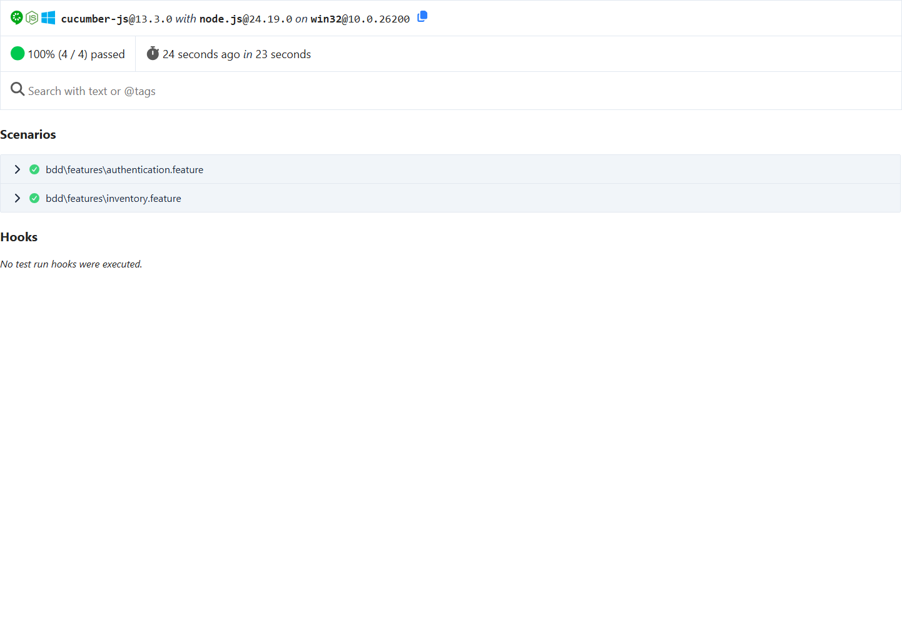
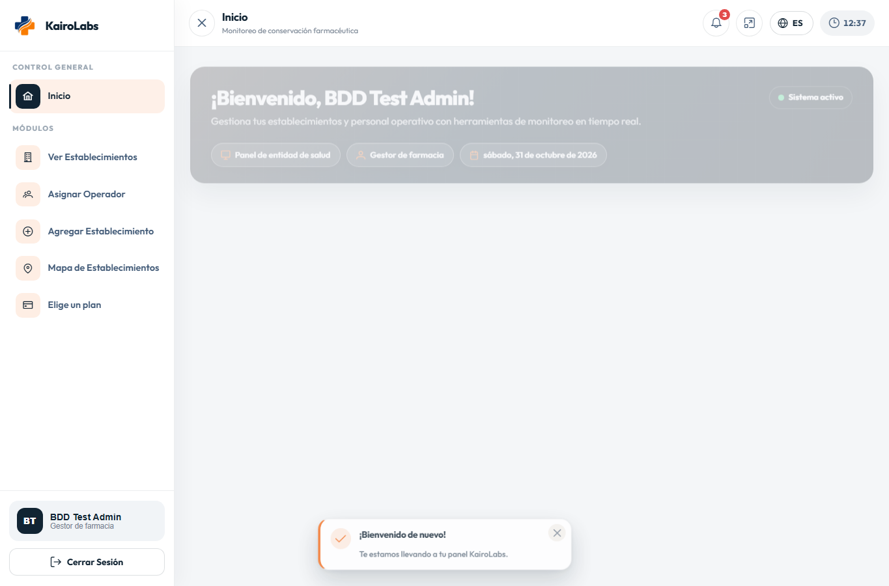
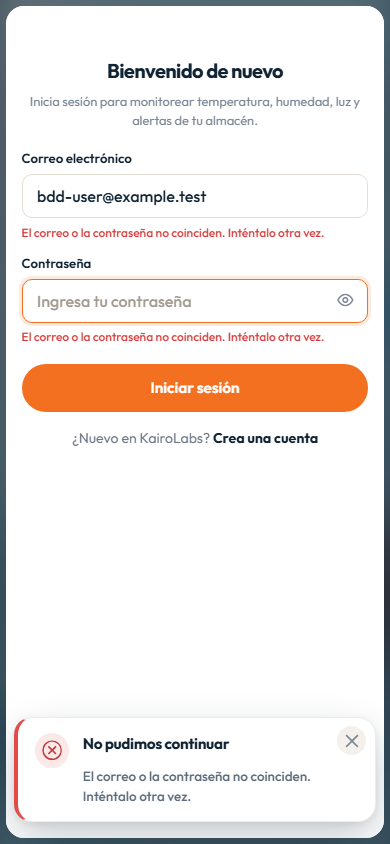
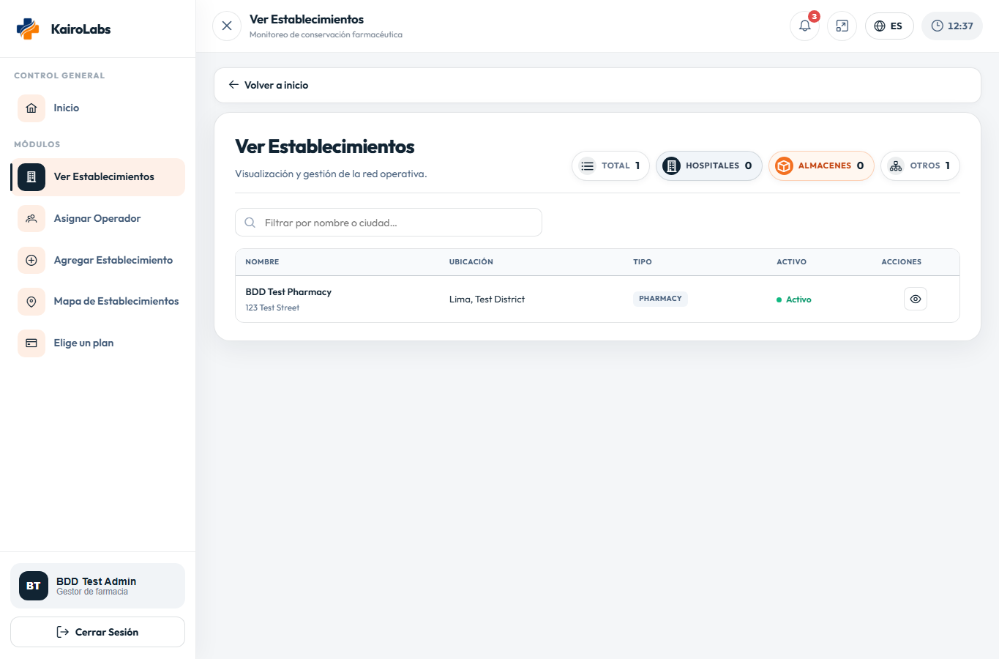
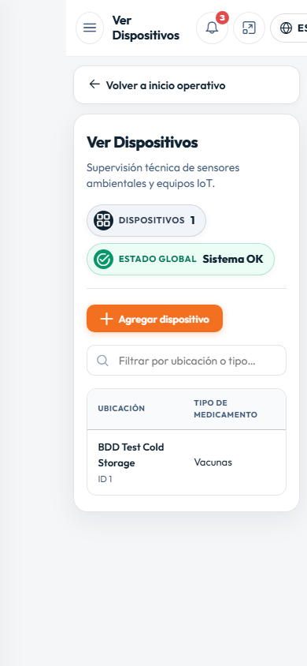

# Capítulo VI: Product Verification & Validation

## 6.1. Testing Suites & Validation

Se verificaron flujos implementados de autenticación y consulta de información operativa de KairoLabs. La validación se realizó en un entorno local de pruebas: frontend web, API y una base MySQL aislada, con registros ficticios. No se usaron cuentas ni datos de producción.

**Herramientas y entorno.** Cucumber.js 13.3.0 ejecutó los escenarios Gherkin; Playwright 1.64.1 controló Chromium 156.0.8078.4. El backend ASP.NET Core se ejecutó con .NET 10 y MySQL 8.0.46. Se usaron dos viewports: escritorio (1365 × 900) y móvil emulado (390 × 844). La emulación comprueba el diseño web móvil en Chromium; no equivale a una prueba en un teléfono físico.

**Ejecución registrada el 31 de octubre de 2026:**

| Ejecución | Viewport | Escenarios | Pasos | Aprobados | Fallidos |
|:--|:--:|--:|--:|--:|--:|
| Escritorio | 1365 × 900 | 4 | 21 | 4 | 0 |
| Móvil emulado | 390 × 844 | 4 | 21 | 4 | 0 |

### 6.1.3. Core Behavior-Driven Development (BDD)

Se aplicó BDD para describir y automatizar el comportamiento esperado desde la perspectiva de los usuarios. Los escenarios se redactaron en Gherkin usando **Given–When–Then (Dado–Cuando–Entonces)** y se ejecutaron con Cucumber.js; Playwright realizó las interacciones observables en la aplicación. Se incluyeron caminos exitosos y un caso de rechazo de credenciales para expresar también el comportamiento ante errores.

#### Funcionalidad: autenticación

```gherkin
Feature: Inicio de sesión de usuarios
  Como usuario de KairoLabs
  Quiero ingresar con mis credenciales
  Para acceder al panel correspondiente a mi rol

  Scenario: La aplicación rechaza credenciales inválidas
    Given que abro la página de inicio de sesión
    When ingreso una contraseña incorrecta y envío el formulario
    Then permanezco en el inicio de sesión y veo un mensaje de error

  Scenario: Una cuenta de prueba activa accede a su panel
    Given que existe una cuenta de prueba configurada para BDD
    And abro la página de inicio de sesión
    When ingreso las credenciales de prueba y envío el formulario
    Then llego al panel asignado por el rol de la cuenta
```

#### Funcionalidad: consulta de información operativa

```gherkin
Feature: Consulta de datos operativos
  Como usuario autenticado
  Quiero consultar establecimientos y dispositivos
  Para supervisar la operación

  Scenario: El usuario consulta establecimientos desde el frontend integrado
    Given que inicié sesión con una cuenta de prueba
    When navego al módulo de establecimientos
    Then el módulo carga establecimientos desde la API de pruebas

  Scenario: El usuario consulta dispositivos desde el frontend integrado
    Given que inicié sesión con una cuenta de prueba
    When navego al módulo de dispositivos
    Then el módulo carga dispositivos desde la API de pruebas
```

Los cuatro escenarios anteriores aprobaron en escritorio y en móvil emulado. Las definiciones ejecutables están en `KairoLabs-Frontend/bdd/features/` y `KairoLabs-Frontend/bdd/step-definitions/`. Cuentas y registros son datos ficticios creados para la prueba.

**Evidencia de ejecución:** los reportes HTML conservan el detalle de escenarios y pasos por viewport.

- [Reporte Cucumber — escritorio](../assets/testing/cucumber-desktop.html)
- [Reporte Cucumber — móvil emulado](../assets/testing/cucumber-mobile.html)



**Figura 6.1.** Resumen de Cucumber para escritorio.


**Figura 6.2.** Resumen de Cucumber para viewport móvil emulado.

### 6.1.4. Core System Tests

Las pruebas de sistema validaron recorridos integrados completos y el resultado observable por el usuario. En los flujos de consulta, el frontend envió solicitudes a la API local, recibió los registros ficticios de MySQL y los presentó en los módulos correspondientes. También se comprobó la navegación desde el inicio de sesión y el rechazo de credenciales inválidas. Los mismos flujos se ejecutaron en escritorio y móvil emulado.

| ID | Precondición y flujo de extremo a extremo | Resultado esperado | Escritorio | Móvil emulado |
|:--|:--|:--|:--:|:--:|
| SYS-01 | Cuenta de prueba activa; enviar credenciales y entrar | Se abre el panel permitido para el rol | Aprobado | Aprobado |
| SYS-02 | Enviar contraseña incorrecta | Se deniega el acceso y se muestra el error; no se abre el panel | Aprobado | Aprobado |
| SYS-03 | Sesión válida; navegar a establecimientos | La API de pruebas responde y el registro ficticio aparece en el módulo | Aprobado | Aprobado |
| SYS-04 | Sesión válida; navegar a dispositivos | La API de pruebas responde y el registro ficticio aparece en el módulo | Aprobado | Aprobado |

En total, cada ejecución cubrió cuatro flujos de sistema; los cuatro aprobaron en ambos viewports. El conteo corresponde a escenarios automatizados, no a una afirmación de cobertura exhaustiva de todos los módulos, roles, navegadores o dispositivos.

#### Evidencia visual de los flujos



**Figura 6.3.** Cuenta ficticia autenticada y panel en escritorio.



**Figura 6.4.** Rechazo de credenciales inválidas en viewport móvil emulado.



**Figura 6.5.** Registro de establecimiento de prueba presentado en escritorio.



**Figura 6.6.** Registro de dispositivo de prueba presentado en móvil emulado.

#### Reproducción

El runner `KairoLabs-Frontend/scripts/run-bdd.ps1` prepara una base MySQL temporal independiente, inicia API y frontend en `localhost`, crea datos ficticios, ejecuta Cucumber/Playwright y guarda reportes y capturas en `assets/testing/`. Los accesos directos son `KairoLabs-Frontend/run-bdd-desktop.cmd` y `KairoLabs-Frontend/run-bdd-mobile.cmd`; las instrucciones están en `KairoLabs-Frontend/bdd/README.md`. El runner está restringido a objetivos locales.

#### Alcance de Lighthouse

La evaluación de Lighthouse de la Landing Page se reporta como evidencia complementaria de rendimiento, accesibilidad, buenas prácticas y SEO. Sus métricas no se cuentan dentro de los escenarios funcionales anteriores y no sustituyen las pruebas de navegación, autenticación ni integración con API.
