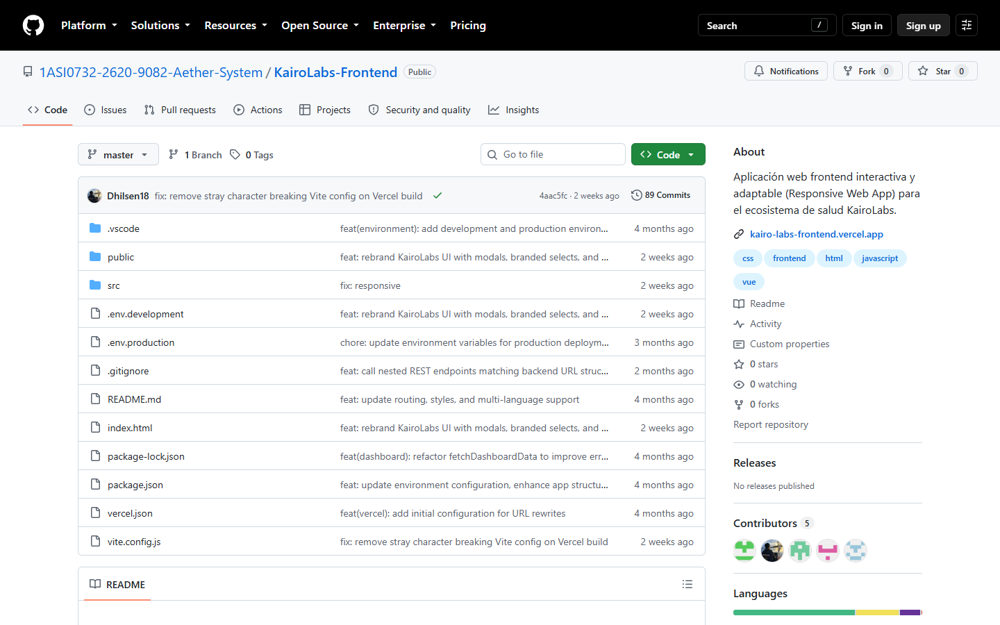
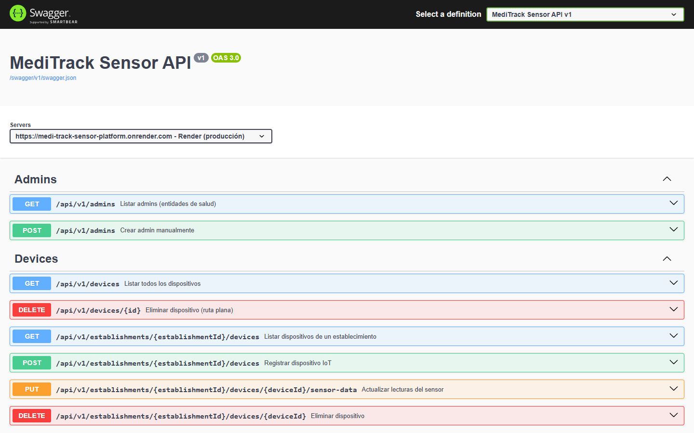
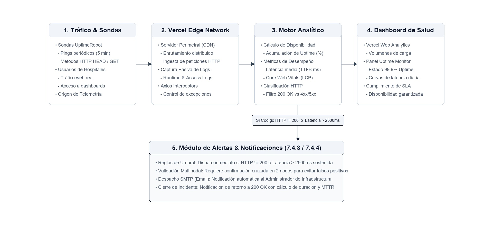

# Capítulo VII: DevOps Practices

Este capítulo describe las prácticas de **DevOps** implementadas para el ecosistema digital de **KairoLabs**, desarrollado por **Aether System** para el curso **1ASI0732 - Diseño de Experimentos de Ingeniería de Software**, ciclo **2026-20**. Se detalla la automatización de los procesos de integración continua (*Continuous Integration*), entrega continua (*Continuous Delivery*), despliegue continuo (*Continuous Deployment*) y la infraestructura de monitoreo continuo (*Continuous Monitoring*) en producción.

---

## 7.1. Continuous Integration

### 7.1.1. Tools and Practices.

*(Sección pendiente de desarrollo)*

### 7.1.2. Build & Test Suite Pipeline Components.

*(Sección pendiente de desarrollo)*

---

## 7.2. Continuous Delivery

### 7.2.1. Tools and Practices.

*(Sección pendiente de desarrollo)*

### 7.2.2. Stages Deployment Pipeline Components.

*(Sección pendiente de desarrollo)*

---

## 7.3. Continuous Deployment

Vistazo general de los pipelines utilizados en KairoLabs:

El ecosistema opera con dos tipos de pipelines. Los de tipo **Test** validan el código antes de que llegue a la rama de producción; los de tipo **Deploy** publican automáticamente cada producto cuando ese código se integra. La Tabla 7.4-1 resume ambos grupos con su último resultado registrado.

*Pipelines de tipo Test y Deploy de KairoLabs*

| Pipeline | Tipo | Producto | Disparador / comando | Último resultado |
| :--- | :---: | :--- | :--- | :--- |
| **Análisis estático** | Test | Web Application | `npm run lint` y `npm run quality` (ESLint, jscpd, npm audit) | Ejecutado; 77 advertencias de ESLint en seguimiento (02/11/2026) |
| **Pruebas unitarias** | Test | Web Application | `npm run test:unit` (`node:test`) | 20/20 aprobadas (02/11/2026) |
| **Pruebas de integración** | Test | RESTful API | `npm test` (Node.js + Kestrel + MySQL de pruebas) | 14/14 aprobadas (02/11/2026) |
| **BDD / sistema** | Test | Web App + API + MySQL | `npm run test:bdd` (Cucumber.js + Playwright) | 4/4 escenarios y 22/22 pasos en escritorio y móvil emulado (02/11/2026) |
| **Deploy Landing Page** | Deploy | Landing Page | Push a `main` → Vercel | *Production*: commit `34434e8` (14/09/2026) |
| **Deploy Web Application** | Deploy | Web Application | Push a `master` → Vercel | *Production*: commit `ffadea8` (14/09/2026); estado ✓ en el último commit (Figura 7.4-4) |
| **Deploy RESTful API** | Deploy | RESTful API | Commit en la rama conectada → Render (Docker) | *Live* en medi-track-sensor-platform.onrender.com (Figura 7.4-5) |

El pipeline de pruebas de la Web Application encadena cuatro etapas que se ejecutan desde la raíz del repositorio KairoLabs-Frontend. Si cualquiera de ellas falla, el cambio no se integra en `master` y, por lo tanto, no se dispara ningún despliegue.

1. **Lint** — `npm run lint`: ESLint con las reglas de Vue y de seguridad (`eslint-plugin-vue`, `eslint-plugin-security`) sobre la carpeta `src/`.
2. **Unit** — `npm run test:unit`: 20 pruebas de las entidades principales del dominio con el runner nativo de Node.js (`node:test`).
3. **BDD / sistema** — `npm run test:bdd`: el runner crea una base MySQL temporal, levanta la API ASP.NET Core y la Web Application en local, ejecuta los escenarios Gherkin de `bdd/core.feature` con Playwright (Chromium) en escritorio y en un Pixel 7 emulado, y elimina los recursos al terminar.
4. **Calidad** — `npm run quality`: métricas de complejidad, duplicación de código (jscpd) y auditoría de dependencias.

  

El pipeline de despliegue de la Web Application se ejecuta en Vercel cada vez que se integra un commit en `master`. Sus etapas son:

1. **Cloning** — Vercel clona KairoLabs-Frontend en el commit exacto que disparó el despliegue.
2. **Installing** — instala las dependencias con npm a partir de `package-lock.json`.
3. **Building** — ejecuta `npm run build` (`vite build`); Vite carga las variables de `.env.production`, entre ellas `VITE_API_BASE_URL`, que apunta a la API en Render.
4. **Deploying** — publica la carpeta `dist/` en la Edge Network y aplica la regla de `vercel.json` que redirige toda ruta a `/index.html` (enrutamiento SPA).
5. **Ready** — asigna el dominio de producción kairo-labs-frontend.vercel.app y reporta el estado del despliegue en el commit de GitHub.

*Commit de corrección con despliegue exitoso reportado en GitHub*

  

Por último, la verificación post-despliegue de la RESTful API se realiza sobre Swagger UI, servido directamente desde el entorno de producción en Render.

*Verificación post-despliegue de la RESTful API en Render*

  

### 7.3.1. Tools and Practices.

Para llevar a cabo el proceso de gestión de versiones en Git, el equipo utiliza la terminal de comandos (Git CLI) y el modelo de ramificación **GitFlow**: las funcionalidades se desarrollan en ramas `feature/*`, se integran en `develop` y llegan a la rama de producción —`main` en la Landing Page y en la RESTful API, `master` en la Web Application— a través de ramas `release/*` o `hotfix/*`. Los mensajes de commit siguen **Conventional Commits** y las versiones se nombran con **Semantic Versioning**, lo que permite vincular cada despliegue con el cambio exacto que lo originó. Como la rama de producción es el único punto que dispara un despliegue, GitFlow funciona como la compuerta de calidad del pipeline: solo llega a `main`/`master` código que ya fue revisado e integrado en `develop`.

Para automatizar el despliegue, el equipo no administra servidores propios: utiliza las integraciones nativas con GitHub de **Vercel** (Landing Page y Web Application) y **Render** (RESTful API), que detectan cada nuevo commit en la rama de producción y ejecutan automáticamente la construcción y la publicación del producto correspondiente. La Tabla 7.3-1 resume las herramientas que intervienen en este proceso.

*Herramientas utilizadas en el proceso de despliegue continuo de KairoLabs*

| Herramienta | Categoría | Uso en KairoLabs |
| :--- | :--- | :--- |
| **Git (CLI) + GitFlow** | Control de versiones | Gestión local de ramas y commits; flujo `feature/*` → `develop` → `release/*` o `hotfix/*` → `main`/`master`. |
| **GitHub** | Repositorio remoto (SCM) | Organización `1ASI0732-2620-9082-Aether-System` con los repositorios KairoLabs-Landing-Page, KairoLabs-Frontend, KairoLabs-Mobile, KairoLabs-Platform y KairoLabs-Project-Report. Origen de los eventos que disparan los despliegues. |
| **Vercel** | Plataforma de despliegue (frontend) | Despliegue automático de la Landing Page y la Web Application al integrar cambios en la rama de producción; publicación en su Edge Network (CDN) con HTTPS; *Preview Deployments* para ramas que no son de producción. |
| **Vite + npm** | Build del frontend | `vite build` genera el bundle optimizado (`dist/`) de la SPA en Vue 3; npm resuelve las dependencias a partir de `package-lock.json`. |
| **Docker** | Empaquetado del backend | Dockerfile multi-stage: imagen `sdk:10.0` para restaurar, compilar y publicar; imagen `aspnet:10.0` para ejecutar la API. |
| **Render** | Plataforma de despliegue (backend) | Web Service con runtime Docker y *Auto-Deploy* ante cada commit en la rama conectada; ejecuta la API ASP.NET Core (Kestrel) en el puerto 8080. |
| **Filess.io** | Base de datos gestionada | Instancia MySQL de producción; la cadena de conexión se inyecta como variable de entorno en Render. |
| **Swagger UI (OpenAPI 3.0)** | Verificación post-despliegue | `/swagger/index.html` permite comprobar que los endpoints de la API responden después de cada despliegue. |
| **UptimeRobot y Vercel Analytics** | Monitoreo | Detectan caídas o degradación de la versión recién desplegada (detalle en la sección de Continuous Monitoring). |

Las prácticas de despliegue continuo adoptadas por el equipo son las siguientes:

* **Despliegue disparado por Git:** el push o merge en `main`/`master` es el único evento que publica en producción. No existen despliegues manuales por FTP ni compilaciones hechas en máquinas locales.
* **Despliegues independientes por producto:** la Landing Page, la Web Application y la RESTful API tienen pipelines separados, de modo que un fallo en uno no bloquea a los demás.
* **Builds reproducibles y artefactos inmutables:** cada despliegue en Vercel produce una versión inmutable con URL propia; en Render, cada despliegue construye una nueva imagen Docker a partir del commit. Las versiones de las dependencias están fijadas en `package-lock.json` y en el archivo `.csproj`.
* **Configuración externalizada por entorno:** las URLs y credenciales no se escriben en el código. La Web Application usa `.env.development` para el entorno local y `.env.production` para producción (`VITE_API_BASE_URL` apunta a la API en Render); la API recibe `ASPNETCORE_ENVIRONMENT` y `ConnectionStrings__DefaultConnection` desde las variables de entorno de Render.
* **Previews antes de producción:** Vercel genera *Preview Deployments* para las ramas que no son de producción, lo que permite revisar cambios visuales con una URL temporal antes del merge.
* **Verificación post-despliegue (smoke test):** tras cada despliegue se comprueba la carga de la Landing Page, el inicio de sesión en la Web Application y la respuesta de Swagger UI; el monitoreo continuo confirma luego la disponibilidad.
* **Rollback inmediato:** si una versión falla, se recupera la anterior con *Instant Rollback* en Vercel o redesplegando el deploy previo en Render. La corrección definitiva se integra mediante una rama `hotfix/*` o un `git revert`, sin reescribir el historial.
* **Trazabilidad:** cada despliegue queda asociado a su commit (SHA y mensaje Conventional Commit), y Vercel reporta el estado del despliegue en el propio commit de GitHub.

### 7.3.2. Production Deployment Pipeline Components.

El pipeline de despliegue a producción de KairoLabs integra los componentes que se describen a continuación.

Los componentes del pipeline son los siguientes:

* **Source Control Management:** Git y GitHub, bajo el modelo GitFlow. Las ramas de producción son `main` (Landing Page y RESTful API) y `master` (Web Application).
* **Build and compilation:** Vite (`npm run build` → `vite build`) para la Web Application; .NET SDK 10 (`dotnet restore`, `dotnet build` y `dotnet publish -c Release`) dentro del Dockerfile para la RESTful API. La Landing Page es un sitio estático y no requiere compilación.
* **Artifact repository:** registro de npm (dependencias del frontend), NuGet (paquetes .NET), Microsoft Container Registry (imágenes base `sdk:10.0` y `aspnet:10.0`), almacenamiento inmutable de deployments de Vercel y registro interno de imágenes de Render.
* **Deployment automation:** integración Git de Vercel y *Auto-Deploy* de Render, activados por cada commit en la rama de producción.
* **Production environment:** Vercel Edge Network (Landing Page y Web Application), Render Web Service con runtime Docker (RESTful API) y Filess.io (base de datos MySQL).
* **Configuration management:** variables de entorno de Vercel y Render, archivos `.env.*` y `vercel.json` (sitio estático en la Landing Page; regla de reescritura SPA en la Web Application).
* **Verification and monitoring:** smoke test manual, Swagger UI, UptimeRobot y Vercel Analytics.
* **Rollback and recovery:** *Instant Rollback* de Vercel, redeploy de la versión anterior en Render y `git revert` o `hotfix/*` en el repositorio.

*Configuración del pipeline de producción por producto*

| Producto | Repositorio · rama | Build | Artefacto | Destino |
| :--- | :--- | :--- | :--- | :--- |
| **Landing Page** | KairoLabs-Landing-Page · `main` | Sin compilación; `vercel.json` con `outputDirectory: "."` y `cleanUrls: true` | Archivos estáticos (HTML, CSS, JS, imágenes) | Vercel [landing-page-kairolabs.vercel.app](https://landing-page-kairolabs.vercel.app) |
| **Web Application** | KairoLabs-Frontend · `master` | `npm install` + `npm run build` (`vite build`) | Bundle `dist/` + reescritura SPA hacia `/index.html` | Vercel [kairo-labs-frontend.vercel.app](https://kairo-labs-frontend.vercel.app) |
| **RESTful API** | KairoLabs-Platform · `main` | Docker multi-stage (.NET SDK 10, configuración Release) | Imagen Docker `aspnet:10.0` (puerto 8080) | Render (Docker) [medi-track-sensor-platform.onrender.com](https://medi-track-sensor-platform.onrender.com/swagger/index.html) |
| **Base de datos** | — | — | — | Filess.io (MySQL), conexión mediante variable de entorno |

*Nota.* Elaboración propia con base en los archivos `vercel.json`, `package.json` y `Dockerfile` de cada repositorio.

*Etapas del pipeline de despliegue a producción*

| Etapa | Descripción | Herramienta | Criterio de salida |
| :--- | :--- | :--- | :--- |
| **1. Integración** | Merge de `release/*` o `hotfix/*` en `main`/`master`. | Git, GitHub | Pruebas de 7.1 y 7.2 aprobadas; commit con mensaje Conventional Commit. |
| **2. Disparo** | GitHub notifica el nuevo commit a la plataforma de despliegue. | GitHub → Vercel / Render | Despliegue encolado con el SHA del commit. |
| **3. Build** | Instalación de dependencias y compilación. | npm + Vite / Docker + .NET SDK 10 | Build sin errores. Si falla, el pipeline se detiene y la versión anterior sigue activa. |
| **4. Empaquetado** | Generación del artefacto inmutable. | Output de Vercel / imagen Docker | Artefacto asociado al commit. |
| **5. Release** | Publicación y asignación del dominio de producción. | Vercel Edge Network / Render | Estado *Ready* (Vercel) o *Live* (Render). |
| **6. Verificación** | Smoke test y monitoreo de la nueva versión. | Navegador, Swagger UI, UptimeRobot | Landing Page, inicio de sesión y endpoints responden correctamente. |
| **7. Recuperación** | Reversión ante un fallo en producción. | Instant Rollback / redeploy / `git revert` | Servicio restablecido en la última versión estable. |

*Nota.* Elaboración propia.

## 7.4. Continuous Monitoring

El monitoreo continuo (*Continuous Monitoring*) en la práctica DevOps de KairoLabs asegura la supervisión proactiva y en tiempo real del ecosistema digital (Frontend Web y servicios en producción). Su objetivo primordial es identificar tempranamente anomalías operativas, degradaciones en la latencia, saturación de peticiones o caídas de servicio (*downtime*) antes de que perjudiquen las operaciones de las clínicas, farmacias y hospitales que confían en el sistema para la trazabilidad y preservación de medicamentos sensibles.

### 7.4.1. Tools and Practices

Para garantizar la observabilidad integral de KairoLabs, el equipo adoptó un enfoque híbrido que combina monitoreo sintético periódico con análisis de telemetría pasiva en el borde de la red:

**Tabla 16**

*Herramientas y prácticas operativas de monitoreo continuo en KairoLabs*

| Herramienta | Tipo de Monitoreo | Métrica Principal Supervisada | Práctica DevOps Implementada |
| :--- | :---: | :--- | :--- |
| **UptimeRobot** | Monitoreo Sintético Externo | Disponibilidad global (*Uptime %*), latencia de conexión (*TTFB* en ms) y códigos de estado HTTP (200 OK vs 5xx/Timeout). | Sondeos automáticos cada 5 minutos mediante solicitudes HTTP `HEAD`/`GET` desde nodos distribuidos globalmente. |
| **Vercel Analytics & Logs** | Observabilidad en Edge Network | Métricas de rendimiento (*Core Web Vitals*: LCP, FID, CLS), volumen de tráfico concurrente y registros de error en tiempo real. | Ingesta pasiva de registros en los nodos perimetrales del CDN sin penalizar el rendimiento del cliente ni consumir recursos extra. |
| **Axios Runtime Interceptors** | Diagnóstico en Cliente Web | Excepciones no controladas de JavaScript, interrupciones de red y fallos de autenticación JWT. | Manejo centralizado de excepciones en la capa de infraestructura del frontend (`base-api.js`), capturando eventos anómalos. |

*Nota.* Elaboración propia basada en la arquitectura de observabilidad desplegada para KairoLabs.

Las prácticas operativas clave implementadas incluyen:
* **Monitoreo Proactivo de Disponibilidad:** Detección automática e inmediata de interrupciones de servicio sin depender del reporte manual de los operadores hospitalarios.
* **Correlación de Despliegues e Incidentes:** Vinculación directa entre cada nuevo despliegue en producción y el impacto en las tasas de error o latencia, agilizando decisiones de rollback o parches urgentes.

---

### 7.4.2. Monitoring Pipeline Components

El pipeline de monitoreo continuo opera mediante un flujo desacoplado compuesto por cuatro fases estructurales: ingesta y sondaje sintético, procesamiento analítico en la nube, visualización en paneles de control y derivación condicional de eventos.

**Figura 42**

*Arquitectura de componentes del pipeline de monitoreo continuo en KairoLabs*

  

*Nota.* Arquitectura del pipeline de observabilidad continua de KairoLabs, detallando la interacción entre sondas sintéticas externas, la red perimetral de Vercel, el motor analítico de agregación, los dashboards de salud operativa y el módulo de alertas. Elaboración propia.

Los componentes principales que articulan este pipeline son:

1. **Componente de Ingesta y Sondaje Sintético:**
   * Agentes distribuidos de UptimeRobot envían solicitudes periódicas hacia la URL pública de producción (`https://landing-page-kairolabs.vercel.app`), midiendo el tiempo de resolución DNS, conexión TCP y recepción del primer byte (*Time to First Byte* - TTFB).
   * La infraestructura perimetral de Vercel captura los metadatos de cada petición entrante de usuarios reales (código de respuesta, región geográfica, ruta de vista y duración de renderizado).
2. **Componente de Agregación y Procesamiento Analítico:**
   * Motor de procesamiento que consolida la telemetría en ventanas temporales para calcular el porcentaje de disponibilidad acumulado (acorde al objetivo SLA $\ge 99.5\%$) y la latencia media de respuesta.
3. **Componente de Visualización y Dashboard de Salud:**
   * Paneles unificados donde el equipo técnico inspecciona el historial de disponibilidad, curvas de tráfico y registros de excepciones en vivo.

---

### 7.4.3. Alerting Pipeline Components

El componente de alertas define la lógica condicional, umbrales y reglas operativas que determinan cuándo una variación de telemetría debe clasificarse como un incidente operativo:

* **Umbral de Caída Crítica (*Down State*):** Si dos sondeos consecutivos devuelven un código de error de servidor (`500 Internal Server Error`, `502 Bad Gateway`, `503 Service Unavailable`) o un tiempo de espera agotado (*Connection Timeout*), el estado de la aplicación cambia de *Up* a *Down*.
* **Umbral de Degradación de Rendimiento (*High Latency Warning*):** Se genera una alerta de advertencia si la latencia promedio supera los 2500 ms de forma continua en una ventana de 10 minutos.
* **Mecanismo de Confirmación Multinodal:** Para mitigar falsos positivos provocados por congestión transitoria en un nodo de red aislado, la alerta crítica solo se consolida si la indisponibilidad es corroborada por al menos dos nodos geográficos distintos.

---

### 7.4.4. Notification Pipeline Components

El pipeline de notificaciones gestiona el despacho oportuno y el enrutamiento de las alertas hacia los canales de comunicación del equipo técnico:

* **Canal Primario de Alerta Inmediata (Correo Electrónico SMTP):** Despacho automatizado de un correo electrónico de alta prioridad hacia los responsables técnicos con el informe del evento (marca de tiempo exacta, código HTTP devuelto y URL afectada).
* **Notificación de Recuperación y Medición de MTTR:** En cuanto el pipeline detecta que los sondeos retornan a un estado consistente de `200 OK`, emite una notificación de resolución calculando el tiempo total de caída (*downtime duration*), métrica indispensable para estimar el tiempo medio de recuperación (*Mean Time to Recovery* - MTTR).
