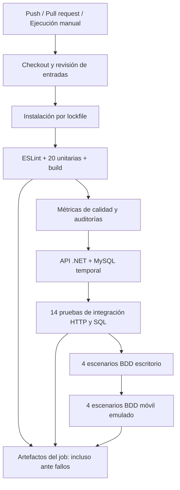
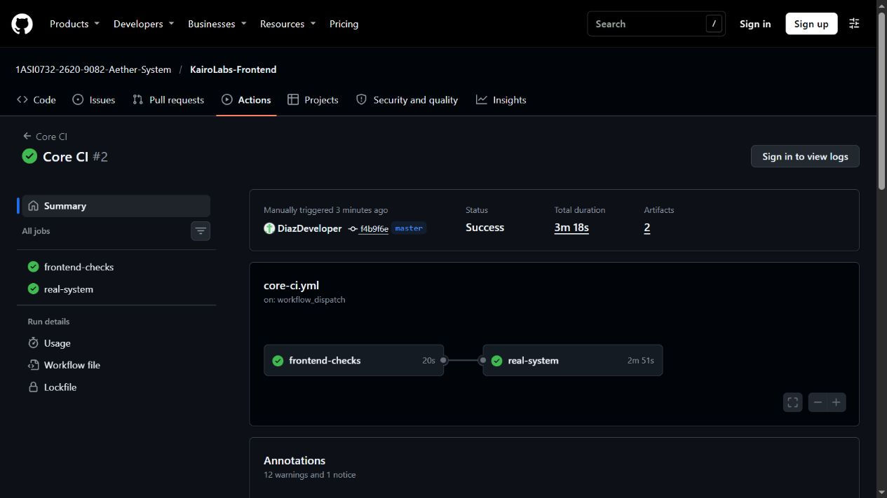
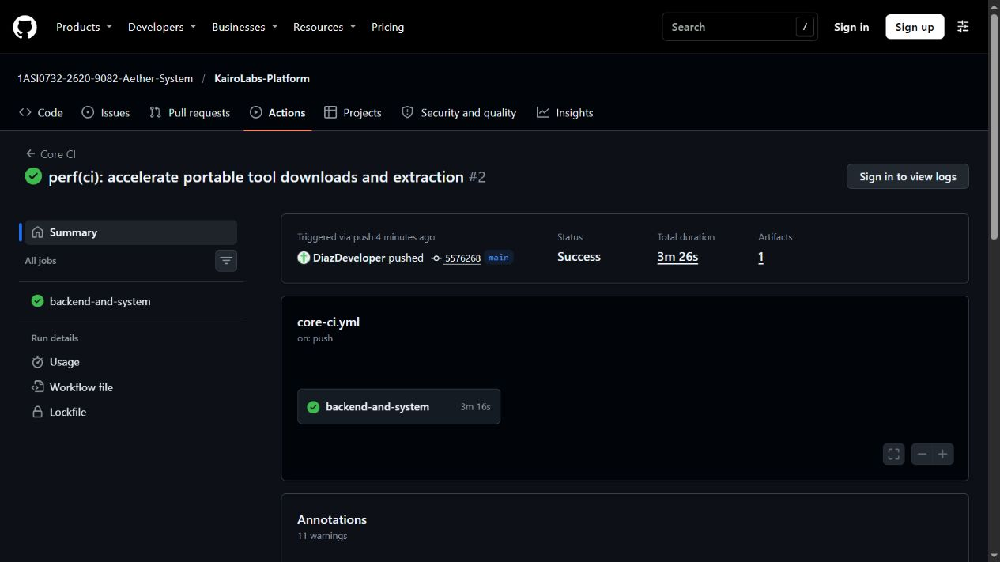
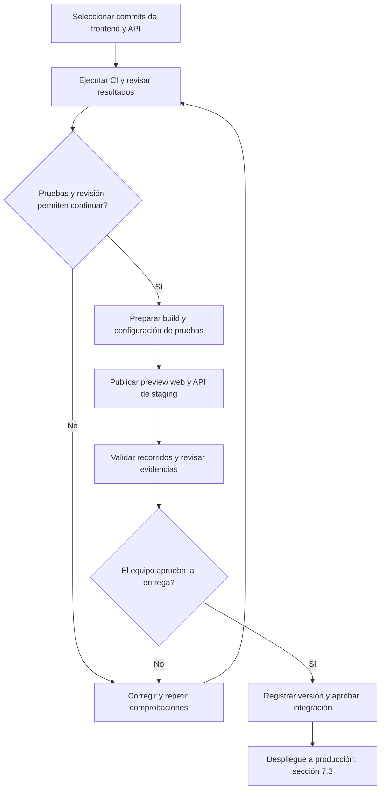
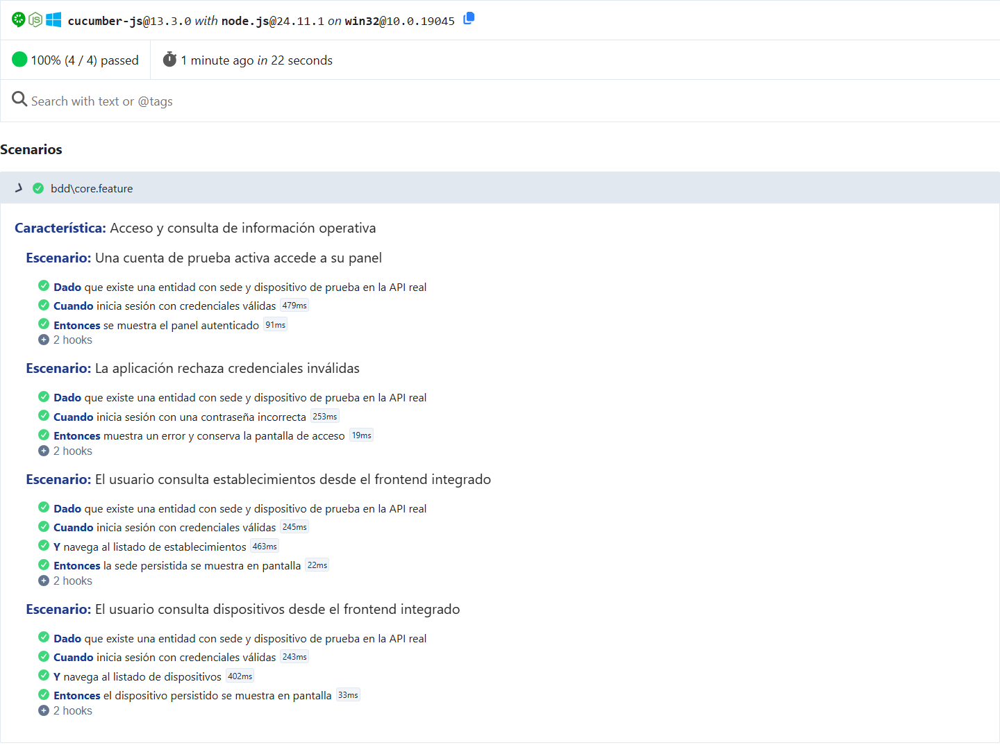

# Capítulo VII: DevOps Practices

Este capítulo describe las prácticas de **DevOps** implementadas para el ecosistema digital de **KairoLabs**, desarrollado por **Aether System** para el curso **1ASI0732 - Diseño de Experimentos de Ingeniería de Software**, ciclo **2026-20**. Se detalla la automatización de los procesos de integración continua (*Continuous Integration*), entrega continua (*Continuous Delivery*), despliegue continuo (*Continuous Deployment*) y la infraestructura de monitoreo continuo (*Continuous Monitoring*) en producción.

---

## 7.1. Continuous Integration

La integración continua (CI) de KairoLabs se organiza como una verificación automática de los cambios del frontend y de la plataforma antes de incorporarlos a la rama compartida. Su alcance comprende inspeccionar las entradas de compilación, restaurar dependencias, analizar código, compilar, ejecutar las suites del capítulo VI y conservar resultados identificables. La guía del trabajo exige implementar el pipeline, por lo que esta sección incluye los archivos YAML ejecutables y no solamente una descripción conceptual.

> **Estado de implementación — 13 de noviembre de 2026 (America/Lima):** los workflows están publicados y ejecutados en GitHub Actions con resultado satisfactorio. Se conservaron las evidencias locales como revisión previa y se añadieron los runs, jobs, artefactos y capturas reales de los runners hospedados. La protección de ramas no se configura ni se acredita en esta actividad.

Las dos versiones base revisadas son frontend `5a0b620524e479f78b02f16187fb0f4924e26dd1` y plataforma `2d736783eaea70ec2e352a002c2e71e7ecb7113e`. Se evaluaron con modificaciones locales identificadas en el paquete de cambios; no se atribuyen los resultados al código remoto sin esas modificaciones. El capítulo del reporte parte de `8346a6c1600cf4164344cf94c262b2171d0f9c43`.

**Incidencia previa al build.** Las versiones base incorporaban `node init` en los scripts de arranque/compilación y una cola de código ofuscado en las configuraciones Vite. Se implementó su retirada y un control de regresión para estos patrones conocidos. El control rechaza un hook simulado inerte y permite las entradas revisadas; no se presenta como detector general de malware. Esa limpieza es un requisito de los resultados locales y forma parte de los cambios que deben revisarse antes de publicar CI.

### 7.1.1. Tools and Practices.

**Tabla 16A**

*Herramientas y responsabilidades de integración continua de KairoLabs*

| Herramienta | Uso concreto | Estado verificable |
| :--- | :--- | :--- |
| Git y GitHub | Historial, ramas, diferencias y revisión mediante pull requests. | Publicación realizada por DiazDeveloper; no se inventa una aprobación por pares. |
| GitHub Actions | Workflows separados que reaccionan a `push`, `pull_request` y `workflow_dispatch`. | YAML publicado, actionlint aprobado y ejecuciones cloud completadas; enlaces abajo. |
| Node.js 24.11.1 y npm | Restauración con lockfile, scripts de build y suites. | Comandos locales ejecutados; en CI se define `npm ci --ignore-scripts --no-audit --no-fund`. |
| ESLint y plugins Vue/security | Análisis de `src/`; reglas bloqueantes y advertencias diferenciadas. | 0 errores y 77 advertencias en esta revisión. |
| Vite | Compilación del frontend y de gateways de integración. | Build local aprobado después de limpiar los hooks. |
| `node:test` y `node:assert` | Suite unitaria y suite HTTP/SQL de integración. | 20/20 unitarias y 14/14 de integración reejecutadas. |
| .NET 10.0.403 y MySQL 8.4.13 | API real y base temporal aislada. | Herramientas portátiles reutilizadas localmente; CI las prepara con `npm run setup`. |
| Cucumber.js y Playwright Chromium | Recorridos BDD en escritorio y Pixel 7 emulado. | Registros por escenario y viewport adjuntos al paquete. |
| jscpd y regla `complexity` | Duplicación y complejidad por función. | Métricas y ubicaciones conservadas en los reportes de calidad. |
| npm audit | Auditoría completa y de dependencias de producción. | Hallazgos abiertos; sus códigos se registran y no equivalen a aprobación de seguridad. |
| actionlint | Validación de sintaxis y estructura de los dos workflows. | Exit code 0 en ambos YAML. |

*Nota.* Las versiones de dependencias de frontend se resuelven mediante el lockfile. Los resultados actuales se distinguen de los registros históricos del capítulo VI.

**Prácticas definidas en los workflows**

1. **Integración mediante cambios revisables.** Se propone trabajar en ramas de funcionalidad y revisar el diff antes de integrar. Los mensajes previstos siguen Conventional Commits: limpieza de entradas, preparación CI, evidencia y documentación. Los commits publicados se identifican por SHA en los runs de Actions.
2. **Activación explícita.** `push` activa CI en `master`, `main`, `develop`, `feature/**` y `codex/**`; los pull requests también activan las comprobaciones. `workflow_dispatch` permite repetirlas manualmente. Se evita `pull_request_target` para ejecutar código de la contribución.
3. **Dependencias reproducibles.** La instalación CI usa el lockfile y desactiva scripts de ciclo de vida. Los builds y pruebas se invocan de forma explícita después del control de entradas. La revisión local reutilizó dependencias instaladas. Después se verificó `npm ci` en runners hospedados nuevos: Ubuntu para frontend y Windows para las suites reales.
4. **Permisos mínimos.** `GITHUB_TOKEN` queda limitado a `contents: read`; checkout no conserva credenciales. Las acciones oficiales están fijadas a SHA en los YAML. Los tests usan datos sintéticos locales y no requieren PAT, tokens de despliegue ni credenciales de producción.
5. **Compatibilidad entre repositorios.** El frontend verifica el cambio propio con un backend revisado; el backend verifica el cambio propio con un frontend revisado. `CI_PLATFORM_REF` y `CI_FRONTEND_REF` deben contener SHA de 40 caracteres de los cambios aprobados. Si falta la referencia, el job falla con un mensaje explícito. Las variables quedaron configuradas con los commits de correcciones aprobados: frontend `480c9211433c2e1ade09d18dd7cfd209f610bb6b` y plataforma `5576268dc92ec24008292d2dedf7a45c25293da0`. Así se evita probar silenciosamente contra otra revisión móvil de `main`.
6. **Aislamiento.** Los jobs de sistema utilizan `windows-latest`, shell Windows PowerShell y las rutas hermanas `KairoLabs-Frontend` / `KairoLabs-Platform`, compatibles con los runners existentes. Cada ejecución crea una base `kairolabs_it_*`, inicia servicios propios y limpia esos recursos. Se comprueban puertos 5187 y 33079; el frontend BDD requiere 5173 libre. No se emplean las bases ni endpoints de producción.
7. **Resultados frescos.** Antes de ejecutar en Actions, un script limitado a su checkout descartable retira evidencia histórica. `upload-artifact` utiliza `if: always()` y conserva los resultados generados durante 14 días; no se sube `.runtime` ni la base de datos. Si un paso previo falla puede no existir reporte de las suites posteriores: se muestra esa ausencia, no un resultado histórico aprobado.
8. **Concurrencia y controles.** Una ejecución más reciente cancela otra de la misma rama. Los jobs tienen tiempo máximo. Lint bloquea errores, no las 77 advertencias actuales. Las pruebas y compilación deben devolver cero. Calidad registra auditorías no aprobadas por separado; este criterio provisional no debe interpretarse como certificación de seguridad.

La protección de ramas y los checks requeridos se configurarán tras obtener los nombres y resultados de los jobs en GitHub; crear el YAML por sí solo no bloquea un merge. La actualización de las referencias compañeras también requiere revisar la combinación antes de aceptarla.

### 7.1.2. Build & Test Suite Pipeline Components.

**Flujo implementado**

*Nota.* El diagrama resume la cobertura de los dos workflows; no implica que todos los pasos compartan un mismo sistema operativo. El workflow frontend tiene un job Ubuntu de comprobaciones y un job Windows dependiente. El de plataforma ejecuta sus comprobaciones y suites reales en un job Windows usando el frontend fijado.

**Tabla 16B**

*Etapas, entradas, salidas y criterios de aprobación*

| Componente | Comando o mecanismo | Evidencia / salida | Criterio |
| :--- | :--- | :--- | :--- |
| Entrada y versiones | Checkout propio + SHA del repositorio compañero. | Revisiones y YAML de la ejecución. | Referencia compañera válida y revisada. |
| Inspección del build | `node scripts/ci/guard-build.mjs`. | Resultado del guard. | Rechazo de `init` y patrones ofuscados conocidos. |
| Restauración | `npm ci --ignore-scripts --no-audit --no-fund`. | Log de instalación. | Lockfile resoluble; exit 0. Comprobado en los runners cloud. |
| Verificación estática | `npm run lint`. | Advertencias y errores ESLint. | Sin errores bloqueantes; advertencias visibles. |
| Unitarias | `node --test` o `npm run test:unit`. | TAP o salida del job. | 20 casos aprobados, 0 fallidos. |
| Frontend build | `npm run build`. | Resultado Vite. | Exit 0. Este pipeline verifica la integración; el despliegue se documenta por separado. |
| Calidad | `npm run quality`. | JSON de ESLint, complejidad, jscpd, auditorías y log de build. | Sin error del análisis o build; hallazgos de audit registrados como deuda abierta. |
| Backend build y entorno | `npm run setup`, seguido del orquestador `npm test`. | Log .NET, advertencias y diagnóstico de arranque. | API y MySQL reales disponibles en localhost. |
| Integración | `npm test` en KairoLabs-Platform. | TAP, resultados por ID y tráfico redactado. | 14 aprobadas, 0 fallidas; limpieza de recursos propios. |
| BDD / sistema | `npm run test:bdd` en frontend. | JSON/HTML Cucumber, PNG y tráfico sin JWT. | 4 escenarios y 22 pasos por viewport, sin fallos. |
| Publicación de evidencia | `actions/upload-artifact` con `always()`. | Artefactos identificados por run ID. | Salidas nuevas disponibles; artefactos disponibles en los runs enlazados. |

*Nota.* BDD y sistema comparten recorridos: no se duplican como ocho pruebas adicionales. El perfil Pixel 7 es emulación en Chromium; no acredita aplicación nativa ni equipo físico.

**Workflows publicados y evidencias**

- [Workflow frontend](https://github.com/1ASI0732-2620-9082-Aether-System/KairoLabs-Frontend/blob/f4b9f6ea3da4757f5f27d3bb2d8f5004a85ae2e6/.github/workflows/core-ci.yml).
- [Workflow plataforma](https://github.com/1ASI0732-2620-9082-Aether-System/KairoLabs-Platform/blob/5576268dc92ec24008292d2dedf7a45c25293da0/.github/workflows/core-ci.yml).
- [Resultado actionlint](../assets/chapter-7/evidence/ci/actionlint.txt) y [prueba de rechazo del guard](../assets/chapter-7/evidence/ci/guard-validation.txt).
- [Registro de unitarias](../assets/chapter-7/evidence/ci/unit-run.txt), [lint](../assets/chapter-7/evidence/ci/lint-run.txt), [integración](../assets/chapter-7/evidence/ci/integration-run.txt) y [BDD](../assets/chapter-7/evidence/ci/bdd-run.txt).
- [Métricas de calidad](../assets/chapter-7/evidence/ci/quality-summary.json) y [trazabilidad del paquete](../assets/chapter-7/evidence/ci/validation.json).

**Resultados y limitaciones de esta revisión local**

| Verificación local | Resultado del 13 de noviembre de 2026 |
| :--- | :--- |
| Unitarias | 20 aprobadas / 0 fallidas. |
| Integración | 14 aprobadas / 0 fallidas. |
| BDD escritorio | 4 escenarios y 22 pasos aprobados. |
| BDD móvil emulado | 4 escenarios y 22 pasos aprobados. |
| ESLint | 0 errores / 77 advertencias. |
| Build frontend | Exit code 0. |
| actionlint | Dos workflows válidos; exit code 0. |
| Auditoría completa | 17 paquetes con avisos: 14 altos y 3 moderados; permanece abierta. |
| Auditoría producción | 13 paquetes con avisos altos; permanece abierta. |
| Run en GitHub Actions | Publicado y completado satisfactoriamente en ambos repositorios; evidencia remota abajo. |

La revalidación del 13 de noviembre utiliza copias de los commits indicados con la retirada de los hooks y el ajuste del runner PowerShell. Este último diferencia stderr nativo del código de salida de .NET, evitando confundir mensajes de arranque con un fallo de compilación. No se cambia ninguna expectativa funcional de las suites.

La ejecución remota comprueba eventos push, instalación por lockfile, jobs hospedados y carga de artefactos. Los resultados se atribuyen a los SHA del run y a las referencias compañeras registradas, no a futuras revisiones del producto. La aprobación humana de un pull request y los checks obligatorios de rama siguen siendo controles independientes.

Las advertencias ESLint, las vulnerabilidades de dependencias, la incidencia de migraciones y la autorización completa por roles mantienen el alcance pendiente documentado en el capítulo VI. El CI implementado comprueba regresión funcional; no garantiza ausencia total de defectos.

**Ejecuciones reales en GitHub Actions**

| Repositorio / job | Run y versión | Resultado |
| :--- | :--- | :--- |
| Frontend / frontend-checks | [Run 43542409469](https://github.com/1ASI0732-2620-9082-Aether-System/KairoLabs-Frontend/actions/runs/43542409469), `f4b9f6e` | Instalación, lint, 20 unitarias, build y métricas: success. |
| Frontend / real-system | Mismo run, backend compañero `5576268`. | 14 integración y 4 escenarios BDD por viewport: success. |
| Plataforma / backend-and-system | [Run 43542367043](https://github.com/1ASI0732-2620-9082-Aether-System/KairoLabs-Platform/actions/runs/43542367043), `5576268`; frontend compañero `480c921`. | Lint, 20 unitarias, build, 14 integración y 4 escenarios BDD por viewport: success. |

*Nota.* Los resultados de ambos repositorios repiten la regresión de la misma cobertura; no se suman como funcionalidades diferentes. El run de plataforma se activó mediante push y el del frontend mediante workflow_dispatch, ambos por **DiazDeveloper**. Los primeros intentos se cancelaron durante la preparación lenta de herramientas; la mejora conserva versiones y checksums, y utiliza curl/tar con progreso desactivado.

Los artefactos originales tienen retención de 14 días. Sus JSON, TAP, reportes HTML y capturas se copiaron al repositorio del informe para conservar evidencia después de ese plazo: [frontend](../assets/chapter-7/evidence/github-actions/web/) y [plataforma](../assets/chapter-7/evidence/github-actions/api/). Los metadatos run.json/jobs.json identifican commit, evento, actor, tiempos y conclusiones; el [resumen validado](../assets/chapter-7/evidence/github-actions/validation.json) reúne resultados y hashes de las capturas.

La auditoría remota mantuvo 17 paquetes con avisos (14 altos y 3 moderados), y 13 altos al excluir desarrollo. ESLint registró 0 errores y 77 advertencias. GitHub notificó además el cambio del runtime de acciones v4 de Node 20 a Node 24; no produjo fallos en estos runs. Los resultados satisfactorios de CI no cierran esos hallazgos.

**Figura 42**

*Ejecución del pipeline del frontend en GitHub Actions*

*Nota.* Captura de la página real del run 43542409469. Se identifican los jobs, el commit, el autor del push y la conclusión. Captura propia del 13 de noviembre de 2026.

**Figura 43**

*Ejecución del pipeline de plataforma en GitHub Actions*

*Nota.* Captura de la página real del run 43542367043. La evidencia corresponde a API/MySQL y navegador ejecutados en el runner hospedado, no a la ejecución local previa. Captura propia del 13 de noviembre de 2026.

**Referencias técnicas para 7.1**

- GitHub. *Workflow syntax for GitHub Actions*. https://docs.github.com/en/actions/writing-workflows/workflow-syntax-for-github-actions
- GitHub. *Events that trigger workflows*. https://docs.github.com/en/actions/reference/workflows-and-actions/events-that-trigger-workflows
- GitHub. *Store and share data with workflow artifacts*. https://docs.github.com/en/actions/tutorials/store-and-share-data
- GitHub Actions. *setup-node*. https://github.com/actions/setup-node
- rhysd. *actionlint*. https://github.com/rhysd/actionlint

---

## 7.2. Continuous Delivery

La entrega continua de KairoLabs busca que cada cambio llegue a una versión que se pueda revisar y preparar para su publicación. Para ello se necesitan pruebas aprobadas, una configuración adecuada para cada ambiente y un registro que permita saber qué código se está entregando. Esto es especialmente útil en KairoLabs porque la aplicación web y la API se mantienen en repositorios distintos y deben funcionar juntas.

El proceso toma como punto de partida los workflows de integración continua de 7.1 y prepara la entrega a las plataformas descritas en 7.3: Vercel para la Landing Page y la Web Application, y Render para la API. Antes de integrar una versión en las ramas que publican en producción, se plantea una revisión del equipo sobre los resultados, los cambios y las observaciones abiertas.

**Alcance al 13 de noviembre de 2026.** Se cuenta con ejecuciones de CI y pruebas de integración y BDD en ambientes temporales de GitHub Actions. Las evidencias conservadas no muestran un ambiente de staging independiente en la nube ni una aprobación de entrega registrada. Por ello, esta sección distingue las comprobaciones ya realizadas de la preparación de previews, el empaquetado y la aprobación que se definen para completar el flujo. Los workflows actuales publican reportes de pruebas; no suben `dist/` ni una imagen Docker como artefactos de entrega.

### 7.2.1. Tools and Practices.

**Herramientas utilizadas y función en la entrega**

Las herramientas se mantienen alineadas con las que utiliza el proyecto. GitHub concentra el código y los resultados de las pruebas; Vercel y Render reciben los productos cuando se autoriza su publicación.

**Tabla 7.2-1**

*Herramientas que intervienen en la entrega continua de KairoLabs*

| Herramienta | Uso en el proceso | Situación en el proyecto |
| :--- | :--- | :--- |
| **Git y GitHub** | Identificar cambios por commit, preparar ramas `release/*` y revisar la entrega mediante un pull request. | Los repositorios y el flujo de ramas se describen en 5.1.2. La aprobación debe quedar registrada para cada entrega. |
| **GitHub Actions** | Ejecutar las comprobaciones antes de preparar la versión candidata. | Existen workflows y ejecuciones satisfactorias para frontend y plataforma en 7.1.2. |
| **Artifacts de GitHub Actions** | Conservar los reportes unitarios, de integración, BDD y calidad asociados a cada ejecución. | Los YAML conservan estos archivos durante 14 días. También hay copias en el repositorio del informe. |
| **Node.js, npm y Vite** | Instalar dependencias a partir del lockfile y compilar la Web Application. | CI ejecuta `npm ci --ignore-scripts --no-audit --no-fund` y `npm run build`. La salida del build es `dist/`; aún no se publica como paquete de entrega en Actions. |
| **.NET y Docker** | Preparar la API y su imagen de ejecución. | CI compila el backend para las pruebas. El empaquetado Docker para el servicio en Render se describe en 7.3; no se acredita una imagen candidata publicada por CI. |
| **MySQL temporal** | Comprobar operaciones y persistencia con datos de prueba. | Las pruebas de integración crean una base `kairolabs_it_*` y la eliminan al finalizar. |
| **Cucumber.js y Playwright** | Revisar los recorridos definidos en Gherkin desde el navegador. | Se conservan resultados de escritorio y Pixel 7 emulado. El runner levanta servicios locales dentro del job. |
| **Vercel Preview Deployments** | Compartir una URL de la Landing Page o Web Application antes de publicar en producción. | Se incorpora como ambiente de revisión del flujo. Falta adjuntar una preview concreta con su commit y resultados. |
| **Servicio de pruebas en Render** | Revisar la API con una URL separada y una base MySQL exclusiva de pruebas. | Se define para staging; no hay evidencia de su creación en esta entrega. |
| **Variables por ambiente** | Separar URL de API, modo de datos, conexión de base de datos y configuración de autenticación. | La configuración base está descrita en 5.1.4. Debe completarse y comprobarse para el ambiente de revisión. |

*Nota.* Vercel permite crear previews para revisar cambios fuera de producción. En Render, una service preview replica el servicio, pero la separación de su base de datos debe resolverse aparte. Estas capacidades se consultaron en la documentación de [Vercel](https://vercel.com/docs/deployments/environments) y [Render](https://render.com/docs/service-previews); su disponibilidad no demuestra que ya estén configuradas en KairoLabs.

**Prácticas para preparar una entrega**

1. **Revisar la combinación de frontend y API.** Cada entrega debe identificar los dos commits compatibles y el run que los probó. Se reutiliza el criterio de `CI_PLATFORM_REF` y `CI_FRONTEND_REF` de 7.1 para evitar que un cambio se pruebe contra una versión distinta de la que se pretende entregar.
2. **Mantener las pruebas separadas de producción.** El ambiente temporal de CI y el staging definido para revisión utilizan datos sintéticos. Una preview del frontend debe consumir la API de pruebas, sin apuntar a la base operativa de los establecimientos.
3. **Preparar el build con la configuración del ambiente.** Para probar la comunicación real, `VITE_USE_MOCKS` debe ser `false` y `VITE_API_BASE_URL` debe señalar la API de pruebas. También deben revisarse las variables específicas de cada contexto, ya que pueden reemplazar la URL general.
4. **Conservar los resultados y los problemas abiertos.** Se revisan pruebas, compilación, advertencias y auditorías. Un run satisfactorio no cierra por sí solo los avisos de seguridad ni demuestra que todos los permisos estén cubiertos. Cada observación que impida publicar debe resolverse antes de aprobar la entrega.
5. **Identificar lo que se entrega.** El registro de la versión debe incluir commits, runs, archivos o identificadores de despliegue, URLs de revisión, cambios de configuración y notas de versión. Si la plataforma recompila desde Git, se conserva el commit y el resultado de ese nuevo build.
6. **Revisar antes de integrar a producción.** El equipo comprueba la versión candidata y registra su decisión en el pull request. Una vez aprobada, la integración en `main` o `master`, según el producto, da paso al despliegue de 7.3. La protección de ramas y los checks obligatorios deben configurarse para que esa revisión bloquee técnicamente un merge.

En Vite, las variables `VITE_*` quedan incorporadas al código del cliente durante el build. Por eso, la URL y el modo de datos deben definirse antes de compilar, y las contraseñas de MySQL o claves de firma JWT deben permanecer en el backend. Si cambia la URL entre preview y producción, se requiere un build con la configuración correspondiente y nuevas comprobaciones sobre ese despliegue. Véase [Env Variables and Modes de Vite](https://vite.dev/guide/env-and-mode).

Como referencia de organización se utilizó el informe **Trabajo Final - Aplicaciones Móviles**, sección 4.2.2.7, páginas 89–93. Allí se presenta una secuencia de preparación del build, configuración, distribución a testers y registro de versión. En KairoLabs se adapta esa secuencia a la revisión web y de API con Vercel y Render. El uso de Firebase App Distribution pertenece al proyecto de referencia: el incremento móvil de KairoLabs descrito en 5.2.5 sigue siendo una experiencia web mobile-first, sin evidencia de distribución de un APK nativo.

### 7.2.2. Stages Deployment Pipeline Components.

El pipeline de entrega conecta la versión que pasó las pruebas con la versión que el equipo revisará antes de publicarla. Sus componentes son el control de versiones, los jobs de CI, el build de cada producto, la configuración por ambiente, el despliegue de revisión, las pruebas de aceptación y el registro de aprobación.

**Ambientes y separación de datos**

**Tabla 7.2-2**

*Ambientes considerados para la entrega de KairoLabs*

| Ambiente | Componentes y propósito | Configuración y datos | Estado |
| :--- | :--- | :--- | :--- |
| **Desarrollo local** | Preparar cambios y comprobarlos antes del pull request. | Puede utilizar mocks para trabajo de interfaz. Para integración real se conecta a la API local. | Descrito en 5.1.4 y capítulo VI. |
| **Validación temporal de CI** | Ejecutar frontend, API y MySQL dentro de los jobs de GitHub Actions. | Servicios locales en puertos 5173, 5187 y 33079; base temporal y datos sintéticos. | Ejecutado y respaldado por los runs de 7.1.2. Se elimina al terminar. |
| **Preview / staging** | Dar al equipo una versión accesible para revisar la entrega completa. | Preview web en Vercel, API separada en Render y MySQL de pruebas. `VITE_USE_MOCKS=false`; sin credenciales ni datos de producción. | Definido para el flujo; falta evidencia de un despliegue integrado. |
| **Producción** | Atender a los usuarios de KairoLabs. | Vercel, API en Render y MySQL en Filess.io, según 5.1.4. | Descrito en los capítulos V y VII, sección 7.3. No se utiliza para las pruebas de escritura de CI. |

*Nota.* La ejecución BDD de Actions levanta Vite y la API en el runner. Esos resultados respaldan la integración temporal; para validar una preview publicada deben repetirse los recorridos contra sus URLs. El perfil Pixel 7 es emulación de navegador.

**Etapas del pipeline de entrega**

**Tabla 7.2-3**

*Entradas, resultados y criterios de cada etapa*

| Etapa | Qué se realiza | Resultado que se debe conservar | Criterio para continuar |
| :--- | :--- | :--- | :--- |
| **1. Selección de la versión** | Identificar los cambios del pull request y la combinación frontend/API. | Commits completos, rama, descripción del cambio y referencias compañeras. | La combinación coincide con la que se probará. |
| **2. Validación automática** | Ejecutar los workflows de 7.1: revisión de entradas de build, lint, unitarias, build, integración, BDD y calidad. | Run, jobs, TAP, reportes Cucumber y auditorías. | Sin fallos de build ni de pruebas. Las advertencias y los avisos de seguridad se revisan por separado. |
| **3. Preparación del paquete** | Preparar archivos estáticos de la Landing Page, `dist/` del frontend y el build o imagen de la API, según el mecanismo de despliegue. | Commit, log de build, configuración utilizada e identificador del paquete o deployment. | El paquete corresponde a los cambios seleccionados. Actions aún no publica estos paquetes de entrega. |
| **4. Configuración del ambiente** | Definir URL de API, conexión MySQL de pruebas, autenticación y orígenes CORS permitidos. | Nombres de variables y ambiente de destino, sin publicar sus valores secretos. | La aplicación utiliza datos de prueba y puede comunicarse con su API. |
| **5. Despliegue de revisión** | Publicar la preview web y la API de staging. Revisar también los enlaces de la Landing Page. | URLs de revisión, commits desplegados y logs de Vercel / Render. | Los servicios arrancan y la aplicación web apunta al backend de pruebas. |
| **6. Validación funcional** | Probar inicio de sesión válido e inválido, consulta de establecimientos y dispositivos; revisar además los módulos afectados por el cambio. | Resultados contra staging, capturas y observaciones del revisor. | Los recorridos funcionan en el despliegue publicado y los problemas que impiden entregar están resueltos. |
| **7. Aprobación y registro** | Revisar resultados, cambios de configuración y riesgos abiertos. Preparar notas de versión. | Decisión en el pull request, nombre del revisor, fecha, commits y referencias de evidencia. | El equipo aprueba la combinación que se entregará. La aprobación aún no está acreditada por los YAML actuales. |
| **8. Paso a producción** | Integrar la versión aprobada en la rama de producción de cada producto. | Pull request integrado, commit final y enlace al despliegue. | Se activa el proceso de 7.3. Si cambia el código durante la integración, se vuelve a validar ese commit. |

**Configuración y comprobaciones del ambiente de revisión**

La Web Application necesita `VITE_USE_MOCKS=false` y una URL de API de pruebas. La API necesita una conexión MySQL separada, su configuración de autenticación y una lista CORS que admita el origen exacto de la preview. Se deben comprobar las respuestas de preflight y el acceso con y sin un JWT válido. Un problema de CORS se resuelve en esa configuración; no se habilitan todos los orígenes para evitar el error.

Las pruebas de integración de CI ya permiten revisar persistencia mediante HTTP y SQL. Para staging se plantea repetir las comprobaciones sobre datos sintéticos, verificar el arranque de la API y ejecutar los recorridos de usuario contra las URLs publicadas. Swagger ayuda a revisar el contrato, pero también debe probarse la comunicación desde el navegador. Las operaciones destructivas o de escritura se mantienen fuera de producción.

Cuando se incorpore un job de despliegue a Actions, puede utilizarse un environment de GitHub con reglas de aprobación y secretos propios, de acuerdo con los permisos y el plan del repositorio. Esa protección solo alcanza a los jobs que lo referencian. Como Vercel y Render también pueden desplegar por su integración con Git, debe revisarse esa configuración para que respete la aprobación definida. Véase [Managing environments for deployment de GitHub](https://docs.github.com/en/actions/how-tos/deploy/configure-and-manage-deployments/manage-environments).

**Evidencias disponibles y registro de la entrega**

Los runs conservados en [validation.json](../assets/chapter-7/evidence/github-actions/validation.json) muestran la base técnica disponible: 20 pruebas unitarias aprobadas, 14 de integración y 4 escenarios BDD con 22 pasos por viewport. ESLint registra 0 errores y 77 advertencias; la auditoría completa mantiene 17 paquetes con avisos, 14 altos y 3 moderados. Estos resultados pertenecen a las versiones registradas y deben revisarse al preparar una nueva entrega.

- **Frontend:** [run 43542409469](https://github.com/1ASI0732-2620-9082-Aether-System/KairoLabs-Frontend/actions/runs/43542409469), commit `f4b9f6e`, y [reportes conservados](../assets/chapter-7/evidence/github-actions/web/).
- **API:** [run 43542367043](https://github.com/1ASI0732-2620-9082-Aether-System/KairoLabs-Platform/actions/runs/43542367043), commit `5576268`, y [reportes conservados](../assets/chapter-7/evidence/github-actions/api/).
- **Pasos ejecutados:** [workflow frontend](../assets/chapter-7/ci/frontend-core-ci.yml) y [workflow plataforma](../assets/chapter-7/ci/platform-core-ci.yml). Permiten comprobar qué pruebas y archivos de evidencia produce cada job.

---

## 7.3. Continuous Deployment

Vistazo general de los pipelines utilizados en KairoLabs:

El ecosistema opera con dos tipos de pipelines. Los de tipo **Test** validan el código antes de que llegue a la rama de producción; los de tipo **Deploy** publican automáticamente cada producto cuando ese código se integra. La Tabla 7.4-1 resume ambos grupos con su último resultado registrado.

*Pipelines de tipo Test y Deploy de KairoLabs*

| Pipeline | Tipo | Producto | Disparador / comando | Último resultado |
| :--- | :---: | :--- | :--- | :--- |
| **Análisis estático** | Test | Web Application | `npm run lint` y `npm run quality` (ESLint, jscpd, npm audit) | Ejecutado; 77 advertencias de ESLint en seguimiento (02/11/2026) |
| **Pruebas unitarias** | Test | Web Application | `npm run test:unit` (`node:test`) | 20/20 aprobadas (02/11/2026) |
| **Pruebas de integración** | Test | RESTful API | `npm test` (Node.js + Kestrel + MySQL de pruebas) | 14/14 aprobadas (02/11/2026) |
| **BDD / sistema** | Test | Web App + API + MySQL | `npm run test:bdd` (Cucumber.js + Playwright) | 4/4 escenarios y 22/22 pasos en escritorio y móvil emulado (02/11/2026) |
| **Deploy Landing Page** | Deploy | Landing Page | Push a `main` → Vercel | *Production*: commit `34434e8` (14/09/2026) |
| **Deploy Web Application** | Deploy | Web Application | Push a `master` → Vercel | *Production*: commit `ffadea8` (14/09/2026); estado ✓ en el último commit (Figura 7.4-4) |
| **Deploy RESTful API** | Deploy | RESTful API | Commit en la rama conectada → Render (Docker) | *Live* en medi-track-sensor-platform.onrender.com (Figura 7.4-5) |

El pipeline de pruebas de la Web Application encadena cuatro etapas que se ejecutan desde la raíz del repositorio KairoLabs-Frontend. Si cualquiera de ellas falla, el cambio no se integra en `master` y, por lo tanto, no se dispara ningún despliegue.

1. **Lint** — `npm run lint`: ESLint con las reglas de Vue y de seguridad (`eslint-plugin-vue`, `eslint-plugin-security`) sobre la carpeta `src/`.
2. **Unit** — `npm run test:unit`: 20 pruebas de las entidades principales del dominio con el runner nativo de Node.js (`node:test`).
3. **BDD / sistema** — `npm run test:bdd`: el runner crea una base MySQL temporal, levanta la API ASP.NET Core y la Web Application en local, ejecuta los escenarios Gherkin de `bdd/core.feature` con Playwright (Chromium) en escritorio y en un Pixel 7 emulado, y elimina los recursos al terminar.
4. **Calidad** — `npm run quality`: métricas de complejidad, duplicación de código (jscpd) y auditoría de dependencias.

  

El pipeline de despliegue de la Web Application se ejecuta en Vercel cada vez que se integra un commit en `master`. Sus etapas son:

1. **Cloning** — Vercel clona KairoLabs-Frontend en el commit exacto que disparó el despliegue.
2. **Installing** — instala las dependencias con npm a partir de `package-lock.json`.
3. **Building** — ejecuta `npm run build` (`vite build`); Vite carga las variables de `.env.production`, entre ellas `VITE_API_BASE_URL`, que apunta a la API en Render.
4. **Deploying** — publica la carpeta `dist/` en la Edge Network y aplica la regla de `vercel.json` que redirige toda ruta a `/index.html` (enrutamiento SPA).
5. **Ready** — asigna el dominio de producción kairo-labs-frontend.vercel.app y reporta el estado del despliegue en el commit de GitHub.

*Commit de corrección con despliegue exitoso reportado en GitHub*

  

Por último, la verificación post-despliegue de la RESTful API se realiza sobre Swagger UI, servido directamente desde el entorno de producción en Render.

*Verificación post-despliegue de la RESTful API en Render*

  

### 7.3.1. Tools and Practices.

Para llevar a cabo el proceso de gestión de versiones en Git, el equipo utiliza la terminal de comandos (Git CLI) y el modelo de ramificación **GitFlow**: las funcionalidades se desarrollan en ramas `feature/*`, se integran en `develop` y llegan a la rama de producción —`main` en la Landing Page y en la RESTful API, `master` en la Web Application— a través de ramas `release/*` o `hotfix/*`. Los mensajes de commit siguen **Conventional Commits** y las versiones se nombran con **Semantic Versioning**, lo que permite vincular cada despliegue con el cambio exacto que lo originó. Como la rama de producción es el único punto que dispara un despliegue, GitFlow funciona como la compuerta de calidad del pipeline: solo llega a `main`/`master` código que ya fue revisado e integrado en `develop`.

Para automatizar el despliegue, el equipo no administra servidores propios: utiliza las integraciones nativas con GitHub de **Vercel** (Landing Page y Web Application) y **Render** (RESTful API), que detectan cada nuevo commit en la rama de producción y ejecutan automáticamente la construcción y la publicación del producto correspondiente. La Tabla 7.3-1 resume las herramientas que intervienen en este proceso.

*Herramientas utilizadas en el proceso de despliegue continuo de KairoLabs*

| Herramienta | Categoría | Uso en KairoLabs |
| :--- | :--- | :--- |
| **Git (CLI) + GitFlow** | Control de versiones | Gestión local de ramas y commits; flujo `feature/*` → `develop` → `release/*` o `hotfix/*` → `main`/`master`. |
| **GitHub** | Repositorio remoto (SCM) | Organización `1ASI0732-2620-9082-Aether-System` con los repositorios KairoLabs-Landing-Page, KairoLabs-Frontend, KairoLabs-Mobile, KairoLabs-Platform y KairoLabs-Project-Report. Origen de los eventos que disparan los despliegues. |
| **Vercel** | Plataforma de despliegue (frontend) | Despliegue automático de la Landing Page y la Web Application al integrar cambios en la rama de producción; publicación en su Edge Network (CDN) con HTTPS; *Preview Deployments* para ramas que no son de producción. |
| **Vite + npm** | Build del frontend | `vite build` genera el bundle optimizado (`dist/`) de la SPA en Vue 3; npm resuelve las dependencias a partir de `package-lock.json`. |
| **Docker** | Empaquetado del backend | Dockerfile multi-stage: imagen `sdk:10.0` para restaurar, compilar y publicar; imagen `aspnet:10.0` para ejecutar la API. |
| **Render** | Plataforma de despliegue (backend) | Web Service con runtime Docker y *Auto-Deploy* ante cada commit en la rama conectada; ejecuta la API ASP.NET Core (Kestrel) en el puerto 8080. |
| **Filess.io** | Base de datos gestionada | Instancia MySQL de producción; la cadena de conexión se inyecta como variable de entorno en Render. |
| **Swagger UI (OpenAPI 3.0)** | Verificación post-despliegue | `/swagger/index.html` permite comprobar que los endpoints de la API responden después de cada despliegue. |
| **UptimeRobot y Vercel Analytics** | Monitoreo | Detectan caídas o degradación de la versión recién desplegada (detalle en la sección de Continuous Monitoring). |

Las prácticas de despliegue continuo adoptadas por el equipo son las siguientes:

* **Despliegue disparado por Git:** el push o merge en `main`/`master` es el único evento que publica en producción. No existen despliegues manuales por FTP ni compilaciones hechas en máquinas locales.
* **Despliegues independientes por producto:** la Landing Page, la Web Application y la RESTful API tienen pipelines separados, de modo que un fallo en uno no bloquea a los demás.
* **Builds reproducibles y artefactos inmutables:** cada despliegue en Vercel produce una versión inmutable con URL propia; en Render, cada despliegue construye una nueva imagen Docker a partir del commit. Las versiones de las dependencias están fijadas en `package-lock.json` y en el archivo `.csproj`.
* **Configuración externalizada por entorno:** las URLs y credenciales no se escriben en el código. La Web Application usa `.env.development` para el entorno local y `.env.production` para producción (`VITE_API_BASE_URL` apunta a la API en Render); la API recibe `ASPNETCORE_ENVIRONMENT` y `ConnectionStrings__DefaultConnection` desde las variables de entorno de Render.
* **Previews antes de producción:** Vercel genera *Preview Deployments* para las ramas que no son de producción, lo que permite revisar cambios visuales con una URL temporal antes del merge.
* **Verificación post-despliegue (smoke test):** tras cada despliegue se comprueba la carga de la Landing Page, el inicio de sesión en la Web Application y la respuesta de Swagger UI; el monitoreo continuo confirma luego la disponibilidad.
* **Rollback inmediato:** si una versión falla, se recupera la anterior con *Instant Rollback* en Vercel o redesplegando el deploy previo en Render. La corrección definitiva se integra mediante una rama `hotfix/*` o un `git revert`, sin reescribir el historial.
* **Trazabilidad:** cada despliegue queda asociado a su commit (SHA y mensaje Conventional Commit), y Vercel reporta el estado del despliegue en el propio commit de GitHub.

### 7.3.2. Production Deployment Pipeline Components.

El pipeline de despliegue a producción de KairoLabs integra los componentes que se describen a continuación.

Los componentes del pipeline son los siguientes:

* **Source Control Management:** Git y GitHub, bajo el modelo GitFlow. Las ramas de producción son `main` (Landing Page y RESTful API) y `master` (Web Application).
* **Build and compilation:** Vite (`npm run build` → `vite build`) para la Web Application; .NET SDK 10 (`dotnet restore`, `dotnet build` y `dotnet publish -c Release`) dentro del Dockerfile para la RESTful API. La Landing Page es un sitio estático y no requiere compilación.
* **Artifact repository:** registro de npm (dependencias del frontend), NuGet (paquetes .NET), Microsoft Container Registry (imágenes base `sdk:10.0` y `aspnet:10.0`), almacenamiento inmutable de deployments de Vercel y registro interno de imágenes de Render.
* **Deployment automation:** integración Git de Vercel y *Auto-Deploy* de Render, activados por cada commit en la rama de producción.
* **Production environment:** Vercel Edge Network (Landing Page y Web Application), Render Web Service con runtime Docker (RESTful API) y Filess.io (base de datos MySQL).
* **Configuration management:** variables de entorno de Vercel y Render, archivos `.env.*` y `vercel.json` (sitio estático en la Landing Page; regla de reescritura SPA en la Web Application).
* **Verification and monitoring:** smoke test manual, Swagger UI, UptimeRobot y Vercel Analytics.
* **Rollback and recovery:** *Instant Rollback* de Vercel, redeploy de la versión anterior en Render y `git revert` o `hotfix/*` en el repositorio.

*Configuración del pipeline de producción por producto*

| Producto | Repositorio · rama | Build | Artefacto | Destino |
| :--- | :--- | :--- | :--- | :--- |
| **Landing Page** | KairoLabs-Landing-Page · `main` | Sin compilación; `vercel.json` con `outputDirectory: "."` y `cleanUrls: true` | Archivos estáticos (HTML, CSS, JS, imágenes) | Vercel [landing-page-kairolabs.vercel.app](https://landing-page-kairolabs.vercel.app) |
| **Web Application** | KairoLabs-Frontend · `master` | `npm install` + `npm run build` (`vite build`) | Bundle `dist/` + reescritura SPA hacia `/index.html` | Vercel [kairo-labs-frontend.vercel.app](https://kairo-labs-frontend.vercel.app) |
| **RESTful API** | KairoLabs-Platform · `main` | Docker multi-stage (.NET SDK 10, configuración Release) | Imagen Docker `aspnet:10.0` (puerto 8080) | Render (Docker) [medi-track-sensor-platform.onrender.com](https://medi-track-sensor-platform.onrender.com/swagger/index.html) |
| **Base de datos** | — | — | — | Filess.io (MySQL), conexión mediante variable de entorno |

*Nota.* Elaboración propia con base en los archivos `vercel.json`, `package.json` y `Dockerfile` de cada repositorio.

*Etapas del pipeline de despliegue a producción*

| Etapa | Descripción | Herramienta | Criterio de salida |
| :--- | :--- | :--- | :--- |
| **1. Integración** | Merge de `release/*` o `hotfix/*` en `main`/`master`. | Git, GitHub | Pruebas de 7.1 y 7.2 aprobadas; commit con mensaje Conventional Commit. |
| **2. Disparo** | GitHub notifica el nuevo commit a la plataforma de despliegue. | GitHub → Vercel / Render | Despliegue encolado con el SHA del commit. |
| **3. Build** | Instalación de dependencias y compilación. | npm + Vite / Docker + .NET SDK 10 | Build sin errores. Si falla, el pipeline se detiene y la versión anterior sigue activa. |
| **4. Empaquetado** | Generación del artefacto inmutable. | Output de Vercel / imagen Docker | Artefacto asociado al commit. |
| **5. Release** | Publicación y asignación del dominio de producción. | Vercel Edge Network / Render | Estado *Ready* (Vercel) o *Live* (Render). |
| **6. Verificación** | Smoke test y monitoreo de la nueva versión. | Navegador, Swagger UI, UptimeRobot | Landing Page, inicio de sesión y endpoints responden correctamente. |
| **7. Recuperación** | Reversión ante un fallo en producción. | Instant Rollback / redeploy / `git revert` | Servicio restablecido en la última versión estable. |

*Nota.* Elaboración propia.

## 7.4. Continuous Monitoring

El monitoreo continuo (*Continuous Monitoring*) en la práctica DevOps de KairoLabs asegura la supervisión proactiva y en tiempo real del ecosistema digital (Frontend Web y servicios en producción). Su objetivo primordial es identificar tempranamente anomalías operativas, degradaciones en la latencia, saturación de peticiones o caídas de servicio (*downtime*) antes de que perjudiquen las operaciones de las clínicas, farmacias y hospitales que confían en el sistema para la trazabilidad y preservación de medicamentos sensibles.

### 7.4.1. Tools and Practices

Para garantizar la observabilidad integral de KairoLabs, el equipo adoptó un enfoque híbrido que combina monitoreo sintético periódico con análisis de telemetría pasiva en el borde de la red:

**Tabla 16**

*Herramientas y prácticas operativas de monitoreo continuo en KairoLabs*

| Herramienta | Tipo de Monitoreo | Métrica Principal Supervisada | Práctica DevOps Implementada |
| :--- | :---: | :--- | :--- |
| **UptimeRobot** | Monitoreo Sintético Externo | Disponibilidad global (*Uptime %*), latencia de conexión (*TTFB* en ms) y códigos de estado HTTP (200 OK vs 5xx/Timeout). | Sondeos automáticos cada 5 minutos mediante solicitudes HTTP `HEAD`/`GET` desde nodos distribuidos globalmente. |
| **Vercel Analytics & Logs** | Observabilidad en Edge Network | Métricas de rendimiento (*Core Web Vitals*: LCP, FID, CLS), volumen de tráfico concurrente y registros de error en tiempo real. | Ingesta pasiva de registros en los nodos perimetrales del CDN sin penalizar el rendimiento del cliente ni consumir recursos extra. |
| **Axios Runtime Interceptors** | Diagnóstico en Cliente Web | Excepciones no controladas de JavaScript, interrupciones de red y fallos de autenticación JWT. | Manejo centralizado de excepciones en la capa de infraestructura del frontend (`base-api.js`), capturando eventos anómalos. |

*Nota.* Elaboración propia basada en la arquitectura de observabilidad desplegada para KairoLabs.

Las prácticas operativas clave implementadas incluyen:
* **Monitoreo Proactivo de Disponibilidad:** Detección automática e inmediata de interrupciones de servicio sin depender del reporte manual de los operadores hospitalarios.
* **Correlación de Despliegues e Incidentes:** Vinculación directa entre cada nuevo despliegue en producción y el impacto en las tasas de error o latencia, agilizando decisiones de rollback o parches urgentes.

---

### 7.4.2. Monitoring Pipeline Components

El pipeline de monitoreo continuo opera mediante un flujo desacoplado compuesto por cuatro fases estructurales: ingesta y sondaje sintético, procesamiento analítico en la nube, visualización en paneles de control y derivación condicional de eventos.

**Figura 44**

*Arquitectura de componentes del pipeline de monitoreo continuo en KairoLabs*

  

*Nota.* Arquitectura del pipeline de observabilidad continua de KairoLabs, detallando la interacción entre sondas sintéticas externas, la red perimetral de Vercel, el motor analítico de agregación, los dashboards de salud operativa y el módulo de alertas. Elaboración propia.

Los componentes principales que articulan este pipeline son:

1. **Componente de Ingesta y Sondaje Sintético:**
   * Agentes distribuidos de UptimeRobot envían solicitudes periódicas hacia la URL pública de producción (`https://landing-page-kairolabs.vercel.app`), midiendo el tiempo de resolución DNS, conexión TCP y recepción del primer byte (*Time to First Byte* - TTFB).
   * La infraestructura perimetral de Vercel captura los metadatos de cada petición entrante de usuarios reales (código de respuesta, región geográfica, ruta de vista y duración de renderizado).
2. **Componente de Agregación y Procesamiento Analítico:**
   * Motor de procesamiento que consolida la telemetría en ventanas temporales para calcular el porcentaje de disponibilidad acumulado (acorde al objetivo SLA $\ge 99.5\%$) y la latencia media de respuesta.
3. **Componente de Visualización y Dashboard de Salud:**
   * Paneles unificados donde el equipo técnico inspecciona el historial de disponibilidad, curvas de tráfico y registros de excepciones en vivo.

---

### 7.4.3. Alerting Pipeline Components

El componente de alertas define la lógica condicional, umbrales y reglas operativas que determinan cuándo una variación de telemetría debe clasificarse como un incidente operativo:

* **Umbral de Caída Crítica (*Down State*):** Si dos sondeos consecutivos devuelven un código de error de servidor (`500 Internal Server Error`, `502 Bad Gateway`, `503 Service Unavailable`) o un tiempo de espera agotado (*Connection Timeout*), el estado de la aplicación cambia de *Up* a *Down*.
* **Umbral de Degradación de Rendimiento (*High Latency Warning*):** Se genera una alerta de advertencia si la latencia promedio supera los 2500 ms de forma continua en una ventana de 10 minutos.
* **Mecanismo de Confirmación Multinodal:** Para mitigar falsos positivos provocados por congestión transitoria en un nodo de red aislado, la alerta crítica solo se consolida si la indisponibilidad es corroborada por al menos dos nodos geográficos distintos.

---

### 7.4.4. Notification Pipeline Components

El pipeline de notificaciones gestiona el despacho oportuno y el enrutamiento de las alertas hacia los canales de comunicación del equipo técnico:

* **Canal Primario de Alerta Inmediata (Correo Electrónico SMTP):** Despacho automatizado de un correo electrónico de alta prioridad hacia los responsables técnicos con el informe del evento (marca de tiempo exacta, código HTTP devuelto y URL afectada).
* **Notificación de Recuperación y Medición de MTTR:** En cuanto el pipeline detecta que los sondeos retornan a un estado consistente de `200 OK`, emite una notificación de resolución calculando el tiempo total de caída (*downtime duration*), métrica indispensable para estimar el tiempo medio de recuperación (*Mean Time to Recovery* - MTTR).
