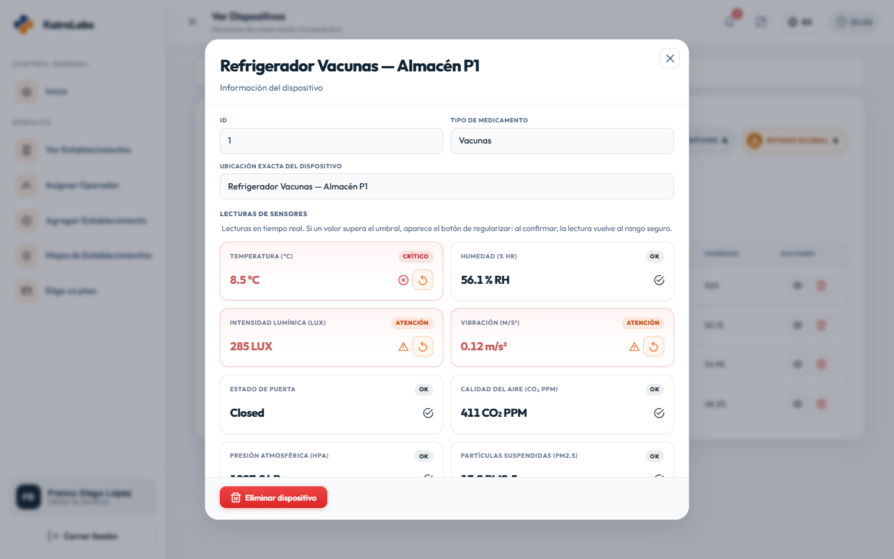
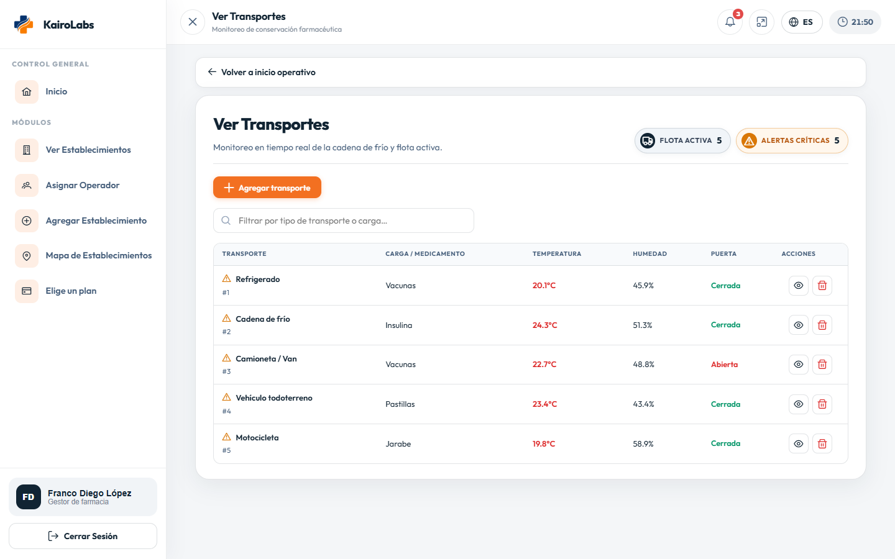
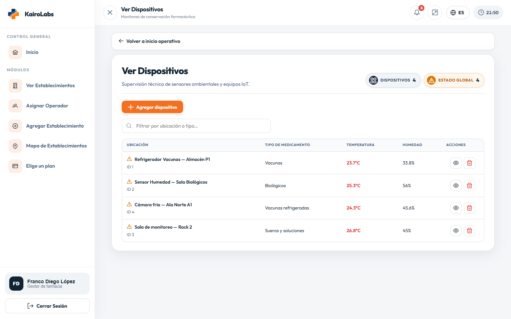
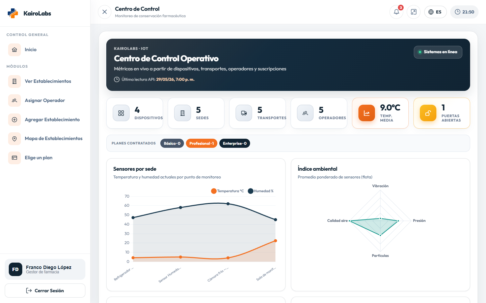
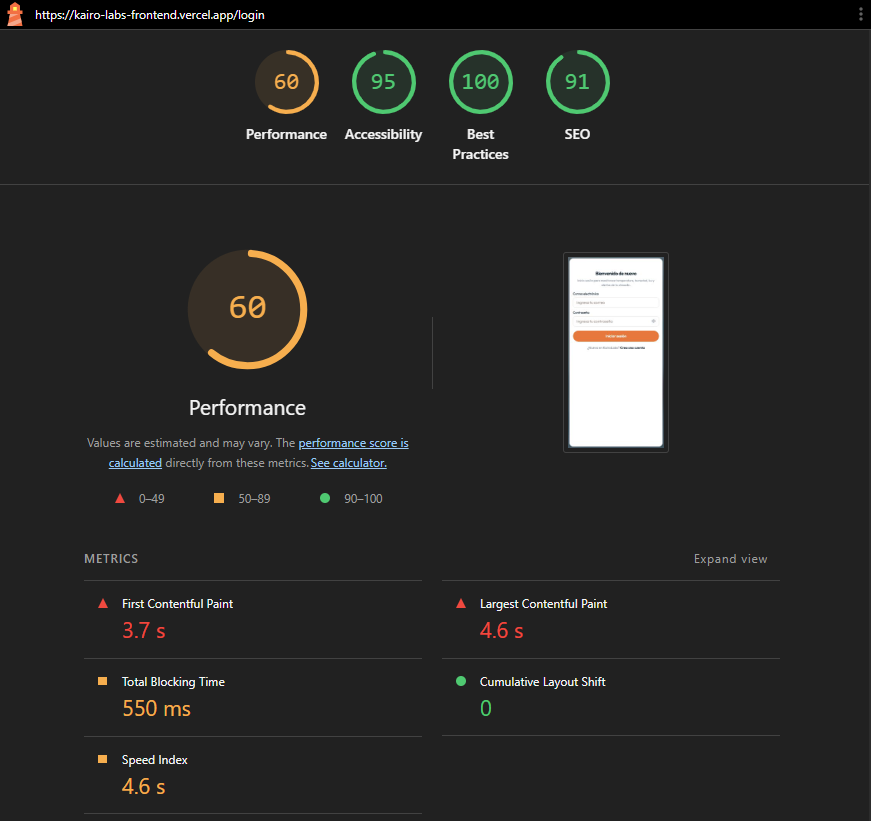
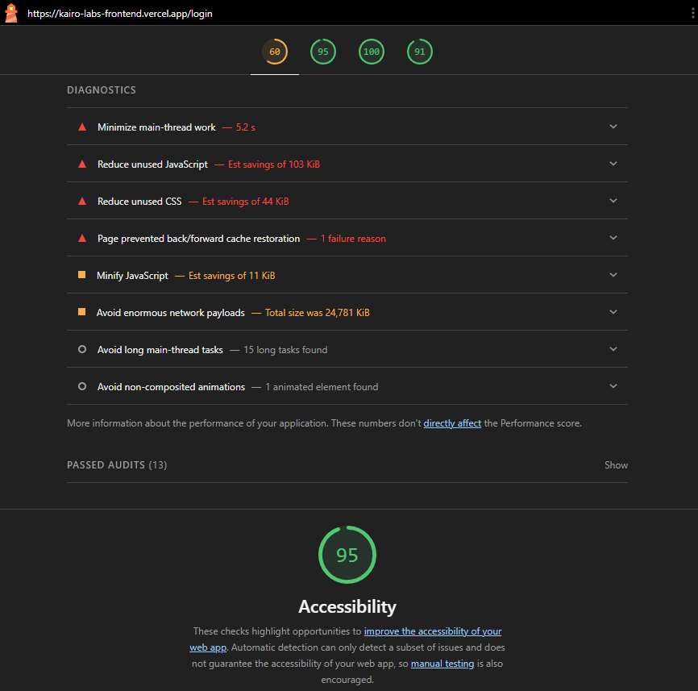
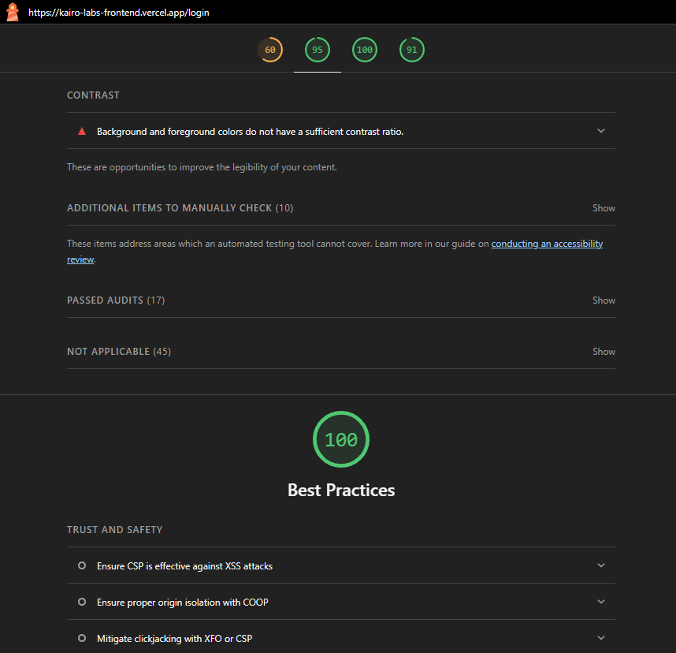
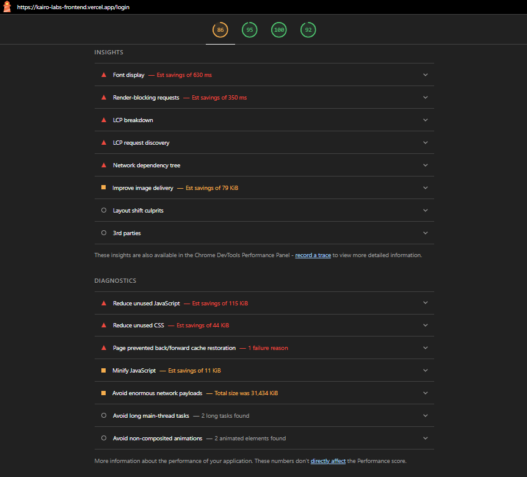

# Capítulo VIII: Experiment-Driven Development

> Plantilla de estructura para completar el capítulo VIII.

## 8.1. Experiment Planning

### 8.1.1. As-Is Summary

### 8.1.2. Raw Material: Assumptions, Knowledge Gaps, Ideas, Claims

### 8.1.3. Experiment-Ready Questions

### 8.1.4. Question Backlog

### 8.1.5. Experiment Cards

## 8.2. Experiment Design

Esta sección presenta el diseño experimental de KairoLabs para contrastar nuestras hipótesis con evidencia. Integra la formulación de hipótesis, las métricas de negocio y medidas, las condiciones y escala de las pruebas, la selección de métodos, los objetivos de analítica, los indicadores clave y el seguimiento web y móvil. El diseño considera las necesidades del personal operativo de almacenes farmacéuticos y de los gestores de salud, y permite relacionar los resultados observados con decisiones concretas sobre el producto.

### 8.2.1. Hypotheses

Formulamos cinco hipótesis comprobables a partir de las necesidades del personal operativo y de los gestores de salud, así como de las funciones de monitoreo, alertas, trazabilidad, sensores y supervisión multisede de KairoLabs. Cada hipótesis establece un resultado medible y su hipótesis nula define el umbral que consideramos insuficiente para respaldar nuestra creencia. Las comparaciones se realizan respecto de una línea base; para evaluar la precisión de las lecturas, se contrastan los datos del sensor con un instrumento de referencia y una tolerancia previamente establecida.

| Question (Pregunta) | Belief (Creencia) | Hypothesis (Hipótesis de trabajo, H1) | Null Hypothesis (Hipótesis nula operativa, H0) |
| :--- | :--- | :--- | :--- |
| ¿El monitoreo continuo ayuda a reducir los incidentes de deterioro de medicamentos? | Creemos que las rondas y los registros manuales pueden dejar pasar desviaciones entre revisiones. Consultar lecturas continuas permitiría reconocer antes una condición crítica. | En los primeros tres meses del piloto, la tasa de incidentes de deterioro asociados a condiciones de almacenamiento disminuirá al menos **30 %** frente a la línea base de los mismos establecimientos. | La tasa de incidentes no alcanzará la reducción mínima del **30 %** frente a la línea base. |
| ¿Las alertas automáticas ayudan al personal a responder más rápido ante una desviación? | Creemos que una alerta inmediata puede acortar el tiempo entre detectar una lectura fuera de rango y registrar una acción. En la validación, el personal operativo prefirió recibir avisos en el celular y pidió poder registrar cómo atendió la alerta. | Durante el piloto, el tiempo mediano entre una lectura fuera de rango y el registro de una respuesta disminuirá al menos **25 %** frente al proceso sin notificación automática. | La reducción del tiempo mediano de respuesta será menor al **25 %**. |
| ¿El historial digital facilita reunir evidencia para una auditoría sanitaria? | Creemos que los registros en papel pueden quedar incompletos y tomar tiempo para reunirlos. En la entrevista de validación, el gestor sugirió contar con un historial exportable para auditorías. | Durante los primeros tres meses, el tiempo promedio para reunir los registros solicitados disminuirá al menos **20 %** frente al proceso manual. | La reducción del tiempo para reunir evidencia será menor al **20 %**. |
| ¿El registro automático mediante sensores mejora la precisión de las lecturas? | Creemos que transcribir varias lecturas al día añade trabajo y oportunidades de error. La integración de sensores IoT permitirá automatizar el registro y comparar sus lecturas con un instrumento de referencia. | En un piloto de tres meses, la proporción de lecturas correctas aumentará al menos **25 %** frente al registro manual. Se contrastará cada lectura con un instrumento de referencia y una tolerancia definida antes de la prueba. | El aumento de lecturas correctas será menor al **25 %**. |
| ¿La gestión centralizada mejora la eficiencia de supervisión y reduce las pérdidas entre varias sedes? | Creemos que los gestores que supervisan más de un almacén necesitan consolidar registros. En la validación, el gestor consideró útil revisar sus sedes desde un solo lugar y pudo registrar un establecimiento y asignarle un operador sin ayuda. | Durante los primeros seis meses, el dashboard multisede reducirá al menos **30 %** el tiempo promedio para revisar el estado de todos los establecimientos y disminuirá al menos **20 %** las pérdidas económicas documentadas por incidentes de almacenamiento, frente a la línea base. | La hipótesis no se respaldará si la reducción queda por debajo de **30 %** en el tiempo de supervisión o de **20 %** en las pérdidas económicas. |

**Lectura de las hipótesis y criterios de decisión**

Las cinco hipótesis se derivan de necesidades del proyecto y vinculan cada problema con un resultado que podemos observar: detección de incidentes, respuesta a alertas, preparación de evidencia, precisión de lecturas y eficiencia multisede. En la última hipótesis, el tiempo de supervisión y las pérdidas económicas son dos resultados relacionados con la gestión centralizada.

Para interpretar los resultados:

- **H1** expresa el cambio que esperamos observar y el umbral que respaldaría nuestra creencia.
- **H0** establece que ese umbral no se alcanza; por tanto, el resultado no respalda la hipótesis de trabajo.
- Si los datos respaldan **H0**, revisaremos las condiciones y los resultados, ajustaremos el diseño o reconsideraremos el supuesto antes de decidir si continuamos con la funcionalidad.

### 8.2.2. Domain Business Metrics

Las métricas de dominio permiten determinar si KairoLabs aporta valor a la conservación de medicamentos, la respuesta ante desviaciones, la trazabilidad y la eficiencia de los almacenes. Cada experimento se evaluará con las métricas definidas en esta tabla y sus metas se compararán con una línea base del mismo contexto de uso. Las visitas, impresiones o clics podrán describir la interacción con la plataforma, pero no se considerarán por sí solos evidencia de impacto de negocio.

| ID / nombre de la métrica | Descripción y vínculo con el objetivo de negocio | Fórmula de cálculo | Técnica de recolección | Meta deseada |
| :--- | :--- | :--- | :--- | :--- |
| **MD-01. Tasa de incidentes de deterioro** | Mide la frecuencia de incidentes en los que un medicamento se deteriora por una desviación ambiental. Se vincula con la meta de proteger la conservación y reducir pérdidas de productos farmacéuticos. | `Tasa = (incidentes confirmados de deterioro / lotes monitoreados) × 100`. `Reducción = ((tasa base − tasa piloto) / tasa base) × 100`. | Consolidamos los incidentes con sede, fecha, condición ambiental, dispositivo y lote afectado; contrastamos cada caso con las lecturas y el registro de disposición del producto. | Reducir la tasa al menos **30 %** frente a la línea base durante los primeros tres meses. |
| **MD-02. Tiempo de respuesta a desviaciones** | Mide cuánto tarda el personal en registrar una acción desde la primera lectura fuera del rango de conservación. Refleja la capacidad de reaccionar oportunamente ante alertas. | `Mediana(hora de registro de la acción − hora de la primera lectura fuera de rango)`, en minutos. | Comparamos las marcas de tiempo de las lecturas con las del registro de atención de la alerta o incidente en la plataforma. | Reducir el tiempo de referencia de **15 a 10 minutos o menos** (mejora de **33,3 %**), superando el umbral experimental de 25 %. |
| **MD-03. Tiempo de preparación de evidencia para auditoría** | Mide el tiempo requerido para reunir el historial de conservación solicitado para revisar una sede, dispositivo o periodo. Se vincula con la trazabilidad y la eficiencia de las auditorías sanitarias. | `Tiempo promedio = suma de minutos de solicitudes completadas / número de solicitudes completadas`. `Reducción = ((promedio manual − promedio digital) / promedio manual) × 100`. | Registramos el inicio de cada solicitud de evidencia y el momento en que se entrega el conjunto de lecturas requerido; comparamos solicitudes equivalentes por búsqueda manual y consulta digital. | Reducir el tiempo promedio al menos **20 %** frente al proceso manual. |
| **MD-04. Precisión de lecturas ambientales** | Mide la concordancia de las lecturas almacenadas por KairoLabs con un instrumento de referencia. La precisión de los datos respalda decisiones confiables sobre la conservación. | `Precisión = (pares de lecturas dentro de tolerancia / pares válidos) × 100`. `Mejora relativa = ((precisión con sensores − precisión manual) / precisión manual) × 100`. | Registramos lecturas simultáneas del sensor y del instrumento de referencia en condiciones comparables; clasificamos cada par según la tolerancia establecida para la variable. | Aumentar la proporción de lecturas correctas al menos **25 %** en términos relativos frente al método manual. |
| **MD-05. Tiempo de supervisión multisede** | Mide el tiempo para revisar el estado de todos los establecimientos asignados a un gestor e identificar cuáles requieren atención. Se vincula con la eficiencia operativa y la supervisión centralizada. | `Tiempo promedio = suma del tiempo de revisión de establecimientos / número de revisiones completadas`. `Reducción = ((tiempo base − tiempo con dashboard) / tiempo base) × 100`. | Cronometramos tareas equivalentes: localizar todas las sedes, identificar su estado y reconocer los casos que requieren atención. Registramos inicio, finalización y tarea completada. | Reducir **20 %** los tiempos de gestión operativa de los almacenes y, específicamente, al menos **30 %** el tiempo de revisión multisede durante los primeros seis meses. |
| **MD-06. Tasa de pérdidas económicas por almacenamiento** | Cuantifica el valor de los medicamentos dañados o descartados por incidentes ambientales en relación con el valor del inventario monitoreado. Complementa la tasa de incidentes con su impacto económico. | `Tasa = (valor de productos dañados o descartados por incidentes / valor del inventario monitoreado) × 100`. `Reducción = ((tasa base − tasa piloto) / tasa base) × 100`. | Contrastamos los registros de incidentes con actas de baja, devolución o cuarentena y con el valor documentado de los productos afectados y del inventario monitoreado. | Reducir las pérdidas al menos **30 %** a nivel general y **20 %** en establecimientos con supervisión multisede, frente a sus respectivas líneas base. |
| **MD-07. Cobertura de establecimientos monitoreados** | Mide la proporción de establecimientos del alcance con dispositivos activos que reportan lecturas vigentes. Refleja la cobertura y continuidad del monitoreo multisede. | `Cobertura = (establecimientos con dispositivo activo y lectura vigente / establecimientos incluidos) × 100`. | Revisamos el inventario de establecimientos y dispositivos junto con la marca de tiempo de la última lectura recibida por cada dispositivo. | Mantener conectados y monitoreados en tiempo real al menos **80 %** de los establecimientos incluidos durante los primeros seis meses. |
| **MD-08. Controles de conservación conformes y trazables** | Mide la proporción de controles programados con evidencia completa y lecturas dentro del rango configurado. Cada registro identifica fecha y lugar, dispositivo, variable, valor y estado; así se puede revisar el cumplimiento documentado de las condiciones de almacenamiento. | `Controles conformes y trazables = (controles con lectura dentro del rango y registro completo / controles programados) × 100`. | Contrastamos el calendario de controles con el historial de lecturas y verificamos fecha, hora, establecimiento, dispositivo, variable, valor, rango aplicable y estado. | Alcanzar **100 %** de controles programados conformes y trazables durante los primeros seis meses de uso. |

Estas métricas conforman el marco común para evaluar los experimentos de KairoLabs: cada resultado se interpreta junto con su línea base, su periodo de observación y la meta correspondiente, evitando tomar actividad digital aislada como prueba de valor para el negocio.

### 8.2.3. Measures

Las medidas especifican qué evidencia recogeremos para responder las preguntas de los cinco experimentos. Seleccionamos como medidas principales los resultados de negocio definidos en **8.2.2**; las medidas secundarias aportan contexto para interpretar esos resultados y comprobar que las funciones de monitoreo, alertas, trazabilidad y supervisión multisede estuvieron disponibles durante la observación. Cada medida es representativa del cambio que plantea su hipótesis y se limita a los datos necesarios para evaluarlo.

| Hipótesis | Medida principal | Evidencia secundaria | Recolección y alcance |
| :--- | :--- | :--- | :--- |
| **H1. Monitoreo continuo y deterioro** | **MD-01. Tasa de incidentes de deterioro:** comparar la tasa del piloto con la línea base de los mismos establecimientos durante los primeros tres meses. | **MD-07. Cobertura de establecimientos monitoreados** y **MD-08. Controles de conservación conformes y trazables**. Permiten interpretar la tasa considerando qué proporción del entorno estuvo efectivamente monitoreada y documentada. | Consolidar incidentes confirmados, lotes monitoreados y registros de lectura con sede y fecha. Revisar únicamente establecimientos incluidos en el piloto y el periodo de comparación establecido. |
| **H2. Alertas y tiempo de respuesta** | **MD-02. Tiempo de respuesta a desviaciones:** medir la mediana entre la primera lectura fuera de rango y el registro de la acción, y compararla con el proceso sin notificación automática. | **MD-07. Cobertura de establecimientos monitoreados** y **MD-08. Controles de conservación conformes y trazables**, para identificar si la lectura y el registro de atención están disponibles para la comparación. | Usar las marcas de tiempo de lecturas y atenciones de alertas vinculadas al mismo incidente. Incluir solo desviaciones con hora de detección y respuesta registradas en el periodo del piloto. |
| **H3. Historial digital y evidencia de auditoría** | **MD-03. Tiempo de preparación de evidencia para auditoría:** comparar el tiempo promedio para completar solicitudes equivalentes mediante búsqueda manual y consulta del historial digital. | **MD-08. Controles de conservación conformes y trazables**, para confirmar que el conjunto solicitado contiene los datos necesarios para revisar el periodo, la sede y el dispositivo. | Registrar el inicio de cada solicitud y la entrega de los registros requeridos. Medir solicitudes comparables y limitar la revisión a los historiales y periodos incluidos en la prueba. |
| **H4. Sensores y precisión de lecturas** | **MD-04. Precisión de lecturas ambientales:** comparar la proporción de lecturas dentro de tolerancia con el instrumento de referencia frente a la proporción correcta del registro manual. | **MD-07. Cobertura de establecimientos monitoreados** y **MD-08. Controles de conservación conformes y trazables**, para contextualizar las lecturas recibidas y verificar su integridad. | Recoger pares de lecturas del sensor y del instrumento de referencia, junto con los registros manuales correspondientes, en condiciones y momentos comparables. Evaluar las variables y tolerancias definidas para la prueba; excluir pares incompletos o no comparables. |
| **H5. Supervisión multisede y pérdidas** | **MD-05. Tiempo de supervisión multisede:** comparar el tiempo promedio para revisar todas las sedes e identificar las que requieren atención. | **MD-06. Tasa de pérdidas económicas por almacenamiento**, como resultado de negocio complementario, y **MD-07. Cobertura de establecimientos monitoreados**, para interpretar el alcance de la supervisión. | Cronometrar revisiones equivalentes con la línea base y el dashboard. Para las pérdidas, contrastar incidentes con documentos de baja, devolución o cuarentena y el valor registrado de los productos afectados, durante el periodo de comparación. |

La recolección se restringe a lecturas ambientales, incidentes, acciones sobre alertas, solicitudes de evidencia, revisiones multisede y documentos que sustentan pérdidas. Conservamos las marcas de tiempo y los datos de sede, dispositivo y lote solo cuando son necesarios para relacionar una observación con su contexto. No usamos impresiones, clics ni actividad general como evidencia de éxito: las señales técnicas de registros y trazas sirven para explicar interrupciones o datos incompletos, mientras que la decisión sobre cada hipótesis se basa en las medidas de negocio anteriores.

### 8.2.4. Conditions

Las condiciones describen el escenario en que recogeremos cada medida y permiten distinguir el efecto de la propuesta de otros factores del entorno. Para cada hipótesis establecemos una condición experimental, que incorpora la función evaluada, y una condición de control, que conserva el proceso de referencia asociado a **H0**. En cada comparación mantenemos equivalentes, en lo posible, los establecimientos, periodos, tareas y criterios de registro, de modo que las diferencias observadas puedan relacionarse con el cambio evaluado.

**Hipótesis 1. Monitoreo continuo y deterioro**

| Elemento | Condición |
| :--- | :--- |
| **Question** | ¿El monitoreo continuo ayuda a reducir los incidentes de deterioro de medicamentos? |
| **Condición Experimental** | Los establecimientos utilizan las lecturas ambientales continuas de KairoLabs para observar las condiciones de conservación y reconocer desviaciones. |
| **Condición de Control** | El personal mantiene el proceso habitual de rondas y registros manuales, sin consultar el monitoreo continuo de KairoLabs para detectar desviaciones. |

La comparación considera los mismos establecimientos o establecimientos equivalentes, periodos de tres meses y criterios comunes para registrar lotes, desviaciones e incidentes confirmados.

**Hipótesis 2. Alertas automáticas y tiempo de respuesta**

| Elemento | Condición |
| :--- | :--- |
| **Question** | ¿Las alertas automáticas ayudan al personal a responder más rápido ante una desviación? |
| **Condición Experimental** | Ante una lectura fuera de rango, el personal recibe la notificación automática y registra en KairoLabs la acción tomada y su hora. |
| **Condición de Control** | El personal sigue el proceso habitual de revisión y atención, sin recibir la notificación automática de KairoLabs; registra la detección y la acción con el mismo criterio temporal. |

Se comparan desviaciones equivalentes por tipo y severidad, con los mismos rangos ambientales y criterios para registrar la detección y la respuesta.

**Hipótesis 3. Historial digital y evidencia de auditoría**

| Elemento | Condición |
| :--- | :--- |
| **Question** | ¿El historial digital facilita reunir evidencia para una auditoría sanitaria? |
| **Condición Experimental** | El responsable consulta el historial digital de KairoLabs para reunir las lecturas solicitadas de una sede, dispositivo y periodo. |
| **Condición de Control** | El responsable busca los mismos datos en los registros manuales disponibles, sin utilizar el historial digital de KairoLabs. |

Las solicitudes son equivalentes en contenido y alcance, y utilizan el mismo perfil de responsable, periodo de registros y criterio para determinar cuándo la búsqueda está completa.

**Hipótesis 4. Sensores y precisión de lecturas**

| Elemento | Condición |
| :--- | :--- |
| **Question** | ¿El registro automático mediante sensores mejora la precisión de las lecturas ambientales? |
| **Condición Experimental** | Las lecturas ambientales se capturan automáticamente con los sensores integrados en KairoLabs. |
| **Condición de Control** | Las lecturas se obtienen mediante el procedimiento manual utilizado como referencia, sin sustituirlo por la captura automática. |

Se registran las mismas variables y ubicaciones en momentos y condiciones ambientales comparables. Ambos registros se contrastan con el mismo instrumento de referencia y la tolerancia establecida para cada variable.

**Hipótesis 5. Supervisión multisede y pérdidas**

| Elemento | Condición |
| :--- | :--- |
| **Question** | ¿La gestión centralizada mejora la eficiencia de supervisión y reduce las pérdidas entre varias sedes? |
| **Condición Experimental** | El gestor consulta el dashboard de KairoLabs para revisar en una sola vista el estado de las sedes asignadas e identificar cuáles requieren atención. |
| **Condición de Control** | El gestor revisa la información de cada sede por separado mediante el proceso y los registros habituales, sin el dashboard multisede. |

Se mantienen equivalentes las sedes asignadas, el periodo de información, las tareas de revisión y los criterios para identificar una sede que requiere atención. Para comparar pérdidas, se consideran periodos y registros de incidentes equivalentes.

En todas las comparaciones, el personal mantiene las prácticas necesarias para conservar los medicamentos y atender desviaciones; la condición de control representa el proceso habitual y no implica omitir acciones de seguridad. La población de interés está formada por personal operativo que registra o atiende condiciones de almacenamiento y gestores responsables de uno o más almacenes farmacéuticos. Estas condiciones delimitan la interpretación de los resultados al contexto de uso de KairoLabs.

### 8.2.5. Scale Calculations and Decisions

La escala se define para cada experimento según su variable, unidad de análisis y periodo de observación. En las cinco comparaciones usamos **α = 5 %** como nivel de significancia y **80 %** como potencia estadística objetivo. El MDE corresponde al umbral cuantitativo de cada H1; el tamaño de muestra se calcula con la tasa base o la variabilidad observada en la condición de control, evitando asignar el mismo número de observaciones a resultados diferentes.

**Experimento 1 — Validación del monitoreo continuo**

| Parámetro | Valor | Justificación |
| :--- | :--- | :--- |
| Nivel de significancia (α) | **5 %** | Limita la probabilidad de concluir que el monitoreo reduce los incidentes cuando la diferencia observada se debe al azar. |
| Potencia estadística (1−β) | **80 %** | Proporciona una probabilidad objetivo de detectar la reducción planteada si el efecto existe. |
| MDE | **30 % de reducción** en la tasa de incidentes de deterioro. | Corresponde al umbral definido para respaldar H1. |
| Duración | **Tres meses** de piloto, comparados con una línea base de igual duración. | Permite contrastar periodos equivalentes en los mismos establecimientos o en establecimientos comparables. |
| Tamaño de muestra | Todos los lotes monitoreados y todos los incidentes confirmados en los establecimientos elegibles durante el periodo. El número de lotes requerido se calcula con la tasa basal, la razón objetivo **0,70**, α y potencia, con ajuste por establecimiento. | La unidad de exposición es el lote monitoreado; considerar el agrupamiento por establecimiento evita tratar observaciones correlacionadas como independientes. |

**Decisión:** respaldamos H1 si la reducción estimada alcanza el MDE y la comparación es compatible con el nivel de significancia establecido. Si la precisión del intervalo no permite distinguir el umbral, el resultado se interpreta como inconcluso.

**Experimento 2 — Validación de las alertas automáticas**

| Parámetro | Valor | Justificación |
| :--- | :--- | :--- |
| Nivel de significancia (α) | **5 %** | Limita los falsos positivos al atribuir a las alertas una reducción del tiempo de respuesta. |
| Potencia estadística (1−β) | **80 %** | Define la probabilidad objetivo de detectar el cambio esperado en los tiempos de respuesta. |
| MDE | **25 % de reducción** en el tiempo mediano de respuesta. | Coincide con el umbral de H1 para comparar la notificación automática con el proceso habitual. |
| Duración | **Tres meses** de observación del piloto. | Recoge desviaciones a lo largo de un periodo común con los experimentos de monitoreo y sensores. |
| Tamaño de muestra | Todas las desviaciones elegibles que tengan hora de detección y hora de respuesta registradas en ambas condiciones. El número requerido se estima mediante simulación o remuestreo de la distribución de tiempos, con α y potencia establecidos. | La medida es una mediana; la escala se basa en la distribución de tiempos y no en una suposición de normalidad de medias. |

**Decisión:** respaldamos H1 si el tiempo mediano disminuye al menos 25 % frente al proceso habitual. Desviaciones sin marcas de tiempo comparables no forman parte del análisis.

**Experimento 3 — Validación del historial digital**

| Parámetro | Valor | Justificación |
| :--- | :--- | :--- |
| Nivel de significancia (α) | **5 %** | Limita los falsos positivos en la comparación del tiempo de preparación de evidencia. |
| Potencia estadística (1−β) | **80 %** | Establece la probabilidad objetivo de detectar la reducción esperada. |
| MDE | **20 % de reducción** en el tiempo promedio para reunir evidencia. | Corresponde al umbral de H1 frente a la búsqueda manual. |
| Duración | **Tres meses** de observación. | Permite recoger solicitudes de evidencia en el mismo periodo de comparación del piloto. |
| Tamaño de muestra | Solicitudes equivalentes de registros, medidas tanto con búsqueda manual como con consulta digital. `n = ((Z₁₋α + Z₁₋β) × σd / Δ)²`, donde `σd` es la desviación estándar de las diferencias pareadas y `Δ` equivale al 20 % del tiempo medio de referencia. | La comparación de las mismas solicitudes controla diferencias en sede, dispositivo, periodo y contenido requerido. |

**Decisión:** respaldamos H1 si el tiempo promedio de consulta digital disminuye al menos 20 % frente a la búsqueda manual y la precisión de la estimación es suficiente para distinguir ese umbral.

**Experimento 4 — Validación de las lecturas de sensores**

| Parámetro | Valor | Justificación |
| :--- | :--- | :--- |
| Nivel de significancia (α) | **5 %** | Limita los falsos positivos al atribuir a los sensores una mejora de precisión. |
| Potencia estadística (1−β) | **80 %** | Define la probabilidad objetivo de detectar la mejora planteada. |
| MDE | **25 % de mejora relativa** en la proporción de lecturas correctas respecto del registro manual. | Mantiene el criterio cuantitativo de H1 y de MD-04. |
| Duración | **Tres meses** de lecturas emparejadas. | Abarca las variables y ubicaciones consideradas durante el piloto. |
| Tamaño de muestra | Todos los pares válidos de lecturas del sensor y del método manual, contrastados con el mismo instrumento de referencia. El número requerido se calcula para proporciones pareadas (prueba de McNemar), usando la proporción esperada de pares discordantes, α y potencia. | El emparejamiento y la tolerancia común permiten comparar la precisión de ambos métodos en condiciones equivalentes. |

**Decisión:** respaldamos H1 si la proporción de lecturas correctas con sensores mejora al menos 25 % en términos relativos. Los pares incompletos o tomados bajo condiciones no comparables se excluyen con el mismo criterio en ambas condiciones.

**Experimento 5 — Validación de la supervisión multisede**

| Parámetro | Valor | Justificación |
| :--- | :--- | :--- |
| Nivel de significancia (α) | **5 %** | Limita los falsos positivos para los resultados de tiempo y pérdidas económicas. |
| Potencia estadística (1−β) | **80 %** | Es la probabilidad objetivo de detectar cada cambio mínimo planteado. |
| MDE | **30 % de reducción** en tiempo de revisión y **20 % de reducción** en la tasa de pérdidas económicas. | Son los dos umbrales de H1 y corresponden a MD-05 y MD-06. |
| Duración | **Seis meses** de observación multisede. | Corresponde al periodo establecido para evaluar supervisión y pérdidas económicas. |
| Tamaño de muestra | Todas las revisiones multisede comparables y todos los incidentes con pérdidas documentadas en los establecimientos incluidos. Se calcula por separado el número requerido para el tiempo de revisión y para la tasa de pérdidas, usando la variabilidad o tasa basal correspondiente. | Los dos resultados tienen unidades distintas; cada uno debe alcanzar su propia escala objetivo para evaluar H1. |

**Decisión:** respaldamos H1 solo si ambos resultados alcanzan sus MDE respectivos. Si uno no alcanza su umbral o no tiene precisión suficiente, se informa por separado y la hipótesis conjunta no se considera respaldada.

En todos los experimentos, los establecimientos, responsables, tareas y criterios de inclusión se mantienen representativos del uso de KairoLabs en almacenes farmacéuticos. Se informan el número de observaciones válidas, el efecto estimado y su intervalo de confianza. La cantidad de registros por sí sola no confirma una hipótesis: la decisión depende de la calidad de la comparación, la precisión alcanzada y el MDE definido.

### 8.2.6. Methods Selection

Para recoger las medidas definidas en **8.2.3** y evaluarlas con la escala de **8.2.5**, distinguimos la pregunta que investigamos del método que usamos para responderla. Seleccionamos técnicas de campo, tareas comparativas y lecturas emparejadas, procurando usar la cosa más simple y útil (*Simplest Useful Thing*) para obtener evidencia pertinente en el contexto de almacenes farmacéuticos.

**Hipótesis 1: Impacto del monitoreo continuo**

**Método: Piloto de campo con comparación antes-después (*Field Trial*)**

- **Propósito:** evaluar si el monitoreo continuo se relaciona con una reducción de al menos **30 %** en la tasa de incidentes de deterioro.
- **Ejecución:** se comparan, por establecimiento, los lotes monitoreados y los incidentes confirmados durante una línea base de tres meses y tres meses de uso del monitoreo KairoLabs. La tasa se ajusta por el volumen de lotes.
- **Herramientas:** [aplicación web KairoLabs](https://kairo-labs-frontend.vercel.app), [API de sensores en Swagger](https://medi-track-sensor-platform.onrender.com/swagger/index.html), inventario y registro de incidentes del establecimiento.

*Figura 8.2.6-1. Referencia de la interfaz utilizada para observar lecturas ambientales y sus estados.*

**Hipótesis 2: Eficacia de las alertas automáticas**

**Método: Piloto de campo con comparación de periodos**

- **Propósito:** determinar si las alertas automáticas reducen al menos **25 %** el tiempo mediano entre una desviación y la respuesta registrada.
- **Ejecución:** se contrastan las marcas de tiempo del proceso habitual con las de desviaciones atendidas mediante notificaciones automáticas. Los casos se comparan por tipo y severidad; se estima la diferencia de medianas y su intervalo de confianza mediante remuestreo.
- **Herramientas:** [aplicación web KairoLabs](https://kairo-labs-frontend.vercel.app), [API de sensores en Swagger](https://medi-track-sensor-platform.onrender.com/swagger/index.html) y registro de detección y atención de alertas.

*Figura 8.2.6-2. Interfaz de transportes con indicadores de alertas críticas de cadena de frío.*

**Hipótesis 3: Eficacia del historial digital para auditorías**

**Método: Prueba comparativa de tareas con solicitudes equivalentes**

- **Propósito:** medir si el historial digital reduce al menos **20 %** el tiempo promedio para reunir evidencia de auditoría.
- **Ejecución:** el personal responsable completa solicitudes equivalentes de lecturas para una sede, dispositivo y periodo mediante búsqueda manual y consulta digital. Se registra el tiempo hasta entregar el conjunto solicitado y se comprueba que ambas búsquedas cubran los mismos datos.
- **Herramientas:** [aplicación web KairoLabs](https://kairo-labs-frontend.vercel.app), [documentación de la API](https://medi-track-sensor-platform.onrender.com/swagger/index.html) y planilla de registro de solicitudes y tiempos.

*Figura 8.2.6-3. Listado de dispositivos que sirve de referencia para localizar una sede y delimitar una solicitud de registros.*

**Hipótesis 4: Precisión del registro mediante sensores**

**Método: Validación de campo con lecturas pareadas**

- **Propósito:** determinar si el registro mediante sensores mejora al menos **25 %** la proporción de lecturas correctas respecto del método manual.
- **Ejecución:** en las mismas ubicaciones y momentos se registran la lectura del sensor, la lectura manual y la de un instrumento de referencia. Cada par se clasifica según la tolerancia definida para su variable; el análisis compara las proporciones pareadas y considera el establecimiento y dispositivo de origen.
- **Herramientas:** dispositivos y sensores de KairoLabs, instrumento de referencia calibrado, [API de sensores en Swagger](https://medi-track-sensor-platform.onrender.com/swagger/index.html) y planilla de lecturas pareadas.

*Figura 8.2.6-4. Evidencia de consulta de lecturas ambientales mediante el endpoint de dispositivos.*

**Hipótesis 5: Eficiencia de la supervisión multisede**

**Método: Prueba comparativa de tareas y análisis de registros de campo**

- **Propósito:** evaluar la reducción de al menos **30 %** en el tiempo de revisión multisede y, como resultado de negocio complementario, de **20 %** en las pérdidas económicas documentadas.
- **Ejecución:** los gestores completan tareas equivalentes de revisión con el proceso habitual y con el dashboard. Por separado, se comparan durante seis meses las tasas de pérdidas documentadas y su exposición por establecimiento; los resultados de tiempo y pérdidas se interpretan con sus MDE respectivos.
- **Herramientas:** [dashboard de KairoLabs](https://kairo-labs-frontend.vercel.app), [API de establecimientos y dispositivos](https://medi-track-sensor-platform.onrender.com/swagger/index.html), registros de incidentes y documentos de baja, devolución o cuarentena.

*Figura 8.2.6-5. Centro de Control con indicadores y sensores organizados por sede.*

**Resumen de métodos seleccionados**

| Método | Hipótesis que valida | Tipo de evidencia | Herramientas principales |
| :--- | :---: | :--- | :--- |
| Piloto de campo con comparación antes-después | H1 | Cuantitativa, tasas de incidentes y exposición por lote | Aplicación web, API de sensores, inventario e incidentes |
| Piloto de campo con comparación de periodos | H2 | Cuantitativa, tiempos medianos de respuesta | Aplicación web, API y registro de alertas |
| Prueba comparativa de tareas con solicitudes equivalentes | H3 | Cuantitativa, tiempos de búsqueda y completitud del conjunto | Aplicación web, Swagger y planilla de registro |
| Validación de campo con lecturas pareadas | H4 | Cuantitativa, proporciones dentro de tolerancia | Sensores, instrumento de referencia, API y planilla |
| Prueba comparativa de tareas y análisis de registros de campo | H5 | Cuantitativa, tiempos de revisión y pérdidas documentadas | Dashboard, API, registros de incidentes y documentos de inventario |

**Herramientas y fuentes de evidencia**

| Herramienta o fuente | Uso en los métodos | Referencia |
| :--- | :--- | :--- |
| Aplicación web KairoLabs | Ejecutar las tareas de monitoreo, consulta de dispositivos y supervisión multisede. | [Abrir aplicación web](https://kairo-labs-frontend.vercel.app) · [Repositorio del frontend](https://github.com/1ASI0732-2620-9082-Aether-System/KairoLabs-Frontend) |
| API MediTrack Sensor | Consultar establecimientos, dispositivos y lecturas disponibles para las medidas de campo. | [Abrir Swagger UI](https://medi-track-sensor-platform.onrender.com/swagger/index.html) · [Repositorio de la API](https://github.com/1ASI0732-2620-9082-Aether-System/KairoLabs-Platform) |
| Planilla de registro | Anotar horas de solicitud, detección y respuesta, lecturas manuales y de referencia, y evidencia documental asociada. | Plantilla de captura del experimento, con los campos de MD-01 a MD-08. |
| Instrumento ambiental de referencia | Contrastar las lecturas de sensores y registros manuales bajo la tolerancia de cada variable. | Instrumento calibrado del establecimiento. |

Se priorizan las funciones y fuentes existentes de KairoLabs y registros operativos pertinentes; la planilla y el instrumento se limitan a las variables necesarias para cada comparación. Las capturas de esta sección documentan las interfaces y fuentes usadas para preparar los métodos; no representan resultados de los experimentos.

**Control de interferencias y ética**

Los experimentos se ejecutan de forma secuencial por tema y módulo. Un mismo participante no realiza al mismo tiempo tareas de dos experimentos que puedan alterar su comportamiento o contaminar las observaciones; si participa en más de uno, las sesiones se programan por separado y se registran por experimento.

El personal conserva los procedimientos habituales para proteger los medicamentos y atender desviaciones. No se retiran controles ni alertas preventivas para formar un grupo de control, no se provocan condiciones ambientales fuera de rango y no se manipulan inventarios reales para generar pérdidas. Las pruebas de consulta y supervisión usan registros autorizados; las tareas pueden emplear escenarios y datos de prueba. Los resultados se presentan de forma agregada y el acceso a los registros se limita a lo necesario para el análisis.

### 8.2.7. Data Analytics: Goals, KPIs and Metrics Selection

En esta sección definimos qué conocimiento esperamos obtener de los experimentos y qué datos usaremos para obtenerlo. La analítica de KairoLabs se enfoca en resultados de conservación farmacéutica y operación: detectar incidentes, responder a desviaciones, preparar evidencia, confiar en las lecturas y supervisar varias sedes. Seleccionamos indicadores que ya tienen fórmula, fuente y meta en **8.2.2**; la actividad digital general no se interpreta como valor de negocio por sí sola.

**1. Metas de análisis (Goals)**

La analítica permitirá al equipo:

- Evaluar si el monitoreo y las alertas se asocian con menos incidentes y respuestas más oportunas (**H1–H2**).
- Medir si el historial digital facilita reunir evidencia de conservación para auditoría (**H3**).
- Comprobar la precisión de las lecturas automáticas frente a un instrumento de referencia y al registro manual (**H4**).
- Estimar la eficiencia de la supervisión multisede y contextualizarla con la cobertura y las pérdidas documentadas (**H5**).
- Distinguir resultados de negocio de señales técnicas que permiten identificar interrupciones, errores o datos incompletos durante la observación.

**2. Selección de KPIs y métricas**

| Nivel | KPI / indicador | Métrica atómica (dato registrado) | Fuente | Justificación de selección y economía de rastreo |
| :--- | :--- | :--- | :--- | :--- |
| Negocio — conservación | **MD-01. Tasa de incidentes de deterioro** | Incidentes confirmados y lotes monitoreados, vinculados por sede, fecha y lote. | Registro de incidentes, inventario e historial de lecturas. | Responde directamente a H1; solo se registran incidentes confirmados y la exposición necesaria para calcular la tasa. |
| Negocio — pérdidas | **MD-06. Tasa de pérdidas económicas por almacenamiento** | Valor de productos dañados o descartados y valor del inventario monitoreado. | Incidentes y documentos de baja, devolución o cuarentena. | Cuantifica el impacto económico asociado a H5 sin registrar actividad ajena al deterioro ambiental. |
| Operación — respuesta | **MD-02. Tiempo de respuesta a desviaciones** | Hora de la primera lectura fuera de rango y hora de la acción registrada. | Lecturas y registro de atención de alertas. | Mide el intervalo necesario para H2; se conservan solo marcas de tiempo asociadas con una desviación. |
| Operación — trazabilidad | **MD-03. Tiempo de preparación de evidencia** | Inicio de la solicitud y entrega del conjunto de registros requerido. | Planilla de tareas y consulta del historial. | Mide H3 con solicitudes equivalentes; no requiere rastrear navegación general del usuario. |
| Producto — precisión de datos | **MD-04. Precisión de lecturas ambientales** | Lectura del sensor, lectura manual y lectura de referencia, junto con variable, ubicación, momento y tolerancia. | Sensores, instrumento de referencia y registros manuales. | Evalúa H4 directamente; se recogen pares comparables, no telemetría adicional sin relación con la lectura. |
| Operación — gestión multisede | **MD-05. Tiempo de supervisión multisede** | Inicio y fin de la tarea de revisión, sedes incluidas y tarea completada. | Planilla de tareas y dashboard de KairoLabs. | Responde al componente de eficiencia de H5 mediante tareas equivalentes y delimitadas. |
| Cobertura — disponibilidad de datos | **MD-07. Cobertura de establecimientos monitoreados** | Establecimientos incluidos, dispositivo activo y marca de tiempo de la última lectura. | Inventario de sedes y lecturas de la API. | Permite interpretar los resultados según la proporción realmente cubierta, sin contar visitas o impresiones. |
| Calidad — integridad del registro | **MD-08. Controles de conservación conformes y trazables** | Controles programados y registros completos con lectura, rango, sede, dispositivo, fecha y hora. | Calendario de controles e historial de lecturas. | Verifica que la evidencia usada para los experimentos sea interpretable y trazable. |

**3. Fuentes de analítica y observabilidad**

| Fuente / herramienta | Datos que aporta | Uso en el análisis |
| :--- | :--- | :--- |
| [Aplicación web KairoLabs](https://kairo-labs-frontend.vercel.app) y [API MediTrack Sensor](https://medi-track-sensor-platform.onrender.com/swagger/index.html) | Estado de sedes y dispositivos, lecturas ambientales y registros relacionados con alertas. | Fuente operativa para MD-01, MD-02, MD-04, MD-07 y MD-08. |
| **UptimeRobot** | Disponibilidad, tiempo de conexión/TTFB y códigos HTTP mediante sondeos sintéticos. | Identifica periodos de indisponibilidad que podrían explicar lecturas ausentes o interrumpidas. |
| **Vercel Analytics & Logs** | Indicadores técnicos web —Core Web Vitals—, solicitudes y errores registrados en la infraestructura. | Ayuda a contextualizar fallos de carga o degradaciones durante las sesiones de prueba. |
| **Axios Runtime Interceptors** | Errores del cliente, interrupciones de red y fallos de autenticación en la aplicación web. | Ayuda a diagnosticar registros incompletos o tareas que no se pudieron terminar por un error técnico. |
| **Planilla de tareas y documentos operativos** | Tiempos de búsqueda y revisión, acciones registradas e importes sustentados de pérdidas. | Complementa los datos de plataforma para MD-02, MD-03, MD-05 y MD-06. |

Las señales técnicas de UptimeRobot, Vercel y Axios son **indicadores de contexto y calidad de datos**, no sustituyen los KPIs de negocio ni se usan para declarar una hipótesis validada. El capítulo VII describe el pipeline de monitoreo y la telemetría de la plataforma; aquí se emplean esas fuentes para reconocer interrupciones y poner en contexto las observaciones experimentales.

**4. Auditoría técnica de la aplicación con Lighthouse**

Se ejecutó Lighthouse sobre la ruta de inicio de sesión del [frontend de KairoLabs](https://kairo-labs-frontend.vercel.app/login), en perfiles **Mobile** y **Desktop**. Los puntajes son una medición técnica de esa ruta bajo las condiciones de cada perfil; no se interpretan como resultados de las hipótesis de negocio ni representan una auditoría de la Landing Page o del Centro de Control.

| Indicador técnico de Lighthouse | Mobile | Desktop |
| :--- | :---: | :---: |
| Performance | **60/100** | **86/100** |
| Accessibility | **95/100** | **95/100** |
| Best Practices | **100/100** | **100/100** |
| SEO | **91/100** | **92/100** |
| First Contentful Paint (FCP) | **3,7 s** | **1,1 s** |
| Largest Contentful Paint (LCP) | **4,6 s** | **1,1 s** |
| Speed Index | **4,6 s** | **7,0 s** |
| Total Blocking Time (TBT) | **550 ms** | **30 ms** |
| Cumulative Layout Shift (CLS) | **0** | **0** |

El perfil Desktop presenta mejores puntajes de Performance y valores menores de FCP, LCP y TBT; el Speed Index reportado es **7,0 s**, por lo que lo conservamos como indicador independiente. En ambos perfiles Lighthouse señala una oportunidad de mejora en el contraste. En Mobile también reporta trabajo prolongado en el hilo principal y recursos JavaScript/CSS no utilizados; en Desktop identifica solicitudes que bloquean el renderizado, demora de fuentes y un payload total de **31 434 KB**. El SEO reporta `robots.txt` inválido (40 errores) en ambas capturas; al tratarse de `/login`, este indicador se interpreta como diagnóstico técnico, no como KPI de negocio.

Estos hallazgos orientan la revisión técnica; no se mezclan con MD-01 a MD-08 ni se usan como evidencia de impacto sobre conservación, alertas o pérdidas.

**Evidencia Lighthouse Mobile**

*Figura 8.2.7-1. Resumen Lighthouse Mobile de `/login`: Performance 60, Accessibility 95, Best Practices 100 y SEO 91.*

*Figura 8.2.7-2. Diagnósticos de carga: solicitudes que bloquean el renderizado, fuentes y descubrimiento del contenido principal.*

*Figura 8.2.7-3. Trabajo del hilo principal, JavaScript y CSS no utilizados y tamaño de recursos identificados en la auditoría.*

*Figura 8.2.7-4. Auditoría de accesibilidad: oportunidad de mejora en contraste de colores.*

*Figura 8.2.7-5. Detalle de Best Practices y SEO para la ruta auditada; Lighthouse señala observaciones de `robots.txt`.*

**Evidencia Lighthouse Desktop**

*Figura 8.2.7-6. Resumen Lighthouse Desktop de `/login`: Performance 86, Accessibility 95, Best Practices 100 y SEO 92.*

*Figura 8.2.7-7. Diagnósticos Desktop de fuentes, solicitudes que bloquean el renderizado, recursos no utilizados y tamaño de la página.*

*Figura 8.2.7-8. Auditoría Desktop de accesibilidad: observaciones de contraste y subtítulos del elemento de video.*

*Figura 8.2.7-9. Auditoría Desktop de buenas prácticas y observación sobre source maps.*

*Figura 8.2.7-10. Auditoría SEO Desktop: `robots.txt` inválido y 40 errores reportados.*

**5. Economía del rastreo**

La recolección se activa para los establecimientos, participantes, variables y periodos que corresponden a cada experimento. Registramos identificadores de sede y dispositivo, marcas de tiempo y datos de resultado solo cuando hacen falta para calcular las métricas MD-01 a MD-08; excluimos clics generales, impresiones y datos personales que no aporten a esas mediciones. El equipo revisa los datos por experimento y conserva el acceso restringido a los registros operativos, presentando los resultados de forma agregada.

### 8.2.8. Web and Mobile Tracking Plan

## 8.3. Experimentation

### 8.3.1. To-Be User Stories

### 8.3.2. To-Be Product Backlog

### 8.3.3. Pipeline-supported, Experiment-Driven To-Be Software Platform Lifecycle

#### 8.3.3.1. To-Be Sprint Backlogs

#### 8.3.3.2. Implemented To-Be Landing Page Evidence

#### 8.3.3.3. Implemented To-Be Frontend-Web Application Evidence

#### 8.3.3.4. Implemented To-Be Native-Mobile Application Evidence

#### 8.3.3.5. Implemented To-Be RESTful API and/or Serverless Backend Evidence

#### 8.3.3.6. Team Collaboration Insights

### 8.3.4. To-Be Validation Interviews

#### 8.3.4.1. Diseño de Entrevistas

#### 8.3.4.2. Registro de Entrevistas

## 8.4. Experiment Aftermath & Analysis

### 8.4.1. Analysis and Interpretation of Results

### 8.4.2. Re-scored and Re-prioritized Question Backlog

## 8.5. Continuous Learning

### 8.5.1. Shareback Session Artifacts: Learning Workflow

## 8.6. To-Be Software Platform Pre-launch

### 8.6.1. About-the-Product Intro Video

### 8.6.2. Resumen usando Gees Framework
